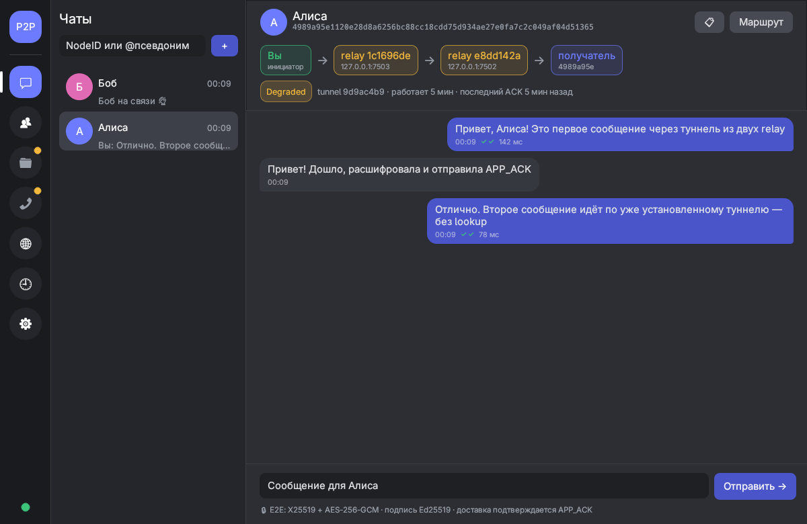

# Secure P2P Overlay — курсовая работа

Узел защищённой оверлейной P2P-сети: **Kademlia DHT** + **TLS 1.3 (mutual, Ed25519)** + **туннели через relay** + **сквозное шифрование сообщений**.

**Язык:** Rust 2021 · **Транспорт:** TCP + TLS 1.3 или собственное рукопожатие · **DHT:** Kademlia · **Уровень:** упрощённый (k=3, 2 relay, N=15) и продвинутый (k=4, 3 relay, пул 3, N=21)

> 📄 [Пояснительная записка](docs/defense/Zapiska.md) · 🎞️ [Презентация](docs/defense/Presentation.pdf) · 📊 [Эксперимент](docs/defense/Report_Experiment.md)
>
> 📚 [Документация](docs/README.md) · 📖 [USERGUIDE](USERGUIDE.md) · 🛡️ [Модель угроз](docs/THREAT_MODEL.md) · 🧭 [Архитектурные решения](docs/dev/ARCHITECTURE_DECISIONS.md) · 📝 [CHANGELOG](CHANGELOG.md)

---

## Одна команда: сеть → приёмка → результаты

```bash
bash scripts/run_acceptance.sh 13 30     # N=13 узлов, 30 контрольных lookup
```

Скрипт собирает проект, поднимает N узлов (первый — seed, остальные знают только его адрес), ждёт сходимости, выгружает таблицы маршрутизации, делает контрольные lookup, **останавливает bootstrap-узел и повторяет lookup**, затем строит графики.

| Что | Где |
|---|---|
| Сводка и критерии ✅/❌ | `experiments/results/accept_*/summary.md` |
| Сырые данные lookup | `lookups_before.csv/json`, `lookups_after_bootstrap_loss.csv/json` |
| Таблицы маршрутизации | `routing_tables/`, `routing_summary.csv` |
| Статистика и графики | `stats.md`, `plots/*.svg` (`./target/debug/p2p-orchestrator plot [каталог]`) |
| Логи узлов (**не в git**) | `logs/accept_*/` |

Все числа — реальные измерения прогона; в `summary.md` записаны коммит и параметры. Отчёт: [docs/defense/Report_Etapy_1-2.md](docs/defense/Report_Etapy_1-2.md).

Сценарии эксперимента 01–09 (ТЗ §15.1) и проверка отсутствия открытого текста в трафике:

```bash
bash experiments/run_all.sh          # N=15 → experiments/results/<сценарий>/<время>/{results.csv,summary.md,meta.json,plots/}
                                     # в конце — pcap: dumpcap на lo + положительный контроль
```

## Быстрый старт

```bash
cargo build --bins                 # требуется Rust 1.75+, Linux/macOS
cargo test                         # 138 тестов, включая негативные (TLS, AKE, E2E, записи DHT, петли, туннели, файлы)

# один узел с веб-панелью
cargo run --bin p2p-node -- --port 7001 --gui-port 8001      # http://127.0.0.1:8001/

# второй узел, bootstrap к первому
cargo run --bin p2p-node -- --port 7002 -b 127.0.0.1:7001 --gui-port 8002 \
    --state-dir state/n2 --metrics-dir metrics/n2

# кластер с веб-интерфейсом оркестратора
cargo run --bin p2p-orchestrator -- --gui-port 8080          # http://127.0.0.1:8080/

# настольное приложение (чаты, контакты, @псевдонимы, сеть, журнал) — само запускает свой узел
cargo run -p p2p-desktop
```



Подробно — в [USERGUIDE.md](USERGUIDE.md).

## Что реализовано

| Область | Реализация |
|---|---|
| Кадры и протокол | заголовок 24 Б, MessagePack, лимит payload 64 КиБ, проверка версии → [PROTOCOL](docs/implementation/PROTOCOL.md) |
| Идентичность | Ed25519; `NodeID = SHA-256(0x01‖pubkey)`, пара NodeID/pubkey проверяется везде |
| DHT | k-buckets, итеративный lookup (α=3), bootstrap, refresh; STORE/FIND_VALUE с R=3 и кворумом ≥2; TTL-очистка и republish |
| Записи | подпись публикатора, `sequence` (откат отвергается), `NodeRecord` (issued_at/expires_at) |
| Канал | **TLS 1.3** (mutual auth, NodeID из SPKI, без 0-RTT и TLS 1.2) или **собственное рукопожатие** (§11.3: подписанный транскрипт, X25519, HKDF, AES-GCM, счётчики записей) — `--channel tls\|ake`; ожидаемый NodeID сверяется в каждом исходящем соединении |
| Туннели | ≥2 relay (продвинутый — 3), `max_hops`, `hops_left`, уникальный `tunnel_id`; контроль доступности по сквозному TUNNEL_ACK; **пул туннелей** с переключением на резервный; **профили ретрансляторов** и стратегии выбора `closest / random / rating` |
| Сообщения | **E2E** (X25519 + HKDF + AES-256-GCM), подпись Ed25519, анти-replay (окно 10 мин, переживает перезапуск), **APP_ACK**, диагностика маршрута, история, **подписанные псевдонимы** `@имя`, **передача файлов** (блоки 40 КиБ, окно подтверждений, SHA-256) |
| Метрики | CSV/JSON по lookup, туннелям; сценарии 01–10 и продвинутые (`failover`, `strategy`, `files`, `channel`, `underlay`) с `meta.json` и графиками SVG |
| GUI | локальная веб-панель узла и оркестратор (только `127.0.0.1`); **настольное приложение** `p2p-desktop` (egui) |

Что **не** реализовано или с ограничениями — см. [модель угроз](docs/THREAT_MODEL.md#остаточные-риски) и [COMPLIANCE](docs/requirements/COMPLIANCE_2026-10-26.md).

## Структура проекта

```
src/
  config.rs, types.rs      — конфигурация (YAML), NodeId, Contact
  protocol/, transport/    — payload-структуры (MessagePack), кадрирование, FramedStream
  identity/                — Ed25519, NodeID, NodeRecord
  security/                — tls.rs (TLS 1.3), e2e.rs (сквозное шифрование)
  dht/                     — routing table, lookup, DhtNode, хранилище записей
  rpc/                     — PING/FIND_NODE/STORE/FIND_VALUE, TUNNEL_*, dial()
  tunnel/                  — builder, session, forwarder, routes, manager
  app/                     — Messenger (E2E-сообщения, APP_ACK), история
  node/, gui/, metrics/    — сервер узла, веб-панель, сбор метрик
  acceptance.rs, orchestrator.rs — приёмочный прогон и оркестратор кластера
desktop/                   — настольное приложение p2p-desktop (egui), только через HTTP API узла
tests/                     — unit/интеграционные и негативные тесты
config/                    — node_config.yaml и примеры
scripts/                   — run_acceptance.sh, run_star.sh, run_ring.sh, run_tests.sh; python/ — запасные версии драйвера и графиков
experiments/               — сценарии 01–09 и результаты (приёмка, сценарии, pcap)
docs/                      — ТЗ, архитектура, протокол, защита, dev-заметки
```

## Безопасность в двух словах

- Весь трафик между узлами — TLS 1.3 с взаимной аутентификацией; ключ в сертификате = identity-ключ узла.
- Relay видят только зашифрованный контейнер; получатель проверяет подпись отправителя.
- Приватные ключи лежат в `state/` — каталог в `.gitignore`, в репозиторий не попадает.
- Логи узлов — в `logs/` (тоже вне git).

Подробно и честно про пробелы: [docs/THREAT_MODEL.md](docs/THREAT_MODEL.md).
