# Руководство пользователя

Все команды — из корня репозитория. Нужны: Rust 1.75+ (Linux/macOS), для настольного приложения — графический
сеанс (X11 или Wayland). Для сценариев экспериментов — Python 3, для графиков — matplotlib, для проверки pcap —
`dumpcap` (пакет wireshark-cli) с правом захвата на `lo`.

Содержание: [1. Сборка](#1-сборка-и-проверка) · [2. Быстрый старт](#2-быстрый-старт-переписка-за-пару-минут) ·
[3. Настольное приложение](#3-настольное-приложение-p2p-desktop) · [4. Android](#4-android-приложение) · [5. Узел из терминала](#5-узел-из-терминала) ·
[6. Веб-панель и HTTP API](#6-веб-панель-и-http-api) · [7. Оркестратор](#7-оркестратор-кластер-из-браузера) ·
[8. Эксперименты](#8-эксперименты) · [9. Конфигурация](#9-конфигурация) · [10. Данные и ключи](#10-данные-ключи-логи) ·
[11. Частые проблемы](#11-частые-проблемы)

## 1. Сборка и проверка

```bash
cargo build --bins             # узел p2p-node и оркестратор p2p-orchestrator
cargo build -p p2p-desktop     # настольное приложение (отдельно: тянет egui)
cargo test                     # все тесты узла (157)
bash scripts/run_tests.sh      # то же, с записью в logs/tests/
```

## 2. Быстрый старт: переписка за пару минут

Сообщение идёт через туннель минимум из **двух ретрансляторов**, поэтому в сети должно быть не меньше четырёх узлов:
отправитель, 2 relay, получатель.

```bash
cargo build --bins && cargo build -p p2p-desktop
bash scripts/run_star.sh 5 &                         # 5 узлов на 127.0.0.1:7001…7005 (seed — 7001)
./target/debug/p2p-desktop --profile alice &         # окно «P2P Overlay — alice»
./target/debug/p2p-desktop --profile bob &           # окно «P2P Overlay — bob»
```

В каждом окне — вкладка **⚙ Подключение**:

| Поле | alice | bob |
|---|---|---|
| Режим | Запустить свой узел | Запустить свой узел |
| Порт узла / порт API | 7600 / 7690 | 7601 / 7691 |
| Bootstrap-пиры | `127.0.0.1:7001` | `127.0.0.1:7001` |

Нажмите **▶ Запустить узел** (индикатор внизу слева станет зелёным). Затем на вкладке **👥 Контакты и профиль** опубликуйте
псевдоним (`alice`, `bob`). В окне alice на вкладке **💬 Чаты** введите `@bob` → **+** и отправьте сообщение: ✔✔ означает,
что bob расшифровал его, проверил подпись и прислал подтверждение (APP_ACK).

Остановить: закройте окна (узлы приложений остановятся сами), затем `kill %1` или `pkill -x p2p-node`.

## 3. Настольное приложение (`p2p-desktop`)

Отдельная программа поверх локального HTTP API узла: либо сама запускает `p2p-node` и управляет им, либо подключается
к уже работающему узлу (`p2p-node --gui-port …`). Узел при этом остаётся обычным процессом, а внутренности DHT, туннелей и
шифрования приложение не трогает.

```bash
cargo run -p p2p-desktop                      # профиль по умолчанию
cargo run -p p2p-desktop -- --profile bob     # второй пользователь на той же машине
```

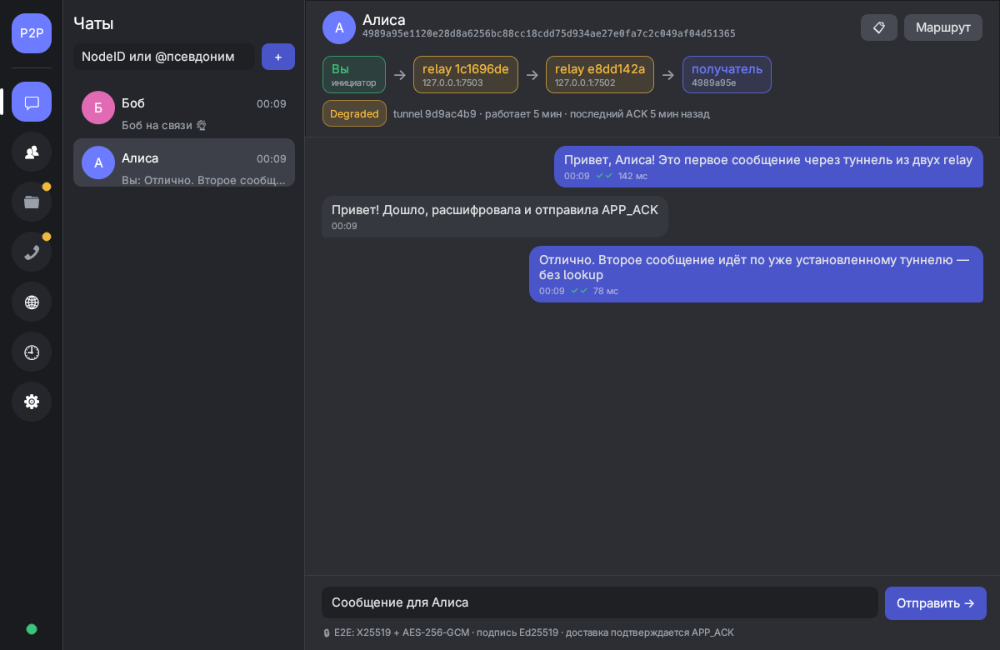

### Вкладки

| Вкладка | Что делает |
|---|---|
| 💬 **Чаты** | Список бесед (история + адресная книга), счётчик непрочитанного. Новый чат — NodeID (64 hex) или `@псевдоним`. Статус сообщения: ⏳ отправляется, ✔✔ доставлено с APP_ACK (рядом RTT), ✖ не доставлено (причина — во всплывающей подсказке). Подсказка над доставленным сообщением показывает разбивку: lookup получателя, построение туннеля (или «уже был установлен»), проход по цепочке relay. Кнопка **Маршрут** рисует цепочку `Вы → relay → relay → получатель` с состоянием туннеля. Также: **«прочитано»** (отчёт о прочтении собеседника), 🕓 «в почтовом ящике» (получатель был недоступен — заберёт сам), «печатает…», **группы** (👥, автор над сообщением; ответить можно из desktop, создаются на телефоне), **номер безопасности** (сверка ключа, отметка «сверен»), 🗑 удаление переписки. |
| 👥 **Контакты и профиль** | Ваш NodeID (кнопка копирования — его и нужно передать собеседнику), адрес узла, публикация **псевдонима** (подписанная запись в DHT; занятое другим узлом имя не перезаписывается). Адресная книга: имя → NodeID, добавить по NodeID или `@псевдониму`. **Приватность**: сообщать «печатает…», отправлять отчёты о прочтении. **Оформление**: шесть тем (тёмная, светлая, «Кровавая луна», «Ночь в замке», «Лесная фея», «Цветочная фея»). |
| 🗀 **Файлы** | Отправка файла: получатель (NodeID, `@псевдоним` или из контактов) и путь — вручную или перетаскиванием файла в окно. Список передач с прогрессом по блокам и статусом (доставлен / получен / отклонён — причина во всплывающей подсказке); после доставки — goodput и служебная доля трафика. Полученные файлы — в `<state>/downloads/<папка собеседника>/`; кнопки «🗀 Имя · N» над списком открывают папку собеседника в файловом менеджере. Файл от незнакомого узла или больше 16 МиБ ждёт вашего решения — **«Принять» / «Отклонить»** в строке передачи, рядом — почему спрашивают (⚠ — файл больше 2 ГиБ, ляжет в «Большие файлы»). |
| 📞 **Звонки** | Голосовой звонок через туннель: «Позвонить» контакту или группе (до 5 участников; кнопка 📞 есть и в шапке чата), входящий — полосой над окном с «Ответить / Отклонить», участники с подсветкой говорящего, качество (MOS, задержка «рот — ухо», потери), микрофон вкл./выкл., «Завершить», недавние звонки. Звук — микрофон и динамик по умолчанию (cpal); кодек, буфер и шифрование — в узле. |
| 🌐 **Сеть** | Счётчики (контакты, бакеты, туннели, записи DHT, время bootstrap), инструменты PING / FIND_NODE / маршрут / STORE / FIND_VALUE, туннели с ролью в пуле (основной / резерв), **профили ретрансляторов** (оценка, успехи, отказы, отказы подряд, EMA задержки) и стратегия выбора, таблица маршрутизации, хранилище DHT. |
| 🕘 **Журнал** | Локальная история отправки и приёма узла (`history.jsonl`) с фильтрами «исходящие / входящие / ошибки». Переживает перезапуск. |
| ⚙ **Подключение** | Режим (запустить свой узел / подключиться к работающему), путь к `p2p-node` (по умолчанию ищется рядом с приложением и в `target/`), порты, bootstrap-пиры, каталог состояния, автозапуск; журнал запущенного узла. |

<p>
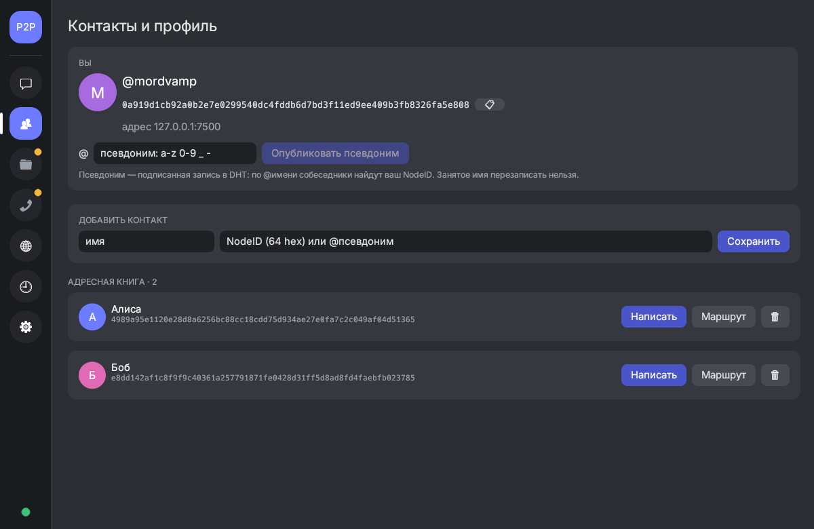
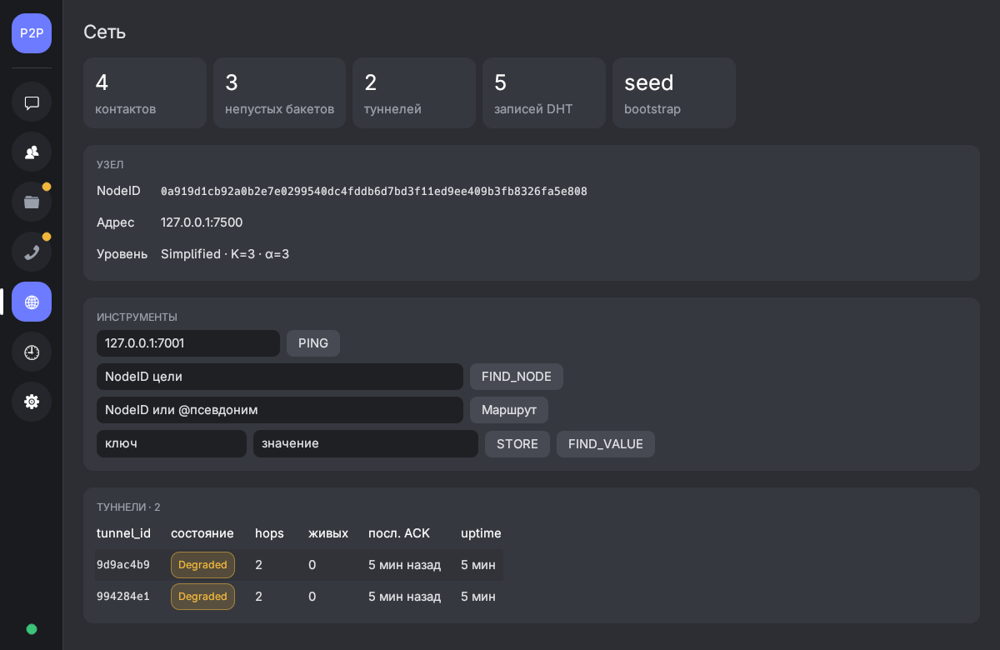
</p>

Темы оформления («Контакты и профиль» → «Оформление»):

<p>
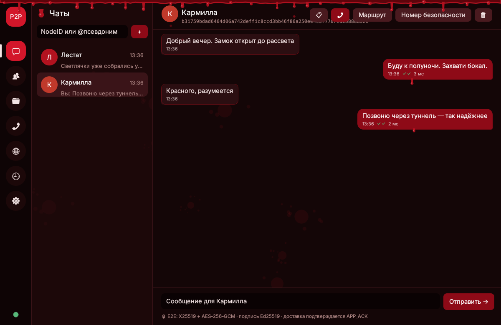
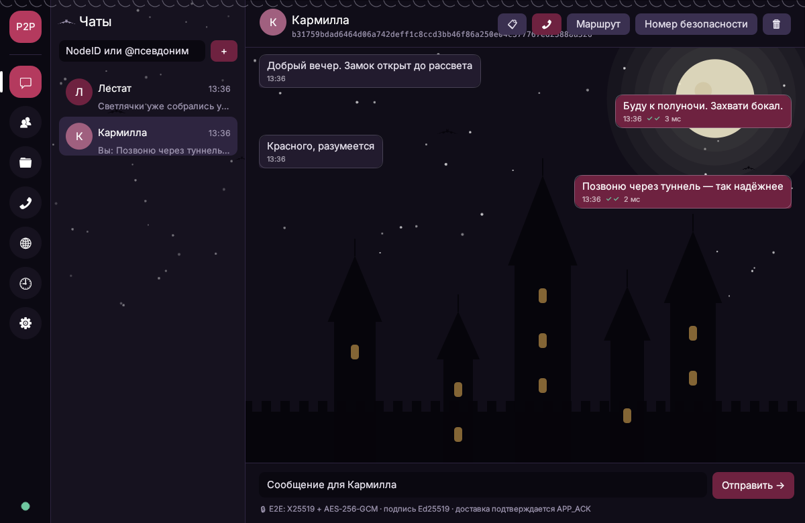
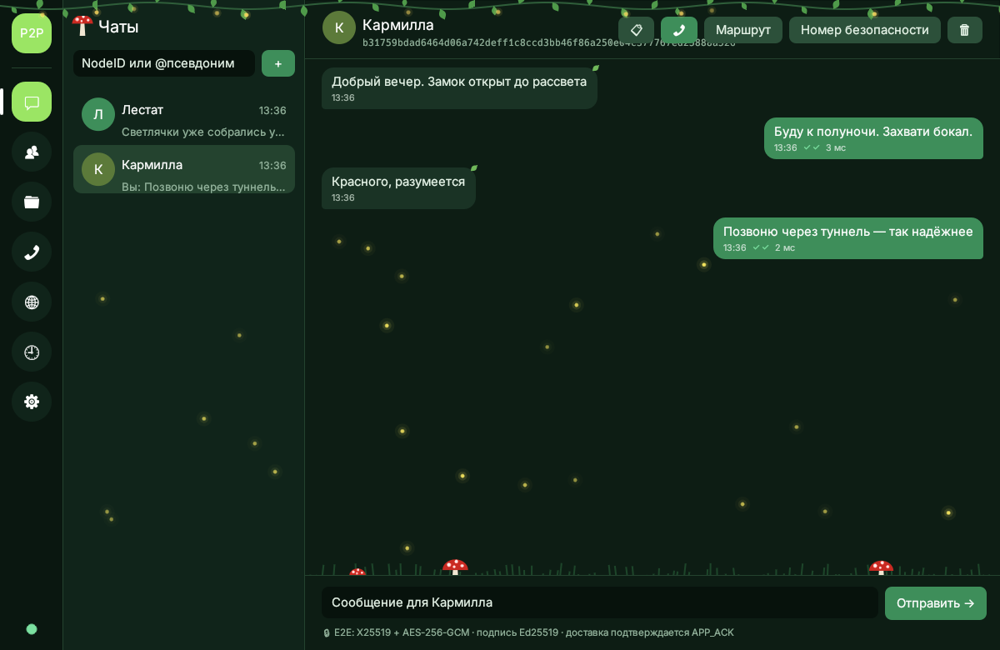
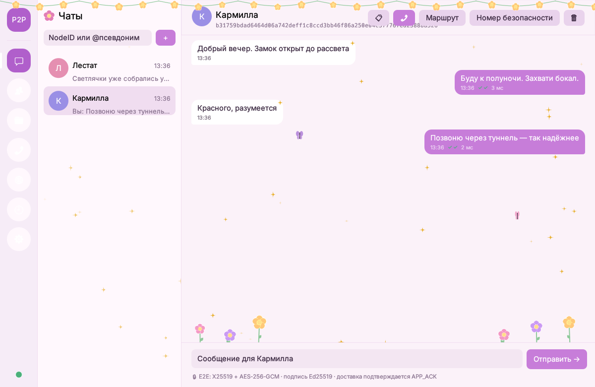
</p>

### Как это устроено
- Опрос `/api/status` и `/api/history` — раз в 1.2 с в фоновом потоке; отправка и прочие действия — в отдельных потоках,
  окно не зависает, даже пока ждёт APP_ACK (до 8 с).
- Если на выбранном порту API уже отвечает узел (например, остался от прошлого запуска), приложение подключится к нему,
  а не будет запускать второй.
- Закрытие окна останавливает узел, запущенный приложением (SIGTERM, через 3 с — kill). Узел в режиме «подключиться»
  не трогается. Если само приложение убито (`kill`), его узел продолжит работать — при следующем запуске приложение
  подключится к нему (см. предыдущий пункт).
- Настройки и адресная книга: `~/.config/p2p-overlay-desktop/settings.json` (профиль `NAME` — `settings-NAME.json`).
  Ключ и история узла: `~/.local/share/p2p-overlay-desktop/[NAME/]node/` (`identity.key` = ваш NodeID, `history.jsonl`, `node.log`).
- Шрифт интерфейса — системный Adwaita Sans / Inter / Noto Sans / DejaVu Sans, если найден; иначе встроенный.

### Пользоваться по сети (не только localhost) и подключить телефон
Узел слушает `0.0.0.0`, но по умолчанию анонсирует себя как `127.0.0.1` (стенд одной машины). Чтобы к нему подключались
другие устройства, включите на вкладке «Подключение» **«Локальная сеть»** — приложение запустит узел с `--advertise auto`,
и он сообщит пирам свой адрес в LAN (частный адрес на Wi-Fi/Ethernet; адреса VPN-туннелей и Docker пропускаются).
Из терминала — `p2p-node --advertise auto` или `--advertise 192.168.1.10`, в конфиге — `node.advertise_host`.
Порт узла нужно открыть в межсетевом экране. Порт API остаётся только на `127.0.0.1`.

Там же **«Ретрансляторы»** (0–6): приложение запустит рядом вспомогательные узлы (порты `P2P+1…`, каталоги
`<state>-helpers/hN`), когда основной узел поднимется, и остановит их вместе с ним. Туннелю нужно ≥ 2 ретранслятора — без них
в сети «телефон + компьютер» сообщения не уйдут.

Когда узел запущен, ниже появляется карточка **«Подключить телефон»**: QR и ссылка `p2p-overlay://IP:порт?id=NodeID`.

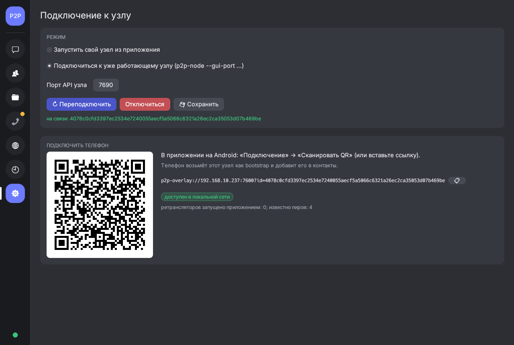

## 4. Android-приложение

Телефон — полноправный узел: в APK тот же `p2p-node` (Rust), собранный под Android; приложение (Kotlin, Jetpack Compose)
запускает его в фоновом сервисе и работает через его локальный API. Сборка, устройство, тесты — [android/README.md](android/README.md).

```bash
rustup target add aarch64-linux-android x86_64-linux-android
android/build_node.sh                          # узел под Android (нужен NDK)
cd android && ./gradlew assembleRelease        # app/build/outputs/apk/release/app-arm64-v8a-release.apk (≈ 5 МБ)
```

**Подключение к компьютеру.** Компьютер: «Подключение» → «Локальная сеть» ✔, «Ретрансляторы» = 3 → «Запустить узел».
Телефон (в той же сети Wi-Fi): вкладка «Узел» → «Сканировать QR» → «Подключить». Узел ПК станет bootstrap-пиром и контактом
«Компьютер»; через несколько секунд в заголовке — «в сети · N пиров».

| Вкладка | Что делает |
|---|---|
| **Чаты** | Поиск по чатам и тексту; удаление беседы долгим нажатием; **группы**; статусы ✔ / ✔✔ (APP_ACK, RTT) / **прочитано** / 🕓 в почтовом ящике; «печатает…»; вложения и **фото с камеры** с превью; меню беседы: **маршрут туннеля**, **номер безопасности**, переименовать, проверить почтовые ящики, удалить |
| **Файлы** | Отправка из системного выбора файла или «Поделиться» из любого приложения; прогресс; превью картинок; открыть / переслать |
| **Сеть** | Пиры (отметка «клиент» у узлов без ретрансляции), туннели (основной / резерв), таблица Kademlia, профили ретрансляторов, роль и режим |
| **Узел** | Старт / стоп, QR-сканер и ссылка, `@псевдоним`, свой QR; **режим энергопотребления**, «только клиент», bootstrap, порт, канал TLS/AKE, LAN, автозапуск, уведомления; **приватность**: «печатает», отчёты о прочтении, блокировка, **тема** (системная, светлая, тёмная, две вампирские и две фейские — ниже); журнал узла |

**Режимы энергопотребления**

| | Эконом | Обычный (по умолчанию) | Максимум |
|---|---|---|---|
| Ретранслирует чужие туннели | нет («только клиент») | да | да |
| Блокировка сна (wake lock) | нет | нет | да — всегда отвечает на PING |
| Обновление бакетов DHT | раз в 10 мин | раз в 60 с | раз в 60 с |
| Проверка почтовых ящиков | раз в 5 мин | раз в 60 с | раз в 30 с |
| Туннелей к собеседнику | 1 | 1 | 2 (мгновенное переключение при отказе) |
| Сводка сети в интерфейсе | раз в 15 с | раз в 5 с | раз в 3 с |

Во всех режимах новые сообщения, «печатает» и прочтение приходят **push** (`/api/events`): процессор не просыпается для
опроса. «Только клиент» можно включить и отдельно в любом режиме.

<p>
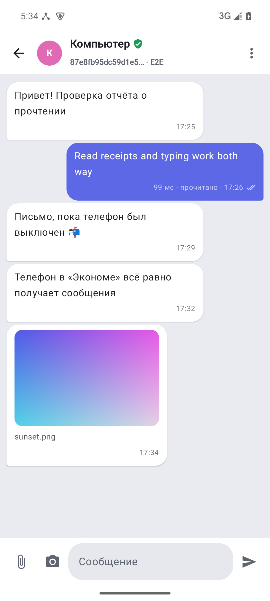
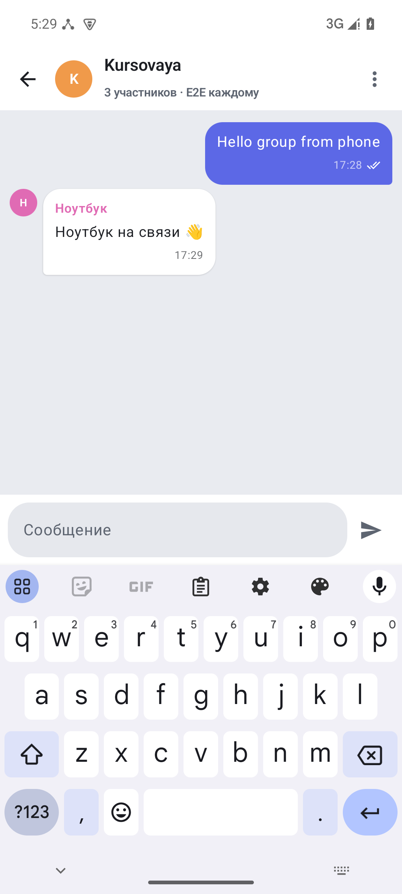
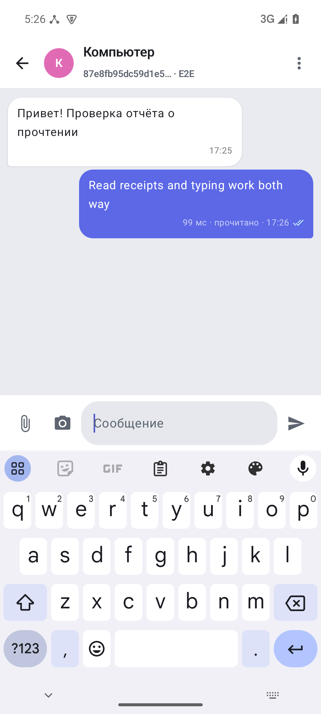
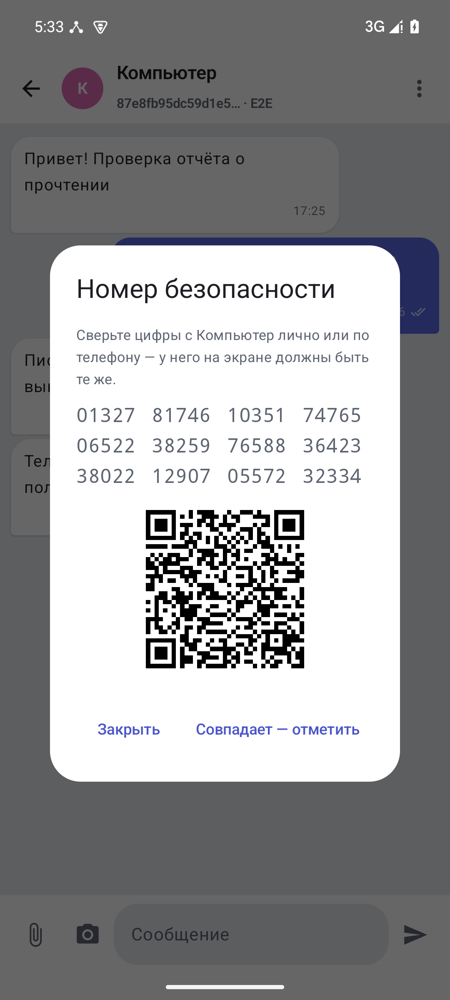
</p>
<p>
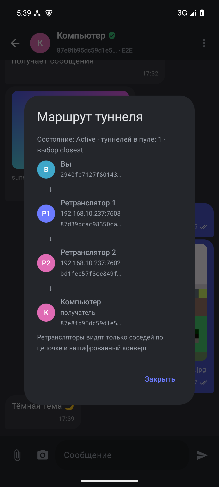
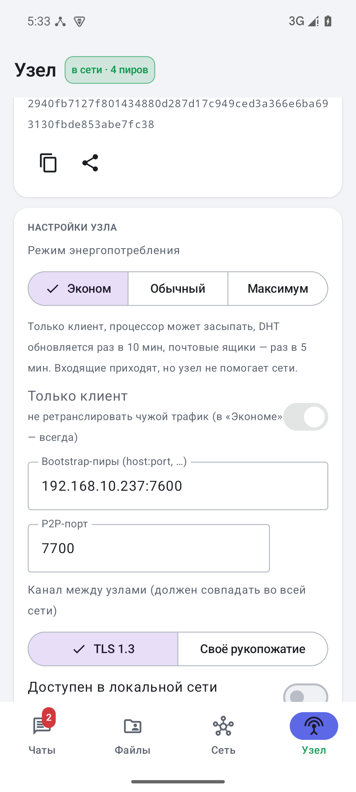
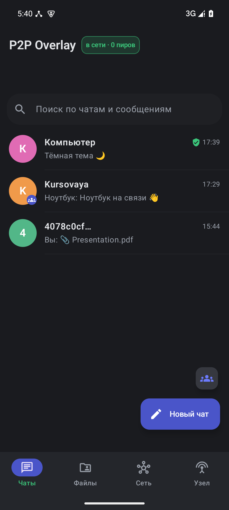
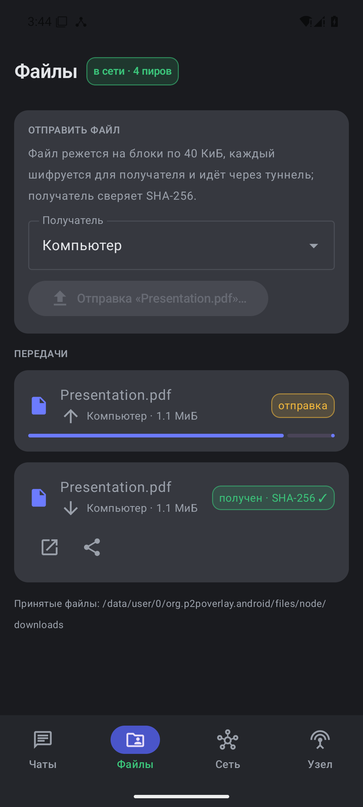
</p>
<p>
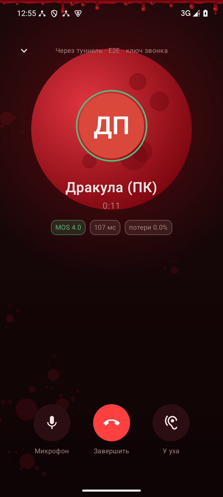
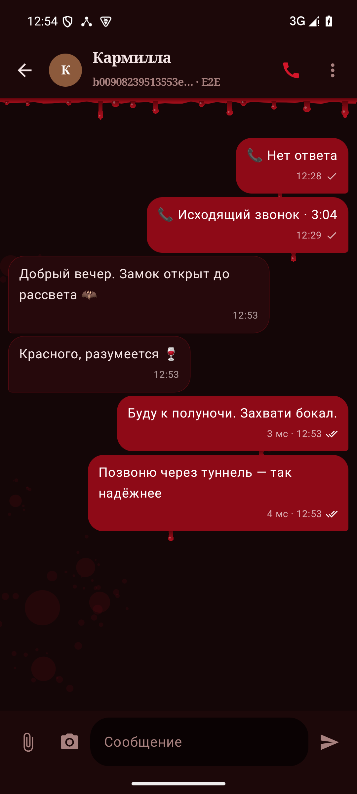
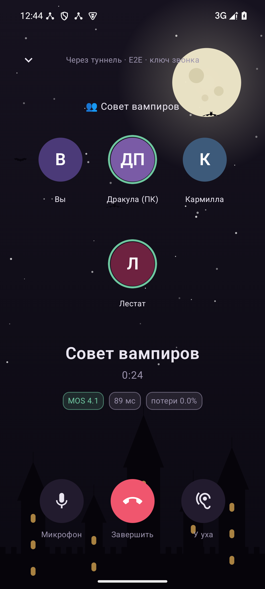
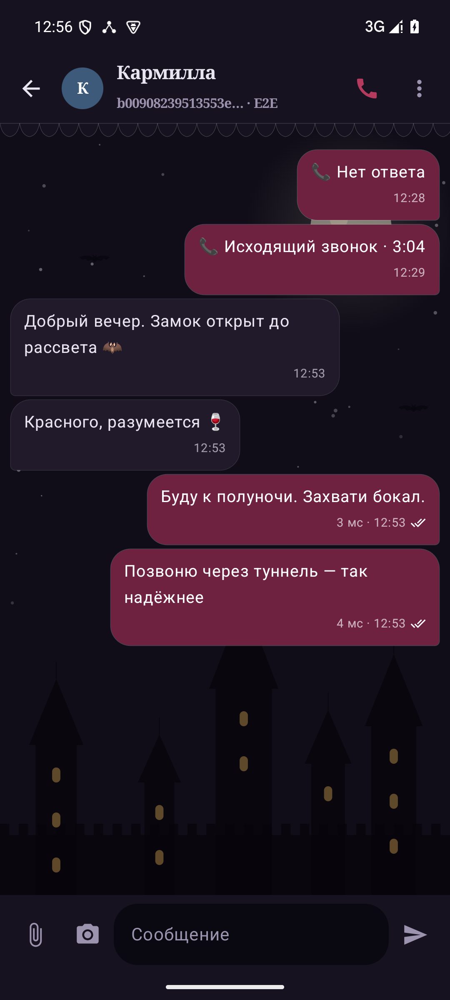
</p>
<p>
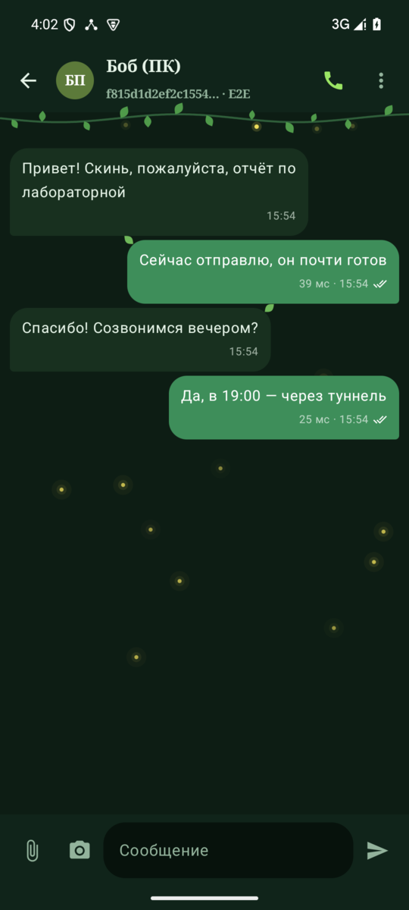
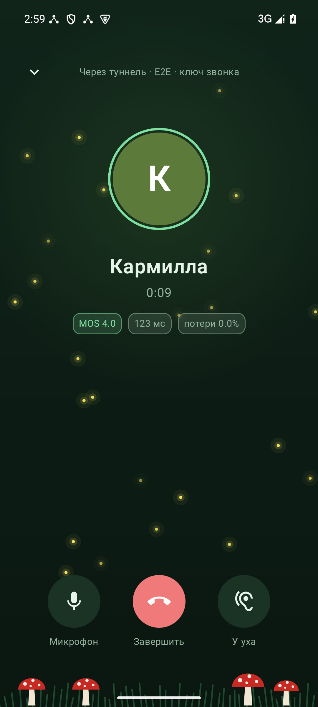
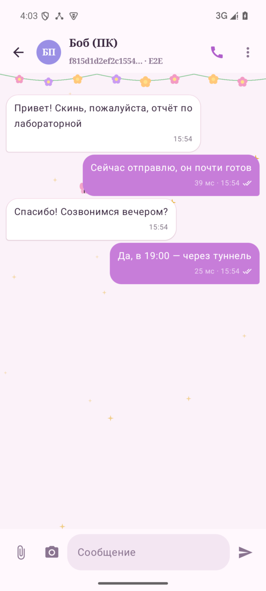
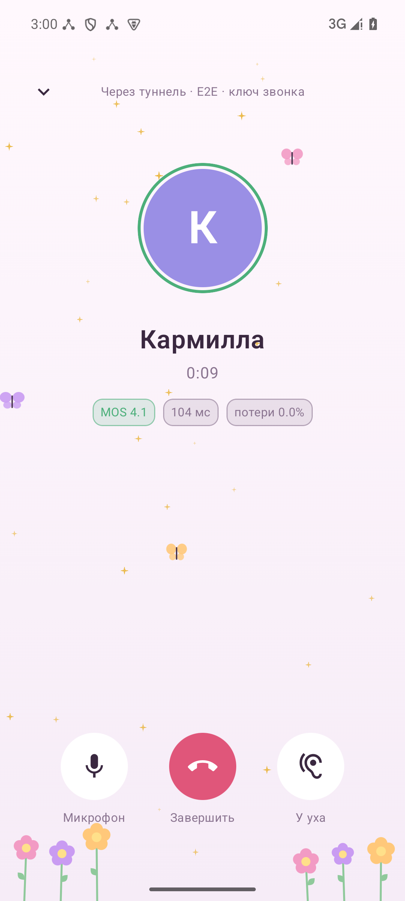
</p>

**Звонки.** Кнопка 📞 в шапке чата: личный звонок или групповой (вся группа, до 5 участников, «каждый с каждым»).
Входящий — уведомление-вызов с мелодией и «Ответить / Отклонить» (на заблокированном экране — полноэкранный вызов).
Экран звонка: участники с кольцом «говорит», длительность, качество (MOS по E-модели, задержка «рот — ухо», потери),
микрофон, «динамик / у уха» (у уха экран гаснет по датчику приближения), свернуть — полоса «идёт звонок» над
приложением. Голос идёт через туннель (Opus, свой ключ на каждый звонок); системное эхо- и шумоподавление телефона.
Нужно разрешение на микрофон (без него вы слышите собеседника, он вас — нет).

**Темы.** Кроме системной, светлой и тёмной — две вампирские, с оформлением, а не только цветом: **«Кровавая луна»** —
кровь стекает с верхней панели (капли срываются и падают), брызги на фоне, подтёки под вашими сообщениями, на экране
звонка — кровавая луна; **«Ночь в замке»** — готические арки под панелью, звёздное небо, луна, силуэт замка с горящими
окнами, летучие мыши (без крови). И две фейские: **«Лесная фея»** — лиана с листьями и светящимися ягодами под панелью,
кружащие светлячки, на экране звонка — трава и мухоморы; **«Цветочная фея»** (светлая) — гирлянда цветов, падающая
пыльца-блёстки, бабочки, цветы по низу. Заголовки — антиквой. Выбор — «Узел» → «Тема». Те же шесть тем (без «Системной»)
есть в настольном приложении: «Контакты и профиль» → «Оформление».

**Где лежат принятые файлы.** У каждого собеседника своя папка — `downloads/<первые 16 символов его NodeID>/`; в
«Файлах» она подписана именем из контактов, у файлов — «Открыть» и «Поделиться». Файлы больше 2 ГиБ — в подпапке
«Большие файлы».

**Файлы от незнакомых.** Небольшой файл (до 16 МиБ) от того, кому вы писали или кто у вас в контактах, принимается сам.
Остальное приходит уведомлением «… предлагает файл» с кнопками «Принять» / «Отклонить» (и в «Файлах»); до согласия на
телефон ничего не записывается, без ответа за 2 минуты предложение отклоняется. В предложении написано, почему
спрашивают; файл больше 2 ГиБ (до 8 ГиБ) помечен ⚠. Автоматически принятые файлы вместе — не больше 2 ГиБ; на телефоне
всегда остаётся не меньше 512 МиБ свободного места (`files.*` в конфиге узла). Рядом с именем каждого файла — его
настоящее расширение (`EXE`, `PDF`): имя со скрытыми символами может «показывать» другое; если такие символы есть в
имени исполняемого файла, предложение предупредит об этом и покажет имя как есть («счёт_⟨U+202E⟩fdp.exe»).

**Хранение и шифрование** (телефон и компьютер; «Узел» → «Хранение», на компьютере — «Контакты и профиль» →
«Хранение»). Ключ узла и история переписки хранятся зашифрованными; ключ шифрования — в Android Keystore, на
компьютере — в хранилище секретов системы (KWallet, GNOME Keyring; при первом запуске может спросить пароль
кошелька), а если хранилища нет — в отдельном файле (приложение об этом предупредит). Каталог узла и папки файлов
закрыты от других пользователей компьютера. История хранится год; потом приложение спросит, что сделать со старыми
записями: **удалить**, **перешифровать и оставить ещё на год** или — красная кнопка — **вынести в открытый файл**
(текст без шифрования; на телефоне сразу откроется «Поделиться», из истории записи уберутся). «Перешифровать новым
ключом» можно и в любой момент. Принятые файлы не шифруются — их открывают другие программы.

**Безопасность на телефоне.** Ключ узла хранится только зашифрованным (`identity.key.enc`), ключ шифрования — в Android
Keystore; локальный API закрыт токеном (другие приложения телефона не могут им воспользоваться); блокировка приложения
отпечатком / PIN; номер безопасности для сверки ключа собеседника.

**Офлайн-доставка.** Если собеседник недоступен, сообщение ложится в **почтовый ящик DHT** (зашифровано для него,
подписано вами); он заберёт его сам, когда появится в сети, — исходящими запросами, так что и телефон за NAT. Статус
меняется с «в почтовом ящике» на «доставлено», когда придёт подтверждение.

Ограничения: для туннелей устройства должны видеть друг друга по IP (одна сеть или VPN), NAT traversal нет; канал (TLS/AKE)
— как во всей сети.

## 5. Узел из терминала

```bash
cargo run --bin p2p-node -- [ОПЦИИ]
```

| Опция | Описание |
|---|---|
| `-c, --config <PATH>` | YAML-конфиг (по умолчанию `config/node_config.yaml`) |
| `-p, --port <PORT>` | переопределить `LISTEN_PORT` |
| `-b, --bootstrap <ADDR>` | bootstrap-пир `IP:PORT` (можно несколько) |
| `--gui-port <PORT>` | включить веб-панель и HTTP API на `127.0.0.1:<PORT>` (без флага выключены) |
| `--state-dir <DIR>` | каталог состояния (приватный ключ, история сообщений) |
| `--metrics-dir <DIR>` | каталог метрик |
| `--host <IP>` | адрес узла (переопределяет `LISTEN_HOST`): слушает и соединяется с него, напр. `127.0.1.5` |
| `--advertise auto\|<IP>` | при прослушивании `0.0.0.0` — какой адрес сообщать пирам (`node.advertise_host`): `auto` — LAN-адрес, без флага — `127.0.0.1`. Нужен для подключения телефона и других машин |
| `--channel <tls\|ake>` | канал между узлами: TLS 1.3 (по умолчанию) или собственное рукопожатие (§11.3); вся сеть — одинаково |
| `--relay-selection <closest\|random\|rating>` | стратегия выбора ретрансляторов |
| `--pool-size <N>` | размер пула туннелей к одному получателю |
| `--fault-drop <P>`, `--fault-delay-ms <D>` | **только эксперименты**: узел как ретранслятор с вероятностью P отказывает / задерживает пересылку |
| `--export-routing <FILE>` | выгрузить таблицу маршрутизации в JSON и выйти |

Первый узел запускается без `-b` (seed), остальные — с `-b <адрес seed>`. **Каждому узлу нужны свой порт и свой
`--state-dir`**, иначе узлы получат один и тот же ключ.

Минимальная сеть из 6 узлов с панелями:

```bash
P=./target/debug/p2p-node
$P -p 7301 --gui-port 8301 --state-dir state/n1 --metrics-dir metrics/n1 &
for i in 2 3 4 5 6; do
  $P -p 730$i -b 127.0.0.1:7301 --gui-port 830$i \
     --state-dir state/n$i --metrics-dir metrics/n$i &
  sleep 0.3
done
# сеть сходится за несколько секунд; остановить: pkill -x p2p-node
```

Уровень логов: `RUST_LOG=p2p_overlay=debug cargo run --bin p2p-node -- ...`.

## 6. Веб-панель и HTTP API

`http://127.0.0.1:<gui-port>/` — панель узла в браузере: статус и NodeID, таблица маршрутизации, туннели, хранилище DHT;
PING, FIND_NODE, построение туннеля, STORE/FIND, отправка сообщения. Те же функции — по HTTP (так работает и настольное
приложение). Изменяющие запросы — `POST`, параметры — в строке запроса:

| Запрос | Ответ / описание |
|---|---|
| `GET /api/status` | NodeID, адрес, таблица маршрутизации, туннели, хранилище, `bootstrap.join_ms`, `features` (что умеет узел) |
| `POST /api/ping?addr=IP:PORT` | PING по адресу, `rtt_ms` |
| `POST /api/lookup?target=<NodeID>` | итеративный FIND_NODE: `rpc_count`, `iterations`, `duration_ms`, опрошенные по итерациям |
| `POST /api/tunnel?target=<NodeID>` | построить туннель: `reused`, `build_ms` |
| `POST /api/store?key=...&value=...` | подписанная запись DHT с репликацией (R=3, кворум ≥2) |
| `GET /api/find?key=...` | поиск записи (проверяется подпись публикатора) |
| `POST /api/send?target=<NodeID или @псевдоним>&text=...` | отправить и **дождаться APP_ACK**: `delivered`, `message_id`, `rtt_ms`, `lookup_ms` (null — не понадобился), `tunnel_reused`, `tunnel_build_ms`, `tunnel_send_ms`, `rebuilt_after_failure`, `failover` (доставлено по резервному туннелю пула), `detect_ms`, `switch_ms`, `wire_bytes` |
| `GET /api/history?limit=N` | локальная история: `dir` (out/in), `peer`, `status` (delivered/sent/failed/received), `text`, `rtt_ms`, `error`, разбивка задержки |
| `POST /api/alias?name=<имя>` | опубликовать свой псевдоним (`[a-z0-9_-]`, 1–32 символа) |
| `GET /api/resolve?alias=<имя>` | псевдоним → NodeID владельца (подпись проверяется) |
| `POST /api/send_file?target=<NodeID или @псевдоним>&path=<путь>` | отправить файл и дождаться проверки SHA-256 получателем → `report`: `goodput_mib_s`, `overhead_share`, `bytes_out/in`, `retransmits`, `duration_ms` |
| `GET /api/files` | передачи файлов (входящие и исходящие, прогресс, статус: `offered` — ждёт решения, `waiting` — ждём согласия получателя) и каталог загрузок |
| `POST /api/file/accept?transfer_id=…` / `reject` | принять или отклонить предложенный файл |
| `GET /api/downloads` | принятые файлы на диске по папкам собеседников: `folders[{folder, files[{name, ext, size, large, path, name_warning}]}]` |
| `GET /api/history/retention` | шифрование и срок хранения истории: `encrypted`, `key_id`, `records`, `expired`, `due` (пора спросить) |
| `POST /api/history/expired?action=delete\|keep\|export` | записи старше срока: удалить; перешифровать новым ключом и оставить на срок; вынести в открытый файл `<state>/export/` (ответ — `path`) |
| `POST /api/history/reencrypt` | сменить ключ истории сейчас (вся история переписывается новым ключом, старый стирается) |
| `GET /api/relays` | профили ретрансляторов этого узла (по убыванию оценки) |
| `GET /api/inbox` | последние входящие (в памяти) |
| `GET /api/route?target=<NodeID или @псевдоним>` | диагностика маршрута: туннель, цепочка relay, состояние, давность последнего ACK |
| `GET /api/events?since=N&timeout=25` | **push**: «долгий» запрос, ответ сразу при событии (`message`, `typing`, `read`, `status`, `file`, `history`) или пустой по тайм-ауту; `seq` — номер для следующего запроса |
| `POST /api/typing?target=…` | «печатает…» (только по уже открытому туннелю; `sent: false`, если туннеля нет) |
| `POST /api/read?target=…&ids=<id,id>` | отчёт о прочтении входящих сообщений |
| `POST /api/send_group?group_id=<hex>&name=…&members=<id,id>&text=…` | групповое сообщение: копия каждому участнику, `results` по участникам (`delivered` / `queued` / `failed`) |
| `POST /api/history/delete?peer=<NodeID или g:<id>>` | удалить переписку на этом узле |
| `POST /api/watch?peers=<id,id>` | проверять почтовые ящики DHT этих собеседников (кроме тех, кто уже есть в истории) |
| `POST /api/mailbox/poll` | проверить почтовые ящики сейчас |
| `GET /api/safety?peer=<NodeID>` | номер безопасности пары (12 групп по 5 цифр) |
| `POST /api/probe?target=…&stream=…&count=250&interval_ms=20&size=80` | измерительный поток как у голоса (сценарий `media`) |
| `GET /api/probe_results?stream=…` | принятые пакеты потока: `seq`, `sent_us`, `recv_us` (у получателя) |
| `POST /api/call/start?target=<NodeID или @псевдоним>` | позвонить: `call_id`; собеседнику уходит подписанный CallOffer с одноразовым ключом |
| `POST /api/call/start?members=<id,id>&name=…[&chat=<id группы>]` | групповой звонок (до 5 вместе с собой, «каждый с каждым»): `call_id` — id сеанса |
| `POST /api/call/accept?call_id=…` / `reject` / `hangup` | ответить, отклонить, завершить (id ноги или сеанса); занятый узел отклоняет второй вызов сам (`end_reason: busy`) |
| `GET /api/calls` | `sessions` — звонки для клиентов: `state`, участники (`peers`: состояние, громкость `level`, `quality` — буфер, FEC, маскировка, «рот — ухо», MOS), `duration_s`, `mos`; `calls` — ноги для замеров (`rx`, `one_way_ms`); `mic_level` |
| `GET /api/call/audio` | локальный аудиоканал клиента: UDP-порт на 127.0.0.1 и токен (PCM 16 кГц кадрами 20 мс, PROTOCOL §7.8) |
| `POST /api/call/tone?freq=440&seconds=5&listen=440,660` | тестовый источник вместо микрофона: тон в звонок; в ответ — какие из `listen` слышны (сценарий `voice`) |
| `POST /api/call/media?call_id=…&count=250&interval_ms=20&size=80` | синтетический поток по активному звонку — замер транспорта (сценарий `call`) |

`/api/send` при недоставке и включённой офлайн-доставке отвечает `delivered: false, queued: true`: сообщение лежит в
почтовом ящике DHT, получатель заберёт его сам. `/api/status` дополнительно отдаёт `relay` (режим «только клиент»),
`typing`, `outbox` (очередь ящиков), `events_seq`, `link` (ссылка-приглашение).

API слушает только `127.0.0.1`. Если узел запущен с переменной окружения `P2P_API_TOKEN` (так делает Android-приложение),
каждый `/api/*` требует заголовок `X-Api-Token`; иначе аутентификации нет — не пробрасывайте порт наружу.

```bash
B=$(curl -s localhost:8306/api/status | python3 -c "import sys,json;print(json.load(sys.stdin)['node_id'])")
curl -s -X POST "localhost:8306/api/alias?name=bob"
curl -s -X POST "localhost:8302/api/send?target=%40bob&text=hello"     # %40 = @
# {"delivered":true,"lookup_ms":22,"message_id":"…","rtt_ms":142,"tunnel_build_ms":11,"tunnel_reused":false,"tunnel_send_ms":19,…}
curl -s "localhost:8306/api/history?limit=5"
```

Первое сообщение собеседнику дольше (lookup + построение туннеля, у получателя — обратный туннель для APP_ACK);
следующие идут по установленной сессии без lookup.

## 7. Оркестратор (кластер из браузера)

```bash
cargo build --bins && cargo run --bin p2p-orchestrator -- --gui-port 8080
# http://127.0.0.1:8080/
```

Запуск N узлов (первый — seed, остальные знают только его адрес), остановка одного или всех, ссылки на панели узлов.

## 8. Эксперименты

```bash
bash scripts/run_acceptance.sh [N=13] [LOOKUPS=30]     # приёмка этапов 1–2 (Rust-оркестратор)
bash experiments/run_all.sh                            # упрощённый уровень: сценарии 01–09 + pcap, N=15 (~5 мин)
bash experiments/run_advanced.sh                       # продвинутый: N=21, k=4, 3 relay, пул 3 — 01–09 (09: star/ring/tree/multi-seed),
                                                       #   failover, strategy, files, channel (~15 мин)
sudo -v && bash experiments/run_advanced.sh --with-root   # + сценарий 10 (tc/netem) и underlay (nftables)
./target/debug/p2p-orchestrator scenario files         # передача файлов: goodput и служебная доля (100 КиБ, 1 МиБ, 10 МиБ × 5)
./target/debug/p2p-orchestrator scenario channel       # TLS 1.3 против собственного рукопожатия
./target/release/p2p-orchestrator scenario channel     # то же на release-сборке (криптография оптимизирована)
./target/debug/p2p-orchestrator scenario 06 --seed 2   # один сценарий (флаги: --nodes --n --runs --inj --seed)
./target/debug/p2p-orchestrator scenario pcap          # в захвате трафика нет открытого текста
./target/release/p2p-orchestrator scenario media       # голосовой поток сообщениями туннеля (режимы соединений)
./target/release/p2p-orchestrator scenario call        # звонок: установление, задержка кадра, джиттер, потери
./target/release/p2p-orchestrator scenario voice       # звук: тоны участников 1:1 и в группе, буфер, «рот — ухо», MOS
./target/debug/p2p-orchestrator plot <каталог>         # перестроить графики (SVG) из сохранённых CSV
# запасной вариант на Python (тот же метод): python3 scripts/python/scenarios.py 06; графики — scripts/python/analyze.py
```

Результат каждого сценария — `experiments/results/<сценарий>/<время>/`: `results.csv` (сырые наблюдения), `summary.md`
(n/min/max/медиана/среднее, p95 при n ≥ 20), `meta.json` (коммит, конфигурация, seed, N/k/α/R, тайм-ауты, граф bootstrap),
`plots/*.svg` (графики из `results.csv`), `node_logs/` (журналы узлов прогона).
Подробно — [experiments/README.md](experiments/README.md). Логи узлов — `logs/` (вне git).

## 9. Конфигурация

`config/node_config.yaml`; ключевые параметры:

| Параметр | По умолчанию | Смысл |
|---|---|---|
| `dht.k_bucket_size` | 3 | размер корзины (simplified=3, advanced=4) |
| `dht.alpha` | 3 | параллелизм lookup |
| `dht.replication_factor` / `store_quorum` | 3 / 2 | STORE успешен при ≥2 из 3 реплик |
| `dht.ttl_seconds` / `republish_interval_seconds` | 180 / 80 | срок жизни записи (и псевдонима) и период переопубликования |
| `transport.connect_timeout_ms` / `read_timeout_ms` | 3000 / 5000 | тайм-ауты: установление соединения; ответ и дочитывание кадра |
| `transport.reuse_connections` | `true` | пул соединений между узлами (с 11.11.2026 по умолчанию); `--no-reuse-connections` или `config/node_config_per_request.yaml` — новое соединение на каждый запрос. Вся сеть — в одном режиме |
| `transport.idle_timeout_ms` / `pool_max` | 60000 / 128 | простой соединения (из пула закрывается через половину); размер пула |
| `transport.pool_scope` | `tunnels` | что идёт через пул (`--pool-scope`): `tunnels` — только туннели, DHT — соединение на каждый запрос; `all` — всё (`config/node_config_pool_all.yaml`) |
| `transport.peer_errors` | `auto` | ошибки для других узлов (`--peer-errors`): `detailed` — с адресами; `generic` — без адресов и причин, узел назван NodeID; `auto` — detailed в debug-сборке, generic в release |
| `history.retention_days` | 365 | срок хранения истории; старые записи — удалить / перешифровать и оставить / вынести в открытый файл |
| `files.accept` | `known` | согласие на приём файлов (`--file-accept`): `known` — сам до 16 МиБ от знакомых; `ask` — всегда; `auto` — без вопросов (эксперименты) |
| `tunnel.min_relays` / `max_hops` | 2 / 5 | длина цепочки relay |
| `tunnel.ttl_seconds` | 600 | срок жизни маршрута на relay; туннель заменяется заранее, на 90% |
| `tunnel.ack_timeout_ms` | 5000 | тайм-аут TUNNEL_ACK; ×12 — окно «свежего» подтверждения (дольше — DEGRADED) |
| `tunnel.pool_size` / `relay_selection` | 1 / closest | пул туннелей к получателю и стратегия выбора relay (продвинутый: 3 / rating) |
| `security.channel` | tls | канал между узлами: `tls` или `ake` (собственное рукопожатие) |
| `files.max_bytes` / `block_size` / `window` / `incomplete_timeout_s` | 64 МиБ / 40 КиБ / 8 / 60 | передача файлов |

Продвинутый уровень целиком — `config/node_config_advanced.yaml` (k = 4, 3 relay, пул 3, `rating`):
`p2p-node -c config/node_config_advanced.yaml …`, сценарии — с `--node-config config/node_config_advanced.yaml --nodes 21`.

Параметры меняются без правки кода; CLI-флаги `-p/-b/--state-dir` переопределяют файл.

## 10. Данные, ключи, логи

| Что | Где | В git? |
|---|---|---|
| Приватный ключ узла (= NodeID) | `<state-dir>/identity.key` (права 0600) | **нет** (`state/` в `.gitignore`) |
| История сообщений (тексты!) | `<state-dir>/history.jsonl` (права 0600) | нет |
| Принятые message_id (анти-replay, 10 мин) | `<state-dir>/replay.log` | нет |
| Полученные файлы | `<state-dir>/downloads/` (неполные — `downloads/.partial/`, удаляются через 60 с без блоков) | нет |
| Настройки и адресная книга приложения | `~/.config/p2p-overlay-desktop/` | нет |
| Логи узлов и тестов | `logs/`, у приложения — `<state-dir>/node.log` | нет |
| Метрики узла | `<metrics-dir>/` | нет |
| Результаты приёмки, сценариев, контрольный pcap | `experiments/results/` | да (без ключей) |

Потеряли каталог состояния — узел получит **новый** NodeID (а псевдоним освободится через TTL). Не копируйте `state/` между машинами.

## 11. Частые проблемы

| Симптом | Причина / решение |
|---|---|
| `bind ...: Address already in use` / «Процесс узла завершился» в приложении | порт занят; выберите другой порт или `pkill -x p2p-node`. Журнал узла — вкладка «Подключение» |
| приложение: «Нет связи с узлом» | узел не запущен или другой порт API; проверьте вкладку «Подключение» |
| приложение: `не удалось запустить p2p-node` | соберите узел (`cargo build --bins`) или укажите путь к программе узла |
| у двух узлов одинаковый NodeID | общий `--state-dir` (или один профиль приложения); задайте отдельный каждому |
| `Failed to build tunnel ... Not enough relay candidates` | в сети меньше 4 узлов или сеть ещё не сошлась (несколько секунд) |
| узел запущен раньше seed: «0 контактов» | узел сам повторяет bootstrap (1, 2, 4 … 30 с) — дождитесь запуска seed; в журнале `Bootstrap: ни один bootstrap-узел не ответил — повтор через … с` |
| звонок: `занято` / `call_missed` | собеседник уже в звонке / не ответил за 30 с |
| звонок: меня не слышно | нет разрешения на микрофон (телефон) или нет устройства ввода (компьютер — подпись под участниками) |
| звонок: MOS жёлтый или красный | потери или большая задержка на пути; буфер углубляется сам после опозданий кадров (до 100 мс) |
| `нет подтверждения доставки` | получатель выключен или недоступен; проверьте «Маршрут» / `/api/route` |
| `псевдоним «…» уже занят узлом …` | имя принадлежит другому узлу, пока его запись жива (TTL 180 с после ухода владельца) |
| туннель в состоянии DEGRADED | давно не было трафика — это не отказ; отказ обнаружится при отправке, и маршрут перестроится автоматически |
| `STORE: подтверждено 1 из 3 реплик` | в сети слишком мало узлов для кворума (нужно ≥2 реплик) |
| окно приложения не открывается под Wayland | попробуйте `WAYLAND_DISPLAY= ./target/debug/p2p-desktop` (X11 через XWayland) |
| телефон: «в сети · 0 пиров» после сканирования QR | на ПК не включена «Локальная сеть» (в ссылке `127.0.0.1`), разные сети Wi-Fi, порт закрыт брандмауэром или разный канал TLS/AKE |
| телефон: `Not enough relay candidates` | на ПК не запущены ретрансляторы — «Ретрансляторы» = 3 и перезапуск узла |
| `--advertise auto` выбрал не тот адрес | укажите адрес явно: `--advertise 192.168.1.10` (или в конфиге `node.advertise_host`) |
| сообщение «в почтовом ящике» и не доставляется | получатель не появлялся в сети или не может достучаться до узлов DHT; письмо живёт, пока ваш узел в сети (republish), до 7 суток |
| телефон: «Блокировка недоступна» | на телефоне не настроены отпечаток или PIN экрана |
| `identity.key.enc зашифрован: нужен P2P_IDENTITY_KEK` | каталог узла Android-приложения запущен вручную без ключа шифрования — запускайте через приложение |
| компьютер: «ключ шифрования узла был в хранилище секретов, но сейчас не получен» | кошелёк (KWallet / GNOME Keyring) закрыт или не запущен — откройте его и перезапустите узел. Новый ключ приложение сознательно не создаёт: старые ключ узла и история стали бы нечитаемыми |
| в журнале ошибок «next hop node:… недоступен» без адреса | так и задумано в release-сборке (адреса чужих узлов не раскрываются); подробно — `--peer-errors detailed` |
| графики не строятся | `pip install matplotlib` |
| сценарий `10` или `underlay`: «нужны права root» | выполните `sudo -v` и запустите снова (драйвер вызывает `sudo -n tc/nft`; правила снимаются сами) |
| файл «отклонён» | имя с `/`, `..`, ведущей точкой; файл больше `files.max_bytes`; получатель отклонил или не ответил за 2 мин; у получателя квота или мало места; причина — в подсказке на вкладке «Файлы» и в `/api/files` |
| отправка файла долго «ждёт согласия получателя» | получатель вас не знает (вы ему не писали и вас нет в его контактах) или файл больше 16 МиБ — нужно его «Принять» |
| `превышен предел сообщений` в журнале получателя | больше 5 сообщений/с от одного узла (запас 30) — лишнее отбрасывается |
| узлы не соединяются после смены `--channel` | вся сеть должна использовать один канал: TLS-узел не понимает AKE и наоборот |
| `scenario pcap`: нет прав на захват | установите wireshark-cli и добавьте пользователя в группу `wireshark` (или запустите через `sudo`) |
