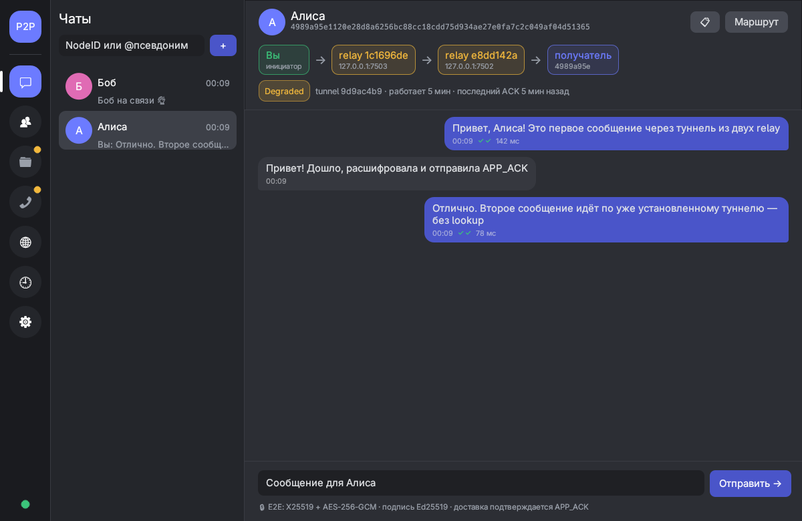
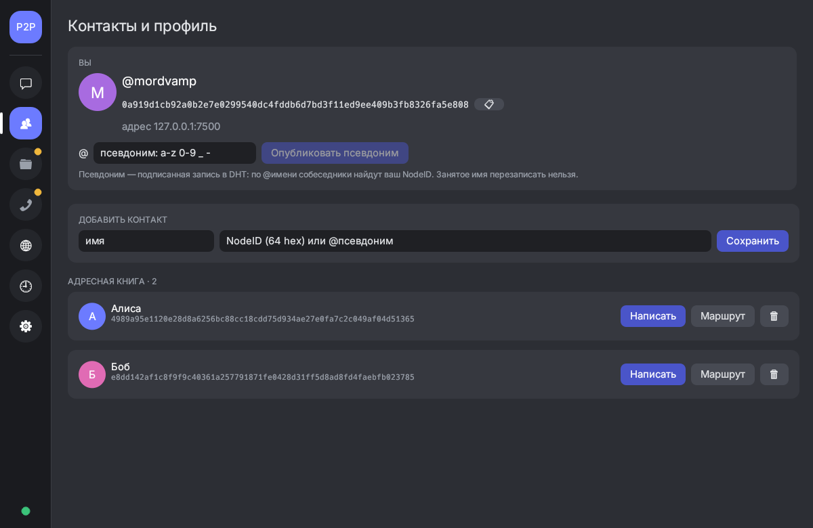
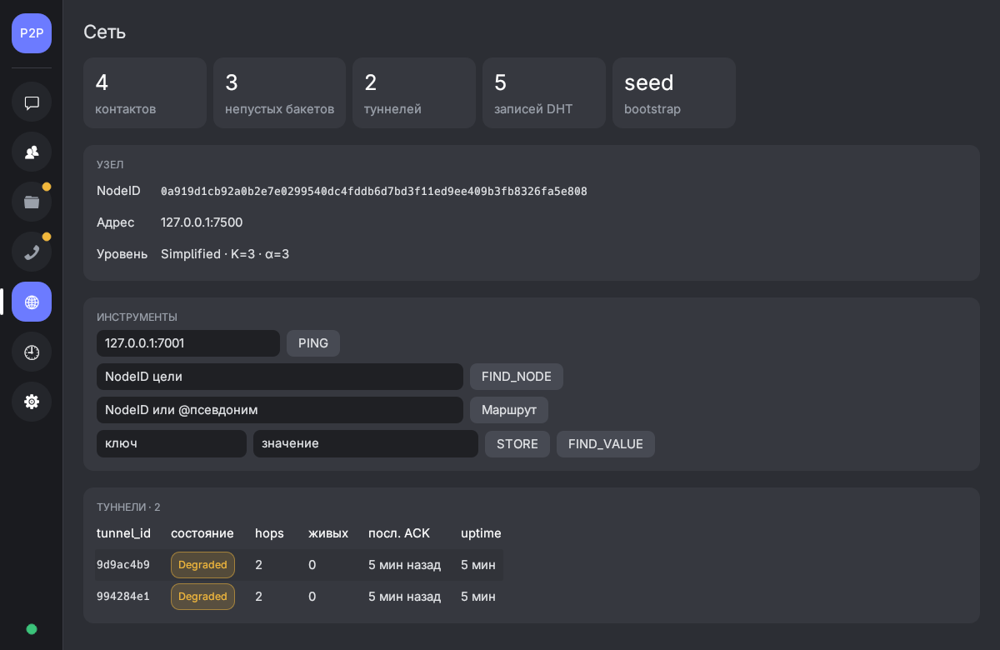

# Руководство пользователя

Все команды — из корня репозитория. Нужны: Rust 1.75+ (Linux/macOS), для настольного приложения — графический
сеанс (X11 или Wayland). Для сценариев экспериментов — Python 3, для графиков — matplotlib, для проверки pcap —
`dumpcap` (пакет wireshark-cli) с правом захвата на `lo`.

Содержание: [1. Сборка](#1-сборка-и-проверка) · [2. Быстрый старт](#2-быстрый-старт-переписка-за-пару-минут) ·
[3. Настольное приложение](#3-настольное-приложение-p2p-desktop) · [4. Узел из терминала](#4-узел-из-терминала) ·
[5. Веб-панель и HTTP API](#5-веб-панель-и-http-api) · [6. Оркестратор](#6-оркестратор-кластер-из-браузера) ·
[7. Эксперименты](#7-эксперименты) · [8. Конфигурация](#8-конфигурация) · [9. Данные и ключи](#9-данные-ключи-логи) ·
[10. Частые проблемы](#10-частые-проблемы)

## 1. Сборка и проверка

```bash
cargo build --bins             # узел p2p-node и оркестратор p2p-orchestrator
cargo build -p p2p-desktop     # настольное приложение (отдельно: тянет egui)
cargo test                     # все тесты узла (113)
bash scripts/run_tests.sh      # то же, с записью в logs/tests/
```

## 2. Быстрый старт: переписка за пару минут

Сообщение идёт через туннель минимум из **двух ретрансляторов**, поэтому в сети должно быть не меньше четырёх узлов:
отправитель, 2 relay, получатель.

```bash
cargo build --bins && cargo build -p p2p-desktop
bash scripts/run_star.sh 5 &                         # 5 узлов на 127.0.0.1:7001…7005 (seed — 7001)
./target/debug/p2p-desktop --profile alice &         # окно «P2P Overlay — alice»
./target/debug/p2p-desktop --profile bob &           # окно «P2P Overlay — bob»
```

В каждом окне — вкладка **⚙ Подключение**:

| Поле | alice | bob |
|---|---|---|
| Режим | Запустить свой узел | Запустить свой узел |
| Порт узла / порт API | 7600 / 7690 | 7601 / 7691 |
| Bootstrap-пиры | `127.0.0.1:7001` | `127.0.0.1:7001` |

Нажмите **▶ Запустить узел** (индикатор внизу слева станет зелёным). Затем на вкладке **👥 Контакты и профиль** опубликуйте
псевдоним (`alice`, `bob`). В окне alice на вкладке **💬 Чаты** введите `@bob` → **+** и отправьте сообщение: ✔✔ означает,
что bob расшифровал его, проверил подпись и прислал подтверждение (APP_ACK).

Остановить: закройте окна (узлы приложений остановятся сами), затем `kill %1` или `pkill -x p2p-node`.

## 3. Настольное приложение (`p2p-desktop`)

Отдельная программа поверх локального HTTP API узла: либо сама запускает `p2p-node` и управляет им, либо подключается
к уже работающему узлу (`p2p-node --gui-port …`). Узел при этом остаётся обычным процессом, а внутренности DHT, туннелей и
шифрования приложение не трогает.

```bash
cargo run -p p2p-desktop                      # профиль по умолчанию
cargo run -p p2p-desktop -- --profile bob     # второй пользователь на той же машине
```



### Вкладки

| Вкладка | Что делает |
|---|---|
| 💬 **Чаты** | Список бесед (история + адресная книга), счётчик непрочитанного. Новый чат — NodeID (64 hex) или `@псевдоним`. Статус сообщения: ⏳ отправляется, ✔✔ доставлено с APP_ACK (рядом RTT), ✖ не доставлено (причина — во всплывающей подсказке). Подсказка над доставленным сообщением показывает разбивку: lookup получателя, построение туннеля (или «уже был установлен»), проход по цепочке relay. Кнопка **Маршрут** рисует цепочку `Вы → relay → relay → получатель` с состоянием туннеля. |
| 👥 **Контакты и профиль** | Ваш NodeID (кнопка копирования — его и нужно передать собеседнику), адрес узла, публикация **псевдонима** (подписанная запись в DHT; занятое другим узлом имя не перезаписывается). Адресная книга: имя → NodeID, добавить по NodeID или `@псевдониму`. |
| 🗀 **Файлы** | Интерфейс передачи файлов. **Функция узла ещё не реализована** (план: §3 `docs/dev/plannow.md`); вкладка помечена жёлтой точкой, элементы неактивны, пока узел не сообщит `features.files = true`. |
| 📞 **Звонки** | Интерфейс группового голосового звонка (участники, микрофон, завершение). **Функция узла запланирована** (§5 плана), элементы неактивны до `features.calls = true`. |
| 🌐 **Сеть** | Счётчики (контакты, бакеты, туннели, записи DHT, время bootstrap), инструменты PING / FIND_NODE / маршрут / STORE / FIND_VALUE, таблицы туннелей, маршрутизации и хранилища DHT. |
| 🕘 **Журнал** | Локальная история отправки и приёма узла (`history.jsonl`) с фильтрами «исходящие / входящие / ошибки». Переживает перезапуск. |
| ⚙ **Подключение** | Режим (запустить свой узел / подключиться к работающему), путь к `p2p-node` (по умолчанию ищется рядом с приложением и в `target/`), порты, bootstrap-пиры, каталог состояния, автозапуск; журнал запущенного узла. |

<p>


</p>

### Как это устроено
- Опрос `/api/status` и `/api/history` — раз в 1.2 с в фоновом потоке; отправка и прочие действия — в отдельных потоках,
  окно не зависает, даже пока ждёт APP_ACK (до 8 с).
- Если на выбранном порту API уже отвечает узел (например, остался от прошлого запуска), приложение подключится к нему,
  а не будет запускать второй.
- Закрытие окна останавливает узел, запущенный приложением (SIGTERM, через 3 с — kill). Узел в режиме «подключиться»
  не трогается. Если само приложение убито (`kill`), его узел продолжит работать — при следующем запуске приложение
  подключится к нему (см. предыдущий пункт).
- Настройки и адресная книга: `~/.config/p2p-overlay-desktop/settings.json` (профиль `NAME` — `settings-NAME.json`).
  Ключ и история узла: `~/.local/share/p2p-overlay-desktop/[NAME/]node/` (`identity.key` = ваш NodeID, `history.jsonl`, `node.log`).
- Шрифт интерфейса — системный Adwaita Sans / Inter / Noto Sans / DejaVu Sans, если найден; иначе встроенный.

### Пользоваться по сети (не только localhost)
Узел слушает `0.0.0.0`, но анонсирует себя как `127.0.0.1` (стенд одной машины). Для нескольких машин в LAN задайте в
`config/node_config.yaml` `node.listen_host` = IP машины и откройте порт узла в межсетевом экране. Порт API остаётся только на
`127.0.0.1` — приложение подключается к узлу на своей машине.

## 4. Узел из терминала

```bash
cargo run --bin p2p-node -- [ОПЦИИ]
```

| Опция | Описание |
|---|---|
| `-c, --config <PATH>` | YAML-конфиг (по умолчанию `config/node_config.yaml`) |
| `-p, --port <PORT>` | переопределить `LISTEN_PORT` |
| `-b, --bootstrap <ADDR>` | bootstrap-пир `IP:PORT` (можно несколько) |
| `--gui-port <PORT>` | включить веб-панель и HTTP API на `127.0.0.1:<PORT>` (без флага выключены) |
| `--state-dir <DIR>` | каталог состояния (приватный ключ, история сообщений) |
| `--metrics-dir <DIR>` | каталог метрик |
| `--export-routing <FILE>` | выгрузить таблицу маршрутизации в JSON и выйти |

Первый узел запускается без `-b` (seed), остальные — с `-b <адрес seed>`. **Каждому узлу нужны свой порт и свой
`--state-dir`**, иначе узлы получат один и тот же ключ.

Минимальная сеть из 6 узлов с панелями:

```bash
P=./target/debug/p2p-node
$P -p 7301 --gui-port 8301 --state-dir state/n1 --metrics-dir metrics/n1 &
for i in 2 3 4 5 6; do
  $P -p 730$i -b 127.0.0.1:7301 --gui-port 830$i \
     --state-dir state/n$i --metrics-dir metrics/n$i &
  sleep 0.3
done
# сеть сходится за несколько секунд; остановить: pkill -x p2p-node
```

Уровень логов: `RUST_LOG=p2p_overlay=debug cargo run --bin p2p-node -- ...`.

## 5. Веб-панель и HTTP API

`http://127.0.0.1:<gui-port>/` — панель узла в браузере: статус и NodeID, таблица маршрутизации, туннели, хранилище DHT;
PING, FIND_NODE, построение туннеля, STORE/FIND, отправка сообщения. Те же функции — по HTTP (так работает и настольное
приложение). Изменяющие запросы — `POST`, параметры — в строке запроса:

| Запрос | Ответ / описание |
|---|---|
| `GET /api/status` | NodeID, адрес, таблица маршрутизации, туннели, хранилище, `bootstrap.join_ms`, `features` (что умеет узел) |
| `POST /api/ping?addr=IP:PORT` | PING по адресу, `rtt_ms` |
| `POST /api/lookup?target=<NodeID>` | итеративный FIND_NODE: `rpc_count`, `iterations`, `duration_ms`, опрошенные по итерациям |
| `POST /api/tunnel?target=<NodeID>` | построить туннель: `reused`, `build_ms` |
| `POST /api/store?key=...&value=...` | подписанная запись DHT с репликацией (R=3, кворум ≥2) |
| `GET /api/find?key=...` | поиск записи (проверяется подпись публикатора) |
| `POST /api/send?target=<NodeID или @псевдоним>&text=...` | отправить и **дождаться APP_ACK**: `delivered`, `message_id`, `rtt_ms`, `lookup_ms` (null — не понадобился), `tunnel_reused`, `tunnel_build_ms`, `tunnel_send_ms`, `rebuilt_after_failure` |
| `GET /api/history?limit=N` | локальная история: `dir` (out/in), `peer`, `status` (delivered/sent/failed/received), `text`, `rtt_ms`, `error`, разбивка задержки |
| `POST /api/alias?name=<имя>` | опубликовать свой псевдоним (`[a-z0-9_-]`, 1–32 символа) |
| `GET /api/resolve?alias=<имя>` | псевдоним → NodeID владельца (подпись проверяется) |
| `GET /api/inbox` | последние входящие (в памяти) |
| `GET /api/route?target=<NodeID или @псевдоним>` | диагностика маршрута: туннель, цепочка relay, состояние, давность последнего ACK |

API слушает только `127.0.0.1` и **не имеет аутентификации** — не пробрасывайте порт наружу.

```bash
B=$(curl -s localhost:8306/api/status | python3 -c "import sys,json;print(json.load(sys.stdin)['node_id'])")
curl -s -X POST "localhost:8306/api/alias?name=bob"
curl -s -X POST "localhost:8302/api/send?target=%40bob&text=hello"     # %40 = @
# {"delivered":true,"lookup_ms":22,"message_id":"…","rtt_ms":142,"tunnel_build_ms":11,"tunnel_reused":false,"tunnel_send_ms":19,…}
curl -s "localhost:8306/api/history?limit=5"
```

Первое сообщение собеседнику дольше (lookup + построение туннеля, у получателя — обратный туннель для APP_ACK);
следующие идут по установленной сессии без lookup.

## 6. Оркестратор (кластер из браузера)

```bash
cargo build --bins && cargo run --bin p2p-orchestrator -- --gui-port 8080
# http://127.0.0.1:8080/
```

Запуск N узлов (первый — seed, остальные знают только его адрес), остановка одного или всех, ссылки на панели узлов.

## 7. Эксперименты

```bash
bash scripts/run_acceptance.sh [N=13] [LOOKUPS=30]     # приёмка этапов 1–2 (Rust-оркестратор)
bash experiments/run_all.sh                            # сценарии 01–09 ТЗ §15.1 (~6 мин)
python3 scripts/scenarios.py 06 --nodes 12 --seed 2    # один сценарий
python3 scripts/scenarios.py pcap                      # в захвате трафика нет открытого текста
python3 scripts/analyze.py [experiments/results/accept_...]   # графики приёмки
```

Результат каждого сценария — `experiments/results/<сценарий>/<время>/`: `results.csv` (сырые наблюдения), `summary.md`
(n/min/max/медиана/среднее, p95 при n ≥ 20), `meta.json` (коммит, конфигурация, seed, N/k/α/R, тайм-ауты, граф bootstrap).
Подробно — [experiments/README.md](experiments/README.md). Логи узлов — `logs/` (вне git).

## 8. Конфигурация

`config/node_config.yaml`; ключевые параметры:

| Параметр | По умолчанию | Смысл |
|---|---|---|
| `dht.k_bucket_size` | 3 | размер корзины (simplified=3, advanced=4) |
| `dht.alpha` | 3 | параллелизм lookup |
| `dht.replication_factor` / `store_quorum` | 3 / 2 | STORE успешен при ≥2 из 3 реплик |
| `dht.ttl_seconds` / `republish_interval_seconds` | 180 / 80 | срок жизни записи (и псевдонима) и период переопубликования |
| `transport.connect_timeout_ms` / `read_timeout_ms` | 3000 / 5000 | тайм-ауты |
| `tunnel.min_relays` / `max_hops` | 2 / 5 | длина цепочки relay |
| `tunnel.ttl_seconds` | 600 | срок жизни маршрута на relay; туннель заменяется заранее, на 90% |
| `tunnel.ack_timeout_ms` | 5000 | тайм-аут TUNNEL_ACK; ×12 — окно «свежего» подтверждения (дольше — DEGRADED) |

Параметры меняются без правки кода; CLI-флаги `-p/-b/--state-dir` переопределяют файл.

## 9. Данные, ключи, логи

| Что | Где | В git? |
|---|---|---|
| Приватный ключ узла (= NodeID) | `<state-dir>/identity.key` (права 0600) | **нет** (`state/` в `.gitignore`) |
| История сообщений (тексты!) | `<state-dir>/history.jsonl` (права 0600) | нет |
| Настройки и адресная книга приложения | `~/.config/p2p-overlay-desktop/` | нет |
| Логи узлов и тестов | `logs/`, у приложения — `<state-dir>/node.log` | нет |
| Метрики узла | `<metrics-dir>/` | нет |
| Результаты приёмки, сценариев, контрольный pcap | `experiments/results/` | да (без ключей) |

Потеряли каталог состояния — узел получит **новый** NodeID (а псевдоним освободится через TTL). Не копируйте `state/` между машинами.

## 10. Частые проблемы

| Симптом | Причина / решение |
|---|---|
| `bind ...: Address already in use` / «Процесс узла завершился» в приложении | порт занят; выберите другой порт или `pkill -x p2p-node`. Журнал узла — вкладка «Подключение» |
| приложение: «Нет связи с узлом» | узел не запущен или другой порт API; проверьте вкладку «Подключение» |
| приложение: `не удалось запустить p2p-node` | соберите узел (`cargo build --bins`) или укажите путь к программе узла |
| у двух узлов одинаковый NodeID | общий `--state-dir` (или один профиль приложения); задайте отдельный каждому |
| `Failed to build tunnel ... Not enough relay candidates` | в сети меньше 4 узлов или сеть ещё не сошлась (несколько секунд) |
| `нет подтверждения доставки` | получатель выключен или недоступен; проверьте «Маршрут» / `/api/route` |
| `псевдоним «…» уже занят узлом …` | имя принадлежит другому узлу, пока его запись жива (TTL 180 с после ухода владельца) |
| туннель в состоянии DEGRADED | давно не было трафика — это не отказ; отказ обнаружится при отправке, и маршрут перестроится автоматически |
| `STORE: подтверждено 1 из 3 реплик` | в сети слишком мало узлов для кворума (нужно ≥2 реплик) |
| окно приложения не открывается под Wayland | попробуйте `WAYLAND_DISPLAY= ./target/debug/p2p-desktop` (X11 через XWayland) |
| графики не строятся | `pip install matplotlib` |
| `python3 scripts/scenarios.py pcap`: нет прав на захват | установите wireshark-cli и добавьте пользователя в группу `wireshark` (или запустите через `sudo`) |
