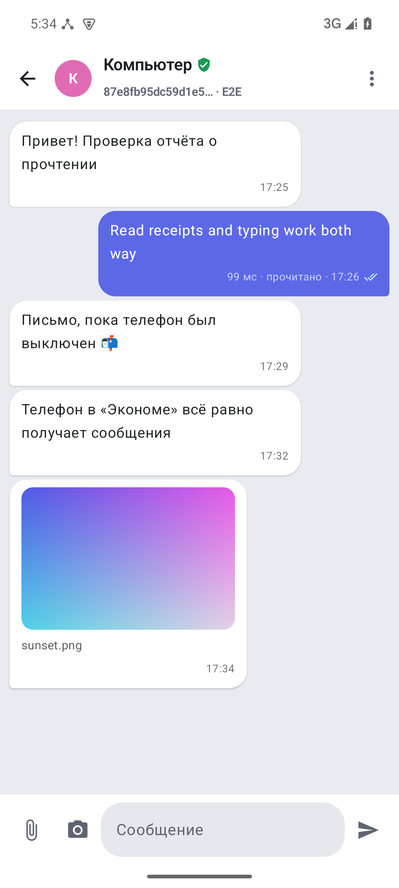
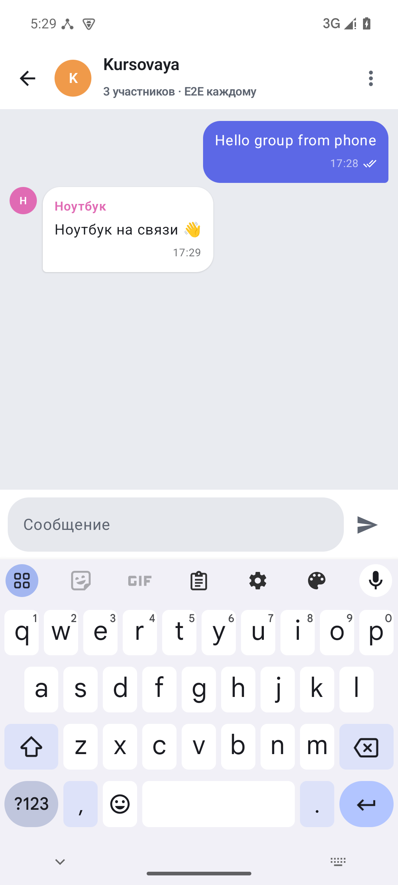
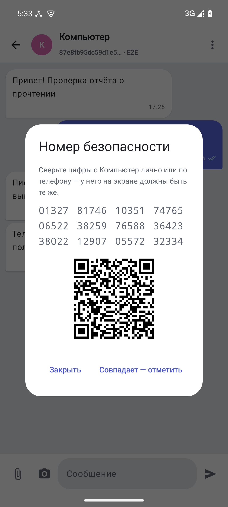
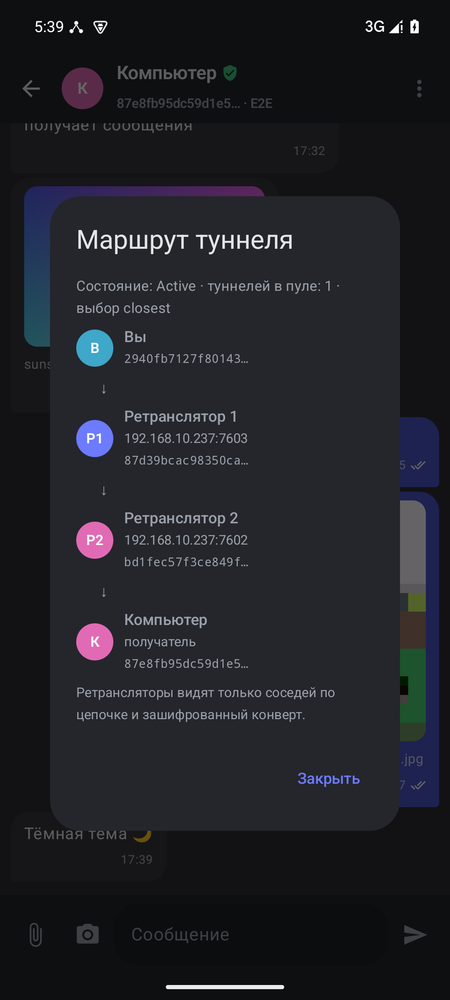

# Android-приложение P2P Overlay

Телефон — **полноправный узел оверлея**, а не пульт к компьютеру. В APK лежит тот же `p2p-node` (Rust), что и на компьютере,
собранный под `aarch64-linux-android` и `x86_64-linux-android`. Приложение запускает его в foreground-сервисе и общается с ним
через тот же локальный HTTP API (`127.0.0.1`), что веб-панель и `p2p-desktop`. Компьютер для телефона — просто ещё один пир:
DHT, туннели через ≥ 2 ретранслятора, TLS 1.3 или AKE, E2E-шифрование и APP_ACK работают так же, как между двумя ПК.

<p>




</p>

## Возможности
| Вкладка | Что делает |
|---|---|
| **Чаты** | Поиск; удаление долгим нажатием; **группы**; статусы ⏱ / ✔✔ (APP_ACK, RTT) / **прочитано** / 🕓 в почтовом ящике / ⚠; «печатает…»; файл 📎 и **фото с камеры** с превью; меню: маршрут туннеля, номер безопасности, переименовать, проверить ящики, удалить |
| **Файлы** | Отправка из системного выбора файла и через «Поделиться»; прогресс; превью картинок; открыть / переслать принятые (SHA-256 ✓) |
| **Сеть** | Пиры (отметка «клиент»), туннели (основной / резерв), таблица Kademlia, профили ретрансляторов, роль и режим узла |
| **Узел** | Старт / стоп / перезапуск, **сканер QR** компьютера, ссылка `p2p-overlay://`, `@псевдоним`, свой QR; **режим** Эконом / Обычный / Максимум, «только клиент», bootstrap, порт, TLS/AKE, LAN, автозапуск, уведомления; «печатает», отчёты о прочтении, блокировка, тема (системная / светлая / тёмная); журнал узла |

Уведомления о входящих — push через `/api/events` (один «долгий» запрос вместо опроса). Режимы и их цена — в
[USERGUIDE §4](../USERGUIDE.md#4-android-приложение).

## Сборка

Нужно: JDK 17+, Android SDK (platform 37, build-tools), Android NDK, Rust-цели для Android.

```bash
# 1. Rust-цели (rustup; системный Rust дистрибутива обычно без android-std)
rustup target add aarch64-linux-android x86_64-linux-android

# 2. Узел под Android → app/src/main/jniLibs/<abi>/libp2pnode.so
#    NDK берётся из ANDROID_NDK_HOME или $ANDROID_HOME/ndk/<последняя>
android/build_node.sh            # release, arm64-v8a + x86_64
android/build_node.sh release arm64-v8a   # только для телефона

# 3. APK (sdk.dir — в android/local.properties или ANDROID_HOME)
cd android && ./gradlew assembleDebug
adb install -r app/build/outputs/apk/debug/app-debug.apk
```

APK собираются отдельно на ABI плюс универсальный: `app-arm64-v8a-*.apk` — для телефона, `app-x86_64-*.apk` — для
эмулятора. Release (`./gradlew assembleRelease`) проходит R8: **≈ 5 МБ** на ABI (debug — ≈ 26 МБ) и заметно быстрее запуск.
Подпись release: `android/make_keystore.sh` создаёт свой ключ (`release.jks` + `keystore.properties`, оба вне git);
без него release подписывается debug-ключом и тоже ставится.

## Тесты
```bash
cargo test                                   # узел: 154 теста, из них 13 — tests/test_mobile_features.rs
cd android && ./gradlew testDebugUnitTest    # JVM: ссылка-приглашение, режимы (6)
./gradlew connectedDebugAndroidTest          # на устройстве/эмуляторе: вкладки, «Узел», новый чат (3)
```
CI: `.github/workflows/android.yml` — тесты узла, кросс-сборка узла, APK, JVM-тесты и инструментальные тесты в эмуляторе.

## Подключение к компьютеру

1. На компьютере: `cargo run -p p2p-desktop` → «Подключение»:
   - включить **«Локальная сеть»** — узел сообщит пирам свой LAN-адрес (`--advertise auto`), а не `127.0.0.1`;
   - **«Ретрансляторы» = 3** — туннелю нужно ≥ 2 промежуточных узла, а в сети «телефон + ПК» их больше нет;
   - «Запустить узел». Внизу появится карточка **«Подключить телефон»** с QR.
2. Телефон в той же сети Wi-Fi; порт узла ПК (по умолчанию 7600 и 7601–7603 у ретрансляторов) открыт в брандмауэре.
3. В приложении: «Узел» → **«Сканировать QR»** → «Подключить». Телефон берёт узел ПК как bootstrap, добавляет его
   в контакты и перезапускает свой узел; через пару секунд в заголовке — «в сети · N пиров».

Без desktop-приложения то же самое из терминала:
```bash
p2p-node -p 7600 --gui-port 7690 --advertise auto --state-dir state/pc
for i in 1 2 3; do p2p-node -p 760$i --advertise auto -b 127.0.0.1:7600 --state-dir state/h$i & done
curl -s http://127.0.0.1:7690/api/status | jq -r .link     # ссылку вставить в приложение
```

## Как это устроено
- `libp2pnode.so` — **исполняемый файл**, а не JNI-библиотека. Android (targetSdk ≥ 29) запрещает exec из каталога данных
  приложения, но разрешает из `nativeLibraryDir`; поэтому бинарник упакован как нативная библиотека
  (`useLegacyPackaging = true` — извлекается на диск при установке).
- `NodeService` — foreground-сервис (`specialUse`) + partial wake lock: узел — ретранслятор для чужих туннелей и должен
  отвечать на PING. Запускает `libp2pnode.so -c node_config.yaml -p … --gui-port … --state-dir files/node --channel …
  [--advertise <Wi-Fi IP>] [-b …]`, ждёт подъёма API, следит за процессом. Узел, оставшийся от убитого процесса
  приложения, при следующем запуске останавливается (PID в `files/node.pid`).
- Интерфейс (Jetpack Compose, Material 3, палитра desktop-клиента) опрашивает `/api/status`, `/api/history`, `/api/files`
  раз в 1.5 с; действия — `POST /api/send`, `/api/send_file`, `/api/alias`, `GET /api/resolve`.
- Для отправки файл из `content://` копируется в `cache/outgoing/` (узлу нужен путь) и удаляется после передачи.
  Принятые файлы — `files/node/downloads/`, наружу отдаются через `FileProvider`.
- HTTP разрешён только к `127.0.0.1` (`network_security_config.xml`); весь трафик между устройствами идёт через узел.
- **Токен API**: узел получает `P2P_API_TOKEN` через окружение и требует `X-Api-Token` на каждом `/api/*` — другие приложения
  телефона не могут управлять узлом (проверено: без токена — 401).
- **Ключ узла**: `P2P_IDENTITY_KEK` (32 байта, хранится обёрнутым ключом Android Keystore) — узел держит ключ только как
  `identity.key.enc`; открытый `identity.key` прежней версии при первом запуске шифруется и удаляется, NodeID не меняется.
- История и принятые файлы — в приватном каталоге приложения; `allowBackup=false`; блокировка приложения биометрией / PIN.
- **Смена сети**: `ConnectivityManager.NetworkCallback` — если адрес Wi-Fi изменился, узел перезапускается с новым
  `--advertise` (через 3 с, чтобы не реагировать на дребезг). В эмуляторе адрес не меняется, на устройстве не проверено.

## Проверка в эмуляторе
Эмулятор находится за NAT, поэтому узлы ПК не могут сами подключиться к узлу телефона. Пробросьте порт через adb
и оставьте в приложении «Доступен в локальной сети» выключенным: телефон анонсирует `127.0.0.1:7700`, и узлы ПК
попадут на него через проброс. На настоящем телефоне в той же Wi-Fi-сети ничего пробрасывать не нужно.
```bash
adb forward tcp:7700 tcp:7700     # P2P-порт приложения = 7700 (вкладка «Узел» → настройки)
```
(`adb emu redir` на образах с виртуальным Wi-Fi до узла не доходит — соединение принимается, но данные теряются.)

Проверено 11.11.2026 (эмулятор Android 15 x86_64 + 4 узла на ПК, TLS 1.3):
- сообщения в обе стороны с APP_ACK; PDF 1.18 МБ (29 блоков) ПК → телефон и телефон → ПК через «Поделиться», SHA-256 совпал;
- «печатает» и «прочитано» в обе стороны; группа из 3 узлов (телефон создал, ноутбук ответил);
- офлайн: телефон выключен → письмо легло в ящик DHT → через 9 с после включения получено и подтверждено;
- «Эконом»: соседи видят телефон с `relay=false`, цепочки ПК→ноутбук идут мимо него, сам он сообщения получает;
- токен API (без него 401), перенос `identity.key` → `identity.key.enc` с тем же NodeID, блокировка PIN;
- фото с камеры → ПК, превью картинок, номер безопасности совпадает с компьютерным, тёмная и светлая темы.

## Ограничения
- Телефон и ПК должны видеть друг друга по IP (одна сеть / VPN). NAT traversal, relay-сервер и мобильный интернет
  без белого адреса не поддерживаются — это свойство самого оверлея, не приложения.
- Канал (`tls` / `ake`) должен совпадать со всей сетью.
- Звонков нет (узел сообщает `features.calls = false`).
- Группы без управления составом: исключить участника нельзя (групповых ключей нет).
- Письмо в почтовом ящике живёт, пока узел отправителя в сети (republish).
- Android может остановить сервис при агрессивном энергосбережении производителя; узел перезапускается кнопкой
  «Запустить» или при открытии приложения (автозапуск).
