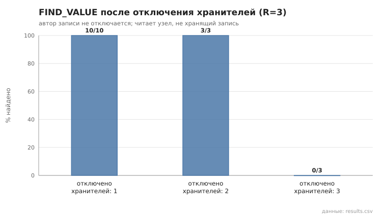
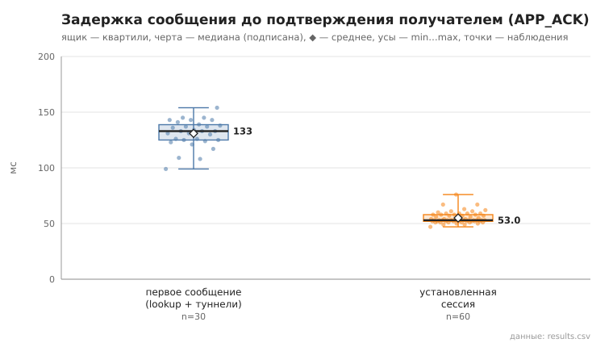
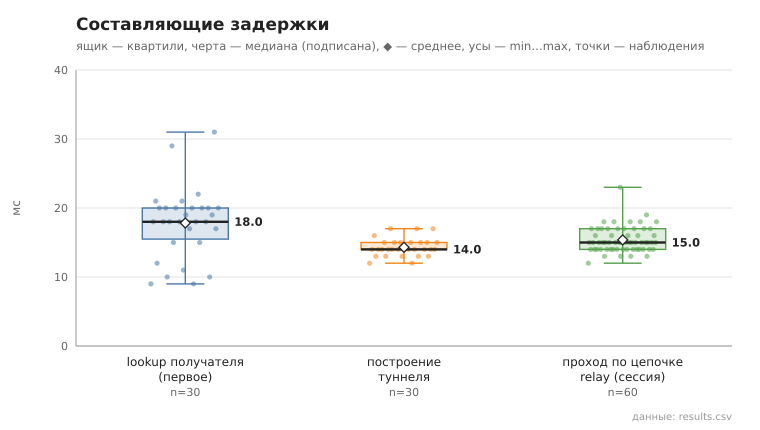
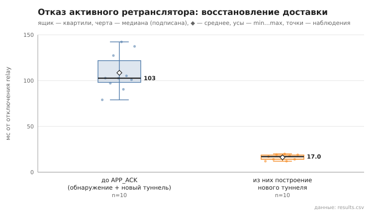

# Отчёт по эксперименту: сценарии 01–09 и проверка pcap

> **Данные:** `experiments/results/<сценарий>/20261102_*` — один прогон всех сценариев 2 ноября 2026.
> **Параметры:** N=15, k=3, α=3, R=3, `min_relays`=2, seed=1; код — коммит `6726459` + незакоммиченные изменения
> (sha256 diff в каждом `meta.json`).
> **Воспроизведение:** `bash experiments/run_all.sh` (≈ 5 мин), отдельный сценарий —
> `./target/debug/p2p-orchestrator scenario <NN>`, графики из сохранённых CSV — `./target/debug/p2p-orchestrator plot <каталог>`.
> В каждом каталоге: `results.csv` (сырые наблюдения), `summary.md`, `meta.json`, `plots/*.svg`, `node_logs/` (журналы узлов).

## 1. Стенд и метод

- **Узлы.** 15 отдельных процессов `p2p-node` на одной машине (localhost, debug-сборка). У каждого свой ключ, порт,
  таблица маршрутизации, хранилище и журнал. Все соединения между узлами идут через TLS 1.3 с взаимной аутентификацией;
  каждый RPC открывает новое соединение с полным рукопожатием (ADR-01).
- **Bootstrap.** Узлам передаётся только адрес bootstrap-узла: star — все к узлу 0, ring — узел i к узлу i−1.
  Оркестратор знает все NodeID, но узлам их не передаёт (§15.1).
- **Управление.** Драйвер `p2p-orchestrator scenario` (Rust, `src/experiment/`) запускает процессы и работает с ними только
  через локальный HTTP API узла — те же вызовы, что у пользователя.
- **Отказы.** Отказ — SIGKILL без корректного завершения. После каждой инъекции узел перезапускается с той же identity,
  чтобы условия следующей инъекции были одинаковыми.
- **Время.** Длительности, измеренные оркестратором, — по монотонным часам. Поля `*_ms` из API — часы самого узла:
  lookup, построение туннеля, проход кадра, bootstrap.
- **Статистика.** n / min / медиана / среднее / max; p95 — только при n ≥ 20 (§15.3).
- **Графики.** Ящик — квартили, черта — медиана, ◆ — среднее, усы — min…max; поверх показаны все наблюдения.

## 2. Сводка метрик §15.2

| Метрика | Значение (медиана; min…max) | n | Сценарий |
|---|---|---|---|
| Время холодной (операционной) сходимости | 4.8 с; 4.4…5.3 (star) | 5 запусков | 01 |
| Bootstrap отдельного узла (PING + self-lookup) | 33.5 мс; 16…178 | 70 | 01 |
| Длительность lookup, цель вне таблицы | 21 мс; 17…41, p95 41 | 30 | 02 |
| RPC на lookup / итераций | 5; 4…7 / 3; 3…3 | 30 | 02 |
| Доля успешных lookup | 100% (30/30); при 20% и 40% отключённых узлов — тоже 100% | 30 + 90 | 02, 05 |
| Время построения туннеля (2 relay) | 14 мс; 12…17, p95 17 | 30 | 06 |
| Первое сообщение, RTT до APP_ACK | 133 мс; 99…154, p95 145 | 30 | 06 |
| Установленная сессия, RTT до APP_ACK | 53 мс; 47…76, p95 63 | 60 | 06 |
| Восстановление доставки после отказа relay | 103 мс; 79…142 | 10 | 07 |

## 3. Сценарии

### 01. Холодный запуск и операционная сходимость
**Метод.** Пять независимых запусков сети из 15 узлов (star). Контрольный раунд — 15 lookup из заранее сформированного
набора пар. Сеть считается сошедшейся, когда два раунда подряд дают ≥95% успеха, а сумма контактов во всех таблицах
меняется не более чем на 10% (§15.1). Время отсчитывается от запуска первого процесса.

**Результат.** Сошлось 5/5 за 4.4–5.3 с, во всех запусках — уже за первые два раунда. Само время задаёт метод: запуск
15 процессов занимает 2.6 с, затем раунд, пауза 1 с и второй раунд. Bootstrap отдельного узла (PING bootstrap-узла и
self-lookup) — медиана 33.5 мс. У таблиц от 6 до 11 контактов при N−1 = 14, то есть ни один узел не знает всех.

**Вывод.** Сеть из 15 узлов становится операционной быстрее, чем метод способен это различить (≈ 4.5 с). Ограничивает
сходимость скорость запуска процессов, а не протокол: узлу хватает десятков миллисекунд на bootstrap. У времени bootstrap
в этом сценарии длинный хвост (до 178 мс в запусках 2–4), в сценарии 09 при том же методе максимум — 50 мс. Это шум
нагрузки машины, а не свойство протокола; поэтому в сравнениях указаны медианы.

### 02. FIND_NODE для цели, отсутствующей у инициатора
**Метод.** 30 lookup. Цель выбирается среди узлов, которых нет в текущей таблице инициатора (по данным самого узла).

**Результат.** Цель отсутствовала у инициатора во всех 30 случаях и найдена в 30/30. Длительность — медиана 21 мс,
p95 41; RPC — медиана 5 (4…7); итераций — 3 во всех случаях.

**Вывод.** Поиск распределённый и невырожденный: инициатор не знает цель, и её находят через промежуточные узлы за
3 итерации и около 5 RPC. Это согласуется с оценкой Kademlia O(log N): log₂ 15 ≈ 3.9. Задержку определяют TLS-рукопожатия:
3 итерации по 1–2 соединения дают ≈ 20 мс на локальной машине.

### 03. STORE / FIND_VALUE с тремя репликами
**Метод.** 30 операций: запись STORE на случайном узле, чтение FIND_VALUE с другого; фактические хранители проверяются по
состоянию хранилищ всех узлов.

**Результат.** STORE успешен 30/30, значение прочитано верно 30/30. Запись лежит ровно на 4 узлах во всех 30 случаях
(автор и 3 реплики). STORE (lookup ключа и 3 STORE) — медиана 73 мс; FIND_VALUE у читателя, не хранящего запись, — 39 мс.

**Вывод.** Репликация R=3 и кворум работают как задумано. Чтение дешевле записи, потому что FIND_VALUE останавливается
на первом хранителе.

### 04. Отключение хранителей
**Метод.** Запись публикует узел 0. Затем отключаются хранители-реплики (автор не трогается), а запись читает живой узел,
который её не хранит. Основной случай §15.1 — отключение одного хранителя (10 инъекций); отключение 2 и 3 хранителей
(по 3 инъекции) показывает границу отказоустойчивости.

**Результат.** Отключён 1 хранитель — найдено 10/10 (медиана 38 мс); отключены 2 — 3/3; отключены все 3 — 0/3.

**Вывод.** При R=3 запись переживает отказ одного и двух хранителей, но не трёх. Копия автора не помогает: автор не входит
в число ближайших к ключу узлов, и FIND_VALUE до него не доходит. Восстанавливает записи republish (каждые 80 с) — в
сценарии его не ждали.

### 05. Отключение промежуточных кандидатов lookup
**Метод.** Отключаются 0, 3 и 6 узлов из 15 (накопительно). Через 2 с, пока отключённые ещё числятся в таблицах
маршрутизации и попадают в кандидаты, выполняются 30 lookup между живыми узлами.

**Результат.** Успех 30/30 на каждом уровне. Медиана длительности — 20.5 / 20 / 13.5 мс, RPC — 5 / 4 / 3.

**Вывод.** Параллельные запросы (α=3) с обработкой ответов по мере поступления обходят мёртвых кандидатов: отказ соединения
приходит сразу и итерацию не задерживает. Lookup даже ускоряется — живых узлов меньше, путь короче. Отказ с долгим
тайм-аутом (узел молчит, а не отвергает соединение) здесь не моделировался — для этого нужен netem.

### 06. Построение туннеля и передача сообщений
**Метод.** 30 различных пар узлов, по 3 сообщения на пару. Первое сообщение пары строит туннель (lookup получателя и
TUNNEL_BUILD через 2 relay; получатель строит свой обратный туннель для APP_ACK). Следующие два идут по уже установленной
сессии без lookup. Доставка считается успешной только после подписанного APP_ACK от получателя.

**Результат.** Доставлено 90/90. Туннель строится за 14 мс (медиана). RTT до APP_ACK: первое сообщение — 133 мс,
установленная сессия — 53 мс. Кадр проходит цепочку relay до получателя за 15 мс (медиана). Повторных перестроений
маршрута не понадобилось.

**Вывод.** Первое сообщение примерно в 2.5 раза дороже последующих. Разницу дают lookup (18 мс), построение туннеля
(14 мс) и, главное, обратный путь: получатель тоже ищет отправителя и строит свой туннель для APP_ACK. В установленной
сессии ≈ 15 мс уходит на путь сообщения по цепочке и ≈ 15–20 мс на путь подтверждения; остальное — шифрование, подпись и
проверка на концах (расшифровка, проверка подписи, шифрование и подпись APP_ACK, обработка запроса API).

### 07. Отключение активного ретранслятора
**Метод.** Отправитель строит туннель (сообщение доставлено), затем один relay этого туннеля отключается — поочерёдно
первый и второй. Сообщение отправляется повторно до доставки (лимит 60 с). Время считается от отключения до APP_ACK.

**Результат.** Доставка восстановлена 10/10, каждый раз в той же отправке, без единой неудачной попытки. Новый маршрут ни
разу не содержал отключённый relay (10/10). Восстановление — медиана 103 мс (79…142), из них построение нового туннеля —
17 мс.

**Вывод.** Отказ обнаруживается той же отправкой: нет сквозного TUNNEL_ACK или relay отвечает ошибкой. Туннель сразу
помечается DEAD, строится новый без отказавшего узла, и кадр уходит повторно. Время восстановления сравнимо с первым
сообщением — по сути это и есть «первое сообщение» по новому маршруту. Проверка доступности без трафика (keepalive) не
нужна, но и отказ не обнаруживается, пока ничего не отправлено (ADR-21).

### 08. Негативные криптографические и replay-тесты
`cargo test --tests`: 114 тестов, все ok, из них 44 негативных (по имени): подмена ключа и NodeID, неверные подписи
записей и сообщений, изменённый шифртекст, эфемерный ключ и nonce, replay сообщений и APP_ACK, откат `sequence`,
TLS 1.2 / без сертификата / не-TLS, петли туннеля. Полный вывод — `cargo_test.txt`.

### 09. Сравнение bootstrap-схем star и ring
**Метод.** По 5 запусков каждой схемы при прочих равных (N, k, α, R, тайм-ауты, seed), критерий сходимости — как в 01.

**Результат.** Обе схемы сходятся 5/5 за 4.3–4.4 с. Bootstrap узла — медиана 24 мс (star) и 24.5 мс (ring). Контактов на
узел — 5…11 и 6…11, суммарно в среднем 132 и 131.

**Вывод.** При N=15 и k=3 различий нет. Первый же self-lookup выводит узел из «кольцевой» изоляции: соседу известны его
соседи, и за 2–3 итерации узел наполняет таблицу так же, как в схеме star. Отличие проявилось бы при большем N, потерях
на канале или одновременном старте всех узлов; это не проверялось. В star после сходимости bootstrap-узел уже не нужен:
lookup и FIND_VALUE работают и после его остановки (приёмка этапов 1–2).

### pcap: в трафике нет открытого текста
**Метод.** `dumpcap -i lo` на портах оверлея во время 5 сообщений и 5 STORE, содержащих уникальный маркер.

**Результат.** Маркера в захвате оверлея нет (600 КБ трафика); в ServerHello все 134 соединения согласовали TLS 1.3.
Положительный контроль — тот же маркер в открытом HTTP панели узла — находится, то есть метод поиска работает.

**Вывод.** Прикладные данные не видны ни на канале (TLS 1.3), ни ретрансляторам (E2E-конверт; проверено тестами 08).
Видны метаданные: кто с кем соединяется, размеры и время; это заявленное ограничение (THREAT_MODEL).

## 4. Дефекты, найденные экспериментом

Эксперимент проверял и сами реализации. Все три дефекта найдены на живых узлах; модульные тесты их не ловили.

| Где проявилось | Дефект | Исправление |
|---|---|---|
| Живой тест «сообщение — пауза 25 с — сообщение» | после простоя туннель ложно помечался DEAD и «восстанавливался» к последнему relay вместо получателя; доставка прекращалась навсегда | живость по сквозному TUNNEL_ACK, перестроение при отправке (ADR-21) |
| 07 | relay после перезапуска терял маршрут и подтверждал чужие кадры как получатель — отправитель не узнавал об обрыве | без маршрута кадр подтверждается, только если E2E-конверт адресован этому узлу (ADR-21) |
| 04 (N=15) | lookup включал в результат самого инициатора; при STORE копия автора засчитывалась как реплика, и кворум 2 из 3 мог выполниться без второго узла | lookup исключает свой NodeID (ADR-26, `tests/test_lookup_self.rs`) |

После третьего исправления весь прогон повторён; данные выше сняты на исправленном коде. Предыдущий прогон
(`*/20261029_*`, N=12, Python-драйвер) снят до него: у него выше RPC на lookup и в 04 встречаются записи с двумя
репликами вместо трёх.

## 5. Общие выводы

1. **Поиск распределённый и устойчивый.** Цель, неизвестная инициатору, находится за 3 итерации и около 5 RPC. Отключение
   40% узлов не снижает успех lookup. Таблицы узлов не вырождены: 6–11 контактов при N−1 = 14.
2. **Хранение выдерживает R−1 отказ.** Запись переживает отказ одного и двух хранителей из трёх; при отказе всех трёх
   теряется до ближайшего republish.
3. **Доставка идёт только через туннель и восстанавливается автоматически.** 90/90 сообщений через 2 relay с подтверждением
   получателя; после отказа relay доставка восстанавливается за ≈ 0.1 с в той же отправке, и новый маршрут отказавший узел
   не содержит.
4. **Стоимость защиты — рукопожатия.** На localhost время почти целиком определяется числом новых TLS-соединений: lookup
   ≈ 20 мс, сообщение по установленной сессии ≈ 50 мс, первое ≈ 130 мс. Пул соединений сократил бы это кратно (ADR-01).
5. **Схема bootstrap при N=15 не важна:** star и ring неразличимы по всем метрикам.

## 6. Ограничения (угрозы валидности)

- Все узлы на одной машине: нет сетевых задержек и потерь, результаты — нижняя граница задержек; debug-сборка.
- Сходимость измерена с разрешением 1 с и упирается в нижнюю границу метода — сравнивать её значения бессмысленно, важен
  факт сходимости.
- Один прогон каждого сценария с одним seed. Объёмы наблюдений соответствуют §15.3, но разброс между прогонами не оценивался;
  предыдущий прогон (N=12) дал те же качественные результаты.
- Отказ моделируется SIGKILL: соединение с мёртвым узлом сразу отвергается. «Молчащий» узел (тайм-аут) и потери пакетов
  требуют netem и root (продвинутый уровень, сценарий 10).
- Метаданные трафика (кто с кем, размеры, время) не скрываются — анонимность не заявляется.
