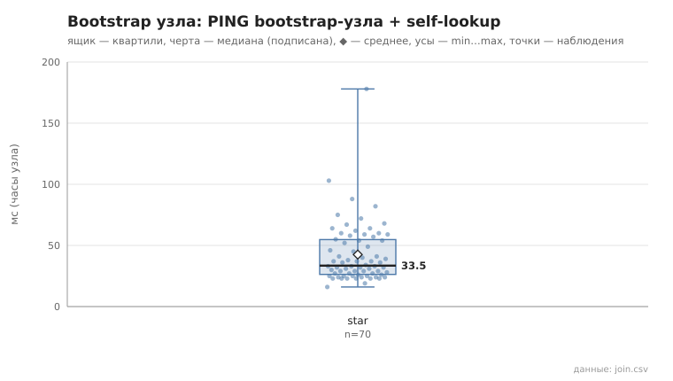
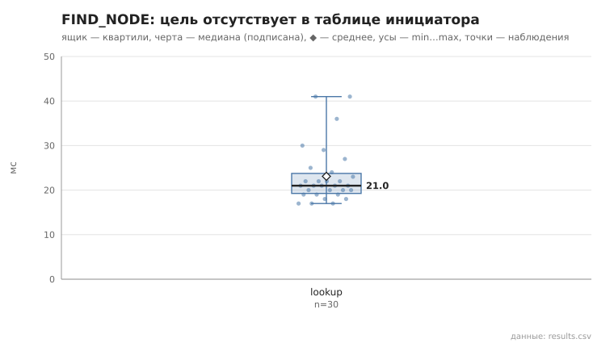
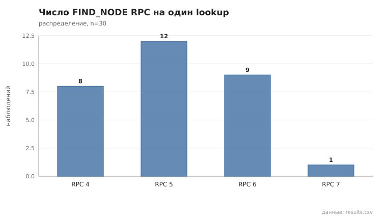
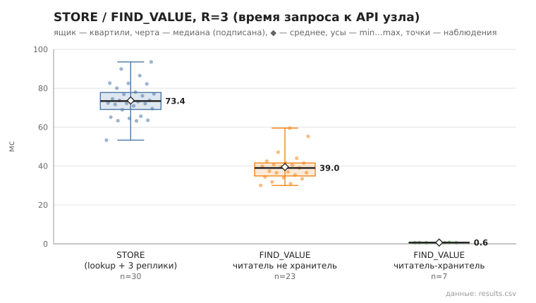
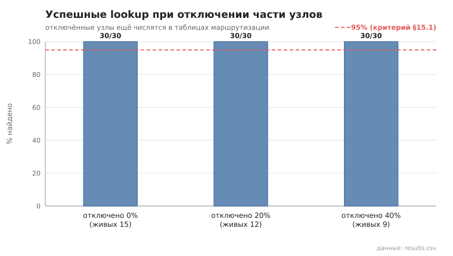
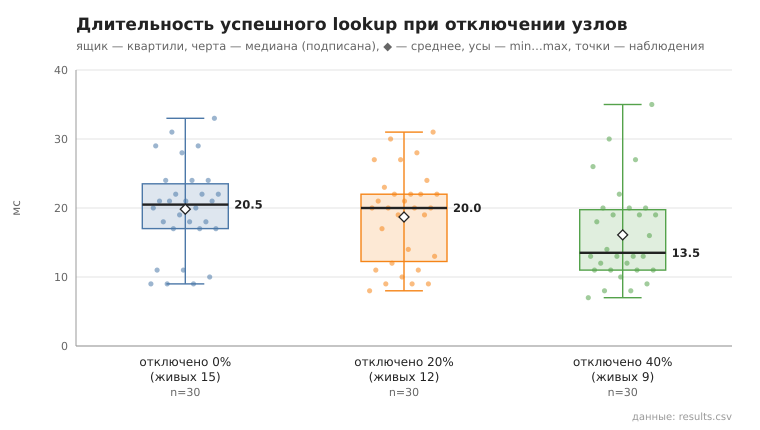
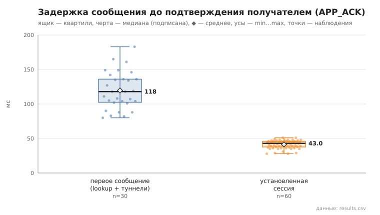
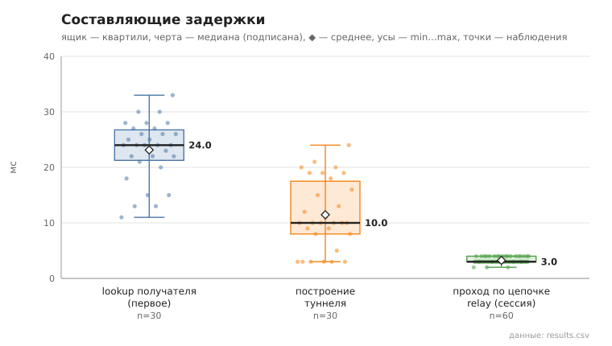
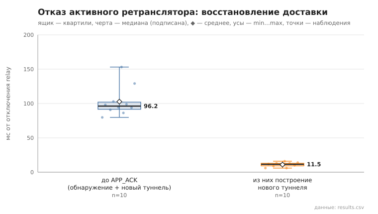
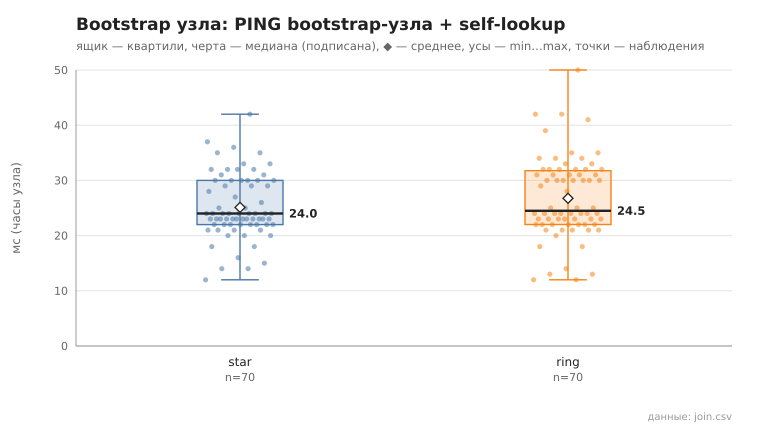

# Отчёт по эксперименту: упрощённый и продвинутый уровни, проверка pcap

> **Данные:** упрощённый уровень — `experiments/results/<сценарий>/20261102_*` (01–05, 09; 2 ноября 2026) и
> `20261111_22*` (06, 07, 08, failover, pcap — 11 ноября, после перехода на пул соединений для туннелей, ADR-41);
> продвинутый — `*_advanced` (DHT — 02.11, туннели, failover, strategy, files, channel — 11.11); сравнения на release —
> `*_release`; режимы соединений — `*_per_request_release`, `*_pool_all_release`, `media_stream/20261111_221155_release`.
> **Параметры:** упрощённый — N=15, k=3, α=3, R=3, `min_relays`=2; продвинутый — N=21, k=4, 3 relay, пул из 3 туннелей,
> выбор `rating`; seed=1; код — коммит и sha256 незакоммиченного diff в каждом `meta.json` (там же поле `connections`).
> **Воспроизведение:** `bash experiments/run_all.sh` (≈ 5 мин), отдельный сценарий —
> `./target/debug/p2p-orchestrator scenario <NN>`, графики из сохранённых CSV — `./target/debug/p2p-orchestrator plot <каталог>`.
> В каждом каталоге: `results.csv` (сырые наблюдения), `summary.md`, `meta.json`, `plots/*.svg`, `node_logs/` (журналы узлов).

## 1. Стенд и метод

- **Узлы.** 15 (продвинутый уровень — 21) отдельных процессов `p2p-node` на одной машине (localhost, debug-сборка). У
  каждого свой ключ, порт, таблица маршрутизации, хранилище и журнал. Все соединения между узлами — TLS 1.3 с взаимной
  аутентификацией (или собственное рукопожатие AKE в сценарии `channel`). Запросы DHT открывают новое соединение с полным
  рукопожатием (ADR-01); трафик туннелей с 11.11 идёт по пулу соединений к соседям по цепочке (ADR-39…41).
- **Bootstrap.** Узлам передаётся только адрес bootstrap-узла: star — все к узлу 0, ring — узел i к узлу i−1.
  Оркестратор знает все NodeID, но узлам их не передаёт (§15.1).
- **Управление.** Драйвер `p2p-orchestrator scenario` (Rust, `src/experiment/`) запускает процессы и работает с ними только
  через локальный HTTP API узла — те же вызовы, что у пользователя.
- **Отказы.** Отказ — SIGKILL без корректного завершения. После каждой инъекции узел перезапускается с той же identity,
  чтобы условия следующей инъекции были одинаковыми.
- **Время.** Длительности, измеренные оркестратором, — по монотонным часам. Поля `*_ms` из API — часы самого узла:
  lookup, построение туннеля, проход кадра, bootstrap.
- **Статистика.** n / min / медиана / среднее / max; p95 — только при n ≥ 20 (§15.3).
- **Графики.** Ящик — квартили, черта — медиана, ◆ — среднее, усы — min…max; поверх показаны все наблюдения.

## 2. Сводка метрик §15.2

| Метрика | Значение (медиана; min…max) | n | Сценарий |
|---|---|---|---|
| Время холодной (операционной) сходимости | 4.8 с; 4.4…5.3 (star) | 5 запусков | 01 |
| Bootstrap отдельного узла (PING + self-lookup) | 33.5 мс; 16…178 | 70 | 01 |
| Длительность lookup, цель вне таблицы | 21 мс; 17…41, p95 41 | 30 | 02 |
| RPC на lookup / итераций | 5; 4…7 / 3; 3…3 | 30 | 02 |
| Доля успешных lookup | 100% (30/30); при 20% и 40% отключённых узлов — тоже 100% | 30 + 90 | 02, 05 |
| Время построения туннеля (2 relay) | 10 мс; 3…24, p95 21 | 30 | 06 |
| Первое сообщение, RTT до APP_ACK | 118 мс; 80…183, p95 165 | 30 | 06 |
| Установленная сессия, RTT до APP_ACK | 43 мс; 28…51, p95 48 | 60 | 06 |
| Восстановление доставки после отказа relay | 96 мс; 80…153 | 10 | 07 |

## 3. Сценарии

### 01. Холодный запуск и операционная сходимость
**Метод.** Пять независимых запусков сети из 15 узлов (star). Контрольный раунд — 15 lookup из заранее сформированного
набора пар. Сеть считается сошедшейся, когда два раунда подряд дают ≥95% успеха, а сумма контактов во всех таблицах
меняется не более чем на 10% (§15.1). Время отсчитывается от запуска первого процесса.

**Результат.** Сошлось 5/5 за 4.4–5.3 с, во всех запусках — уже за первые два раунда. Само время задаёт метод: запуск
15 процессов занимает 2.6 с, затем раунд, пауза 1 с и второй раунд. Bootstrap отдельного узла (PING bootstrap-узла и
self-lookup) — медиана 33.5 мс. У таблиц от 6 до 11 контактов при N−1 = 14, то есть ни один узел не знает всех.

**Вывод.** Сеть из 15 узлов становится операционной быстрее, чем метод способен это различить (≈ 4.5 с). Ограничивает
сходимость скорость запуска процессов, а не протокол: узлу хватает десятков миллисекунд на bootstrap. У времени bootstrap
в этом сценарии длинный хвост (до 178 мс в запусках 2–4), в сценарии 09 при том же методе максимум — 50 мс. Это шум
нагрузки машины, а не свойство протокола; поэтому в сравнениях указаны медианы.

### 02. FIND_NODE для цели, отсутствующей у инициатора
**Метод.** 30 lookup. Цель выбирается среди узлов, которых нет в текущей таблице инициатора (по данным самого узла).

**Результат.** Цель отсутствовала у инициатора во всех 30 случаях и найдена в 30/30. Длительность — медиана 21 мс,
p95 41; RPC — медиана 5 (4…7); итераций — 3 во всех случаях.

**Вывод.** Поиск распределённый и невырожденный: инициатор не знает цель, и её находят через промежуточные узлы за
3 итерации и около 5 RPC. Это согласуется с оценкой Kademlia O(log N): log₂ 15 ≈ 3.9. Задержку определяют TLS-рукопожатия:
3 итерации по 1–2 соединения дают ≈ 20 мс на локальной машине.

### 03. STORE / FIND_VALUE с тремя репликами
**Метод.** 30 операций: запись STORE на случайном узле, чтение FIND_VALUE с другого; фактические хранители проверяются по
состоянию хранилищ всех узлов.

**Результат.** STORE успешен 30/30, значение прочитано верно 30/30. Запись лежит ровно на 4 узлах во всех 30 случаях
(автор и 3 реплики). STORE (lookup ключа и 3 STORE) — медиана 73 мс; FIND_VALUE у читателя, не хранящего запись, — 39 мс.

**Вывод.** Репликация R=3 и кворум работают как задумано. Чтение дешевле записи, потому что FIND_VALUE останавливается
на первом хранителе.

### 04. Отключение хранителей
**Метод.** Запись публикует узел 0. Затем отключаются хранители-реплики (автор не трогается), а запись читает живой узел,
который её не хранит. Основной случай §15.1 — отключение одного хранителя (10 инъекций); отключение 2 и 3 хранителей
(по 3 инъекции) показывает границу отказоустойчивости.

**Результат.** Отключён 1 хранитель — найдено 10/10 (медиана 38 мс); отключены 2 — 3/3; отключены все 3 — 0/3.

**Вывод.** При R=3 запись переживает отказ одного и двух хранителей, но не трёх. Копия автора не помогает: автор не входит
в число ближайших к ключу узлов, и FIND_VALUE до него не доходит. Восстанавливает записи republish (каждые 80 с) — в
сценарии его не ждали.

### 05. Отключение промежуточных кандидатов lookup
**Метод.** Отключаются 0, 3 и 6 узлов из 15 (накопительно). Через 2 с, пока отключённые ещё числятся в таблицах
маршрутизации и попадают в кандидаты, выполняются 30 lookup между живыми узлами.

**Результат.** Успех 30/30 на каждом уровне. Медиана длительности — 20.5 / 20 / 13.5 мс, RPC — 5 / 4 / 3.

**Вывод.** Параллельные запросы (α=3) с обработкой ответов по мере поступления обходят мёртвых кандидатов: отказ соединения
приходит сразу и итерацию не задерживает. Lookup даже ускоряется — живых узлов меньше, путь короче. Отказ с долгим
тайм-аутом (узел молчит, а не отвергает соединение) здесь не моделировался — для этого нужен netem.

### 06. Построение туннеля и передача сообщений
**Метод.** 30 различных пар узлов, по 3 сообщения на пару. Первое сообщение пары строит туннель (lookup получателя и
TUNNEL_BUILD через 2 relay; получатель строит свой обратный туннель для APP_ACK). Следующие два идут по уже установленной
сессии без lookup. Доставка считается успешной только после подписанного APP_ACK от получателя.

**Результат** (`20261111_221343`). Доставлено 90/90. Туннель строится за 10 мс (медиана). RTT до APP_ACK: первое
сообщение — 118 мс, установленная сессия — 43 мс. Кадр проходит цепочку relay до получателя за 3 мс (медиана).
Повторных перестроений маршрута не понадобилось. Прогон 02.11 (соединение на каждый запрос): 133 / 53 мс, проход — 15 мс.

**Вывод.** Первое сообщение примерно в 2.7 раза дороже последующих. Разницу дают lookup (24 мс), построение туннеля
(10 мс) и, главное, обратный путь: получатель тоже ищет отправителя и строит свой туннель для APP_ACK. В установленной
сессии путь по цепочке — ≈ 3 мс в каждую сторону (соединения с ретрансляторами открыты); остальное — шифрование, подпись и
проверка на концах в debug-сборке (в release сессия занимает 3 мс целиком).

### 07. Отключение активного ретранслятора
**Метод.** Отправитель строит туннель (сообщение доставлено), затем один relay этого туннеля отключается — поочерёдно
первый и второй. Сообщение отправляется повторно до доставки (лимит 60 с). Время считается от отключения до APP_ACK.

**Результат** (`20261111_221355`). Доставка восстановлена 10/10, каждый раз в той же отправке, без единой неудачной
попытки. Новый маршрут ни разу не содержал отключённый relay (10/10). Восстановление — медиана 96 мс (80…153), из них
построение нового туннеля — 11,5 мс.

**Вывод.** Отказ обнаруживается той же отправкой: нет сквозного TUNNEL_ACK или relay отвечает ошибкой. Туннель сразу
помечается DEAD, строится новый без отказавшего узла, и кадр уходит повторно. Время восстановления сравнимо с первым
сообщением — по сути это и есть «первое сообщение» по новому маршруту. Проверка доступности без трафика (keepalive) не
нужна, но и отказ не обнаруживается, пока ничего не отправлено (ADR-21).

### 08. Негативные криптографические и replay-тесты
`cargo test --tests` (`20261112_190110`): 197 тестов, все ok, из них 65 негативных (по имени): подмена ключа и NodeID,
неверные подписи записей и сообщений, изменённый шифртекст, эфемерный ключ и nonce, replay сообщений и APP_ACK, откат
`sequence`, TLS 1.2 / без сертификата / не-TLS, подмена полей и повтор записей собственного рукопожатия, петли туннеля,
файлы с обходом каталога, групповое сообщение не от участника, ретрансляция узлом «только клиент», подменённый или чужой медиакадр звонка, слабый одноразовый ключ звонка. Полный вывод — `cargo_test.txt`.

### 09. Сравнение bootstrap-схем star и ring
**Метод.** По 5 запусков каждой схемы при прочих равных (N, k, α, R, тайм-ауты, seed), критерий сходимости — как в 01.

**Результат.** Обе схемы сходятся 5/5 за 4.3–4.4 с. Bootstrap узла — медиана 24 мс (star) и 24.5 мс (ring). Контактов на
узел — 5…11 и 6…11, суммарно в среднем 132 и 131.

**Вывод.** При N=15 и k=3 различий нет. Первый же self-lookup выводит узел из «кольцевой» изоляции: соседу известны его
соседи, и за 2–3 итерации узел наполняет таблицу так же, как в схеме star. Отличие проявилось бы при большем N, потерях
на канале или одновременном старте всех узлов; это не проверялось. В star после сходимости bootstrap-узел уже не нужен:
lookup и FIND_VALUE работают и после его остановки (приёмка этапов 1–2).

### pcap: в трафике нет открытого текста
**Метод.** `dumpcap -i lo` на портах оверлея во время 5 сообщений и 5 STORE, содержащих уникальный маркер.

**Результат.** Маркера в захвате оверлея нет ни с TLS 1.3 (`20261111_222104`: 550 КБ, во всех 128 ServerHello —
TLS 1.3), ни с собственным рукопожатием (`20261111_222051_ake`: 429 КБ, tshark видит только непрозрачные данные — записи
AEAD). Положительный контроль — тот же маркер в открытом HTTP панели узла — находится, то есть метод поиска работает.

**Вывод.** Прикладные данные не видны ни на канале (TLS 1.3), ни ретрансляторам (E2E-конверт; проверено тестами 08).
Видны метаданные: кто с кем соединяется, размеры и время; это заявленное ограничение (THREAT_MODEL).

## 3а. Продвинутый уровень (N = 21, k = 4, 3 relay, пул из 3 туннелей)

**DHT** (`*/20261102_*_advanced`): сходимость star — 6,1 с (5/5); lookup — 35,5 мс, 8 RPC, 3 итерации; STORE — 93,7 мс,
FIND_VALUE — 53,7 мс; отказ хранителей 1 / 2 / 3 — 10/10, 3/3, 0/3; lookup при 0 / 20 / 40% отключённых — 30/30, 30/30,
27/30; star, ring, tree, multi-seed — 5/5 каждая за 6,0–6,1 с.

**Туннели** (`*/20261111_22*_advanced`): 90/90 сообщений через 3 relay; первое — 143,5 мс, сессия — 42,5 мс; отказ relay —
10/10 за 61 мс, по резервному туннелю пула (нового построения не было).

### failover: пул туннелей
| Пул | Как восстановлено | Обнаружение | Переключение / новый туннель | Восстановление, медиана (min…max) |
|---|---|---|---|---|
| 1 (`20261111_222459`, N=15) | перестроение 10/10 | 1,5 мс | новый туннель 13 мс | 95,0 мс (78,1…129,3) |
| 3 (`20261111_221514_advanced`) | резервный 10/10 | 2,0 мс | переключение 22,5 мс | 68,3 мс (61,1…88,4) |

**Вывод.** Резервный туннель убирает из восстановления lookup и построение — восстановление на 28% быстрее и с меньшим
разбросом.

### strategy: выбор ретрансляторов (`20261111_221942_advanced`)
5 из 21 узла отвечают ошибкой с вероятностью 0,5; одни и те же отправители, получатели и неисправные узлы; по 60 сообщений.

| Стратегия | Доставлено | Без отказа на пути | Переключений / перестроений | RTT, медиана; p95 |
|---|---|---|---|---|
| closest | 57/60 | 67% | 5 / 12 | 47 мс; 195 мс |
| random | 60/60 | 78% | 7 / 6 | 47 мс; 178 мс |
| rating | 60/60 | 97% | 1 / 1 | 46 мс; 141 мс |

**Вывод.** `closest` раз за разом берёт одних и тех же ближайших к получателю узлов, и неисправный среди них попадает
почти в каждый туннель. `rating` по профилю кандидата обходит неисправные узлы — почти без отказов на пути и с самым
коротким хвостом задержки.

### files: передача файлов (`20261111_221634_advanced`, `20261111_222641_advanced_release`)
| Размер | Доставлено, SHA-256 | Goodput debug / release, МиБ/с | Служебная доля |
|---|---|---|---|
| 100 КиБ | 5/5 | 0,2 / 2,1 | 2,9% |
| 1 МиБ | 5/5 | 0,3 / 6,1 | 1,5% |
| 10 МиБ | 5/5 | 0,3 / 7,1 | 1,4% |

**Вывод.** Повторов блоков нет (на стенде нет потерь); служебная доля падает с размером до 1,4%. Скорость в debug
ограничена неоптимизированной криптографией на каждом блоке — в release в 20 раз выше.

### channel: собственное рукопожатие и TLS 1.3 (`channel_compare/20261111_221602_advanced`, `20261111_220821_advanced_release`)
| Медиана, мс | TLS debug | AKE debug | TLS release | AKE release |
|---|---|---|---|---|
| PING по новому соединению | 9 | 32 | 2 | 1 |
| lookup | 27 | 102 | 6 | 5 |
| первое сообщение | 158 | 466 | 26 | 25 |
| установленная сессия | 43,5 | 51 | 3 | 3 |

**Вывод.** В release варианты неразличимы. В debug AKE в 3–4 раза медленнее: у TLS криптография ring оптимизирована и в
debug, у AKE — реализации на чистом Rust без оптимизаций. Сравнения, зависящие от криптографии, нужно делать на release.

## 3б. Способ соединений между узлами (release, N = 15)
| Медиана, мс | На каждый запрос | Пул для туннелей (по умолчанию) | Всё через пул |
|---|---|---|---|
| lookup (02) | 5,0 | 5,0 | 2,5 |
| первое сообщение (06) | 24 | 17,5 | 9 |
| установленная сессия (06) | 7 | 3 | 3 |
| восстановление (07), 10/10 | 19,3 | 13,8 | 7,1 |
| голосовой поток (`media`), в одну сторону; p95 | 4,5; 5,3 | 1,6; 1,9 | 1,6; 2,0 |

**Вывод.** Пул для туннелей даёт для сессии и потока то же, что «всё через пул», и не меняет DHT — поэтому результаты
01–05 и 09 действительны в обоих режимах. Подробности — `docs/dev/TRANSPORT_OPTIONS.md` §7–9.

### call: звонок поверх туннеля (`call_stream/20261111_225806_release`, `20261111_225842`)
**Метод.** 5 звонков между случайными парами (N = 15, пул для туннелей): CallOffer → CallAnswer, затем 250 кадров по
80 байт каждые 20 мс кадрами TUNNEL_MEDIA, зашифрованными ключом звонка; общие часы стенда.

| Сборка | Установление, медиана | В одну сторону, медиана / p95 | Джиттер | Потери / отвергнуто |
|---|---|---|---|---|
| release | 72 мс | 0,6 / 0,9 мс | < 0,1 мс | 0 / 0 |
| debug | 185 мс | 1,9 / 2,4 мс | 0,2 мс | 0 / 0 |

**Вывод.** Кадр без подтверждения и с одним AEAD вместо X25519 + Ed25519 в 2,7 раза быстрее потока `media` в release и
в 12 раз — в debug (24 → 1,9 мс); очередь не растёт. Подробности — `docs/dev/TRANSPORT_OPTIONS.md` §7а.

### voice: звук звонка, 1:1 и групповой (`voice_call/20261112_124521_release`, `20261112_124741`)
**Метод.** N = 15; 10 звонков 1:1 и 5 групповых по 3 участника между случайными узлами. Каждый участник 6 с играет свой
тон (440 / 554 / 660 Гц) тестовым источником узла вместо микрофона → Opus → ключ звонка → TUNNEL_MEDIA → джиттер-буфер,
FEC / маскировка → смешивание. Проверка — алгоритм Гёрцеля по принятому: слышны ровно тоны собеседников.

| Сборка | Слышно верно | Установление, медиана | Буфер | «Рот — ухо» | Слышимые потери | MOS |
|---|---|---|---|---|---|---|
| release | 15/15 | 62 мс | 40 мс | 68 мс | 0% | 4,1 |
| debug | 15/15 | 315 мс | 49 мс | 81 мс | 0% | 4,1 |

**Вывод.** Задержка «рот — ухо» в 2 раза меньше порога 150 мс (ITU-T G.114) даже на debug-сборке; групповой звонок
«каждый с каждым» на 3 участника не хуже звонка 1:1. MOS — по упрощённой E-модели с допущением Ie = 10 для Opus.

## 4. Дефекты, найденные экспериментом

Эксперимент проверял и сами реализации. Все дефекты найдены на живых узлах; модульные тесты их не ловили.

| Где проявилось | Дефект | Исправление |
|---|---|---|
| Живой тест «сообщение — пауза 25 с — сообщение» | после простоя туннель ложно помечался DEAD и «восстанавливался» к последнему relay вместо получателя; доставка прекращалась навсегда | живость по сквозному TUNNEL_ACK, перестроение при отправке (ADR-21) |
| 07 | relay после перезапуска терял маршрут и подтверждал чужие кадры как получатель — отправитель не узнавал об обрыве | без маршрута кадр подтверждается, только если E2E-конверт адресован этому узлу (ADR-21) |
| 07 (11.11, перепрогон) | при k = 3 у недавно вошедшего узла 3 контакта — без отказавшего узла и адресата не набрать 2 ретранслятора; один случай восстановления 56 с | кэш замены корзин (Kademlia §2.4), кандидаты — из таблицы и кэша (ADR-42) |
| `voice` (12.11, первый прогон, `voice_call/20261111_234939_release`) | групповой звонок 8 из 8 не установился: вызов второго участника пришёл третьему, пока тот отвечал инициатору, — нога осталась «звонит» навсегда | «ответ в пути» считается входом в звонок; после ответа принимаются ноги, пришедшие за это время |
| эмулятор Android, звонок (12.11) | уведомление о входящем не снималось после ответа: номер события в `/api/events` не рос, когда ни один клиент не ждал (`watch::send` без подписчиков не меняет значение), — следующее событие получало тот же номер и пропускалось; так же могли теряться «сообщение», «печатает», «прочитано» | `send_replace` (`app/events.rs`, тест `sequence_grows_without_waiting_clients`) |
| эмулятор Android, групповой звонок на 4 | 5,8% кадров «опоздали к такту» воспроизведения: буфер 40–60 мс мельче скачков такта | буфер углубляется после опозданий с растяжением звука (как NetEq), спадает через 5 с; стало 0% |
| 04 (N=15) | lookup включал в результат самого инициатора; при STORE копия автора засчитывалась как реплика, и кворум 2 из 3 мог выполниться без второго узла | lookup исключает свой NodeID (ADR-26, `tests/test_lookup_self.rs`) |
| channel (11.11, пул) | с пулом и AKE первое сообщение — 280 мс против 20 мс у TLS: алгоритм Нейгла с отложенным ACK в долгих соединениях | `TCP_NODELAY` на всех сокетах (ADR-41); все прогоны 11.11 сняты после исправления |
| `media` (шаг 0 плана звонков) | кадры туннеля идут строго по одному; при круге по цепочке дольше интервала потока очередь растёт (debug: до 1,2 с) | пул соединений (ADR-39); медиакадры TUNNEL_MEDIA без подтверждения и ключ звонка (ADR-43, сценарий `call`) |

После третьего исправления весь прогон повторён; данные выше сняты на исправленном коде. Предыдущий прогон
(`*/20261029_*`, N=12, Python-драйвер) снят до него: у него выше RPC на lookup и в 04 встречаются записи с двумя
репликами вместо трёх.

## 5. Общие выводы

1. **Поиск распределённый и устойчивый.** Цель, неизвестная инициатору, находится за 3 итерации и около 5 RPC. Отключение
   40% узлов не снижает успех lookup. Таблицы узлов не вырождены: 6–11 контактов при N−1 = 14.
2. **Хранение выдерживает R−1 отказ.** Запись переживает отказ одного и двух хранителей из трёх; при отказе всех трёх
   теряется до ближайшего republish.
3. **Доставка идёт только через туннель и восстанавливается автоматически.** 90/90 сообщений через 2 relay (продвинутый
   уровень — 3) с подтверждением получателя; после отказа relay доставка восстанавливается за ≈ 0.1 с в той же отправке, и
   новый маршрут отказавший узел не содержит; пул из 3 туннелей ускоряет восстановление до 68 мс.
4. **Стоимость защиты — рукопожатия и криптография.** Новые соединения дороги: пул для туннелей ускорил установленную сессию
   в 2,3 раза и голосовой поток в 2,8 раза (release). В debug-сборке время определяет неоптимизированная криптография —
   поэтому сравнения каналов и файлов приведены и для release.
5. **Профиль кандидата работает:** выбор по рейтингу обходит неисправные ретрансляторы (97% доставок без отказа против 67%).
6. **Схема bootstrap не важна:** star и ring при N=15, star, ring, tree и multi-seed при N=21 неразличимы по всем метрикам.

## 6. Ограничения (угрозы валидности)

- Все узлы на одной машине: нет сетевых задержек и потерь, результаты — нижняя граница задержек; debug-сборка.
- Сходимость измерена с разрешением 1 с и упирается в нижнюю границу метода — сравнивать её значения бессмысленно, важен
  факт сходимости.
- Один прогон каждого сценария с одним seed. Объёмы наблюдений соответствуют §15.3, но разброс между прогонами не оценивался;
  предыдущий прогон (N=12) дал те же качественные результаты.
- Отказ моделируется SIGKILL: соединение с мёртвым узлом сразу отвергается. «Молчащий» узел (тайм-аут) и потери пакетов
  требуют netem и root (продвинутый уровень, сценарий 10).
- Метаданные трафика (кто с кем, размеры, время) не скрываются — анонимность не заявляется.
- Debug-сборка искажает сравнения, зависящие от криптографии (AKE против TLS, goodput файлов) — они даны и для release.
- 01–05 и 09 сняты 02.11 с соединением на каждый запрос, туннельные — 11.11 с пулом; для DHT поведение одинаковое (§3б),
  но код между прогонами менялся (`meta.json`).
