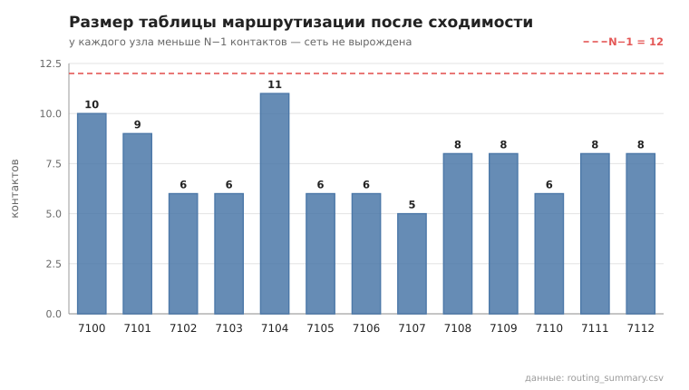
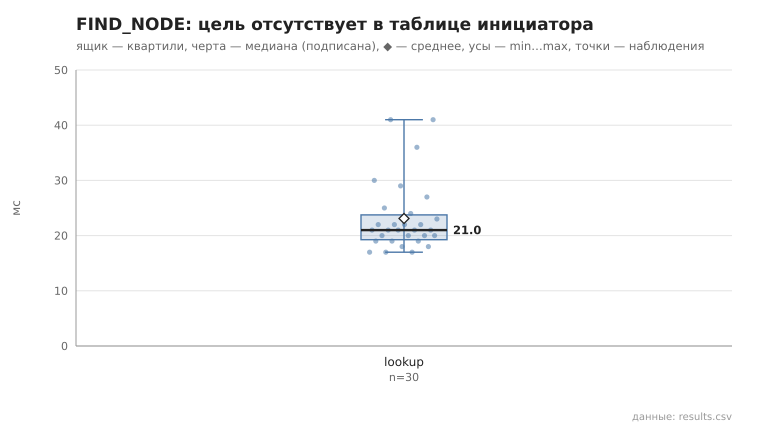
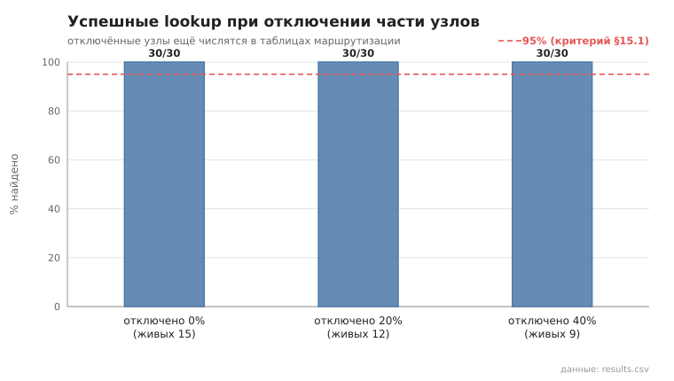
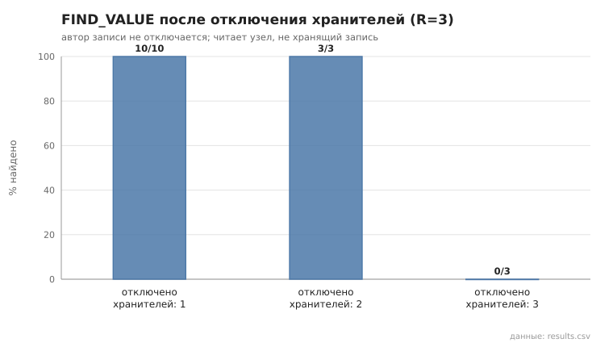
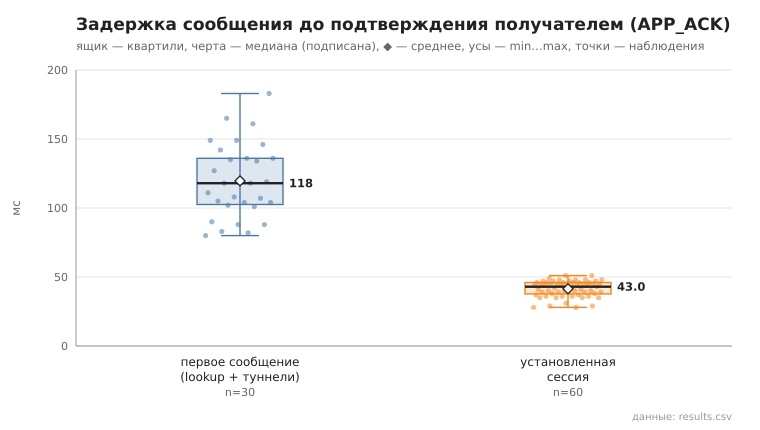
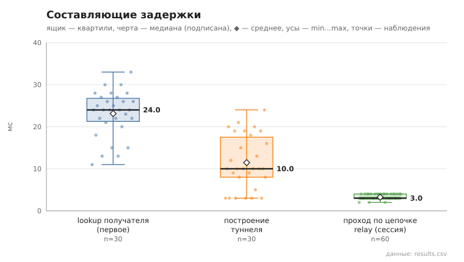
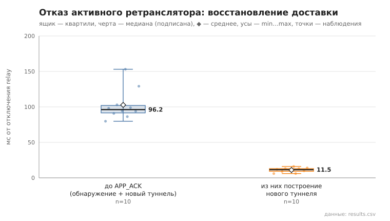
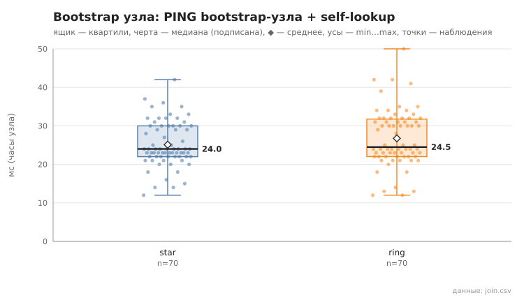
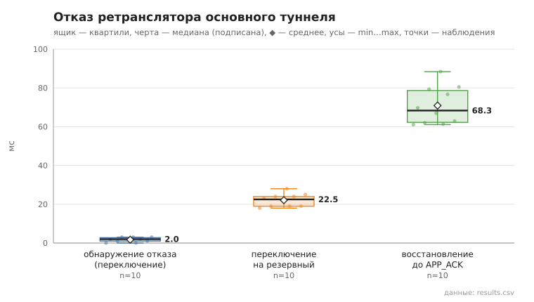
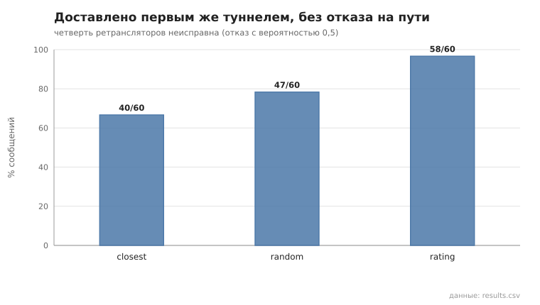

# Пояснительная записка

**Защищённая оверлейная сеть передачи данных на основе пиринговых протоколов**
Курсовая работа · уровни реализации — упрощённый и продвинутый · язык — Rust · ноябрь 2026

> Все численные результаты получены на сохранённых данных репозитория: приёмка этапов 1–2 —
> `experiments/results/accept_20261027_163001/` (N = 13), сценарии упрощённого уровня — `experiments/results/*/20261102_09*`
> (N = 15; сценарии с туннелями 06, 07, 08, failover и pcap — `*/20261111_22*`, после перехода на пул соединений для
> туннелей, ADR-41), продвинутого — `*/20261102_*_advanced` (DHT) и `*/20261111_22*_advanced` (туннели, failover,
> strategy, files, channel) (N = 21), сравнения на release-сборке — `*_release`, режимов соединений — `*_per_request_release`,
> `*_pool_all_release`.
> Ссылки вида [n] ведут к списку источников (раздел 15). Подробности реализации — в [PROTOCOL.md](../implementation/PROTOCOL.md),
> [ARCHITECTURE.md](../implementation/ARCHITECTURE.md), журнале решений [ADR-01…41](../dev/ARCHITECTURE_DECISIONS.md) и
> [модели угроз](../THREAT_MODEL.md); выводы по каждому сценарию — в [Report_Experiment.md](Report_Experiment.md).

## Содержание

1. Цель, задачи, объект и предмет
2. Сравнение Kademlia со структурированными альтернативами
3. Сравнение механизмов защиты канала
4. Модель угроз и границы применимости
5. Архитектура и взаимодействие подсистем
6. Формат кадра и сообщения протокола
7. Алгоритмы bootstrap, lookup, хранения, refresh и republish
8. Подписанная DHT-запись и разрешение конфликтов
9. Построение и восстановление туннеля
10. Стенд: underlay-, bootstrap-, DHT- и туннельный графы
11. План эксперимента
12. Результаты
13. Обсуждение, угрозы валидности и ограничения
14. Заключение
15. Источники

---

## 1. Цель, задачи, объект и предмет

**Цель** — спроектировать, реализовать и экспериментально исследовать оверлейную сеть, в которой узлы без центрального
каталога находят друг друга и данные (распределённая хеш-таблица), а прикладные сообщения доставляются через
многопереходный туннель так, что промежуточные узлы не видят содержимое, а отказ промежуточного узла не прерывает доставку.

**Задачи:**
1. Реализовать транспорт поверх TCP с собственным форматом кадра, устойчивый к частичным и склеенным чтениям и к
   некорректным кадрам.
2. Реализовать самосертифицирующуюся идентичность (NodeID как хеш открытого ключа) и её проверку во всех сообщениях.
3. Реализовать Kademlia: k-бакеты, итеративный lookup, STORE/FIND_VALUE с репликацией и кворумом, TTL, refresh, republish,
   подписанные записи с защитой от отката версии.
4. Защитить канал между узлами (TLS 1.3 с взаимной аутентификацией) и содержимое сообщений от ретрансляторов (E2E).
5. Реализовать туннель через ≥ 2 ретранслятора с подтверждением включения, защитой от петель, контролем доступности и
   автоматическим восстановлением после отказа ретранслятора.
6. Реализовать прикладной сервис сообщений: подтверждение доставки, защита от повторов, история, подписанные псевдонимы,
   диагностика маршрута.
7. Провести воспроизводимый эксперимент по сценариям §15 ТЗ с сохранением сырых данных и построить выводы только на них.

**Объект** — пиринговые оверлейные сети со структурированной маршрутизацией.
**Предмет** — алгоритмы поиска и хранения в Kademlia, механизмы защиты канала и содержимого, протокол построения и
восстановления туннеля, а также их измеримые характеристики (сходимость, длительность и стоимость поиска, задержка доставки,
время восстановления, устойчивость к отказам).

**Выбранные параметры.** Упрощённый уровень: N = 15 узлов в эксперименте (N = 13 в приёмке этапов 1–2), k = 3, α = 3,
R = 3, кворум записи 2, 2 ретранслятора, TLS 1.3, MessagePack. N выбран у верхней границы рекомендованного диапазона
12–15: при малом N lookup вырождается (каждый узел знает всех), а при k = 3 и N = 15 таблица гарантированно неполна.
Продвинутый уровень (`config/node_config_advanced.yaml`): N = 21, k = 4, 3 ретранслятора, пул из 3 туннелей, выбор
ретрансляторов по профилю, передача файлов, bootstrap-схемы tree и multi-seed; канал — TLS 1.3 или собственное
рукопожатие (§3).

## 2. Сравнение Kademlia со структурированными альтернативами

Рассмотрены три структурированные DHT, исторически появившиеся одновременно с Kademlia: Chord [2], Pastry [3] и CAN [4].

| Критерий | Kademlia [1] | Chord [2] | Pastry [3] | CAN [4] |
|---|---|---|---|---|
| Пространство и метрика | 160/256-бит ID, XOR | кольцо 2ᵐ, расстояние по часовой стрелке | 128-бит ID, префикс + числовая близость | d-мерный тор, евклидово расстояние |
| Симметричность метрики | да: d(a,b) = d(b,a) | нет | частично | да |
| Состояние узла | O(log N) бакетов по k контактов | finger table O(log N) + successor list | leaf set + таблица префиксов + neighborhood set | O(d) соседей |
| Длина поиска | O(log N) | O(log N) | O(log_{2^b} N) | O(d · N^{1/d}) |
| Параллельные запросы | да, α параллельно, итеративно | нет, последовательно | нет | нет |
| Обучение таблицы | из любого входящего запроса | только stabilize / fix_fingers | из маршрутизируемых сообщений | при join/leave |
| Отказ узла в пути | обходится альтернативами из α-набора | тайм-аут, затем следующий finger | тайм-аут, затем альтернатива | тайм-аут, затем обход |
| Поддержка | refresh бакетов, republish | периодическая стабилизация | периодическая проверка leaf set | восстановление зон |
| Применение | BitTorrent Mainline [16], IPFS/libp2p [17], Ethereum | исследовательские системы | исследовательские системы | исследовательские системы |

**Почему Kademlia.** (1) Симметричная XOR-метрика: узел пополняет таблицу из самих входящих запросов, отдельный протокол
стабилизации не нужен. В нашей реализации таблица обновляется в каждом PING, FIND_NODE и STORE. (2) Параллельные
итеративные запросы делают поиск устойчивым к отказам без ожидания тайм-аутов. Это прямо проверяется сценарием 05.
(3) Предпочтение «старых» контактов в бакетах (LRU с PING перед вытеснением) защищает таблицу от вытеснения новыми
узлами и опирается на наблюдение, что давно живущие узлы с большей вероятностью проживут дольше [1]. (4) Kademlia
применяется в действующих системах [16, 17], а её свойства и уязвимости изучены [5, 20, 21].
Chord проще в анализе, но несимметричен и требует стабилизации; Pastry учитывает близость в underlay, что на стенде из
одной машины не имеет смысла; CAN плохо масштабируется по длине пути при малом d.

**Ограничение сравнения.** Сравнение аналитическое. Альтернативы не реализованы, сравнение Kademlia и Chord на одном стенде
предлагается ТЗ как расширение (§21).

## 3. Сравнение механизмов защиты канала

Защита рассматривается раздельно на двух уровнях: **канал между соседними узлами** (hop-by-hop) и **содержимое от
отправителя до получателя** (end-to-end). TLS только между соседями не скрывает содержимое от ретрансляторов (§11.2 ТЗ).

### 3.1. Канал между узлами

| Критерий | TLS 1.3 [9] (выбран) | Noise, напр. XX/IK [15] | Собственная AKE (SIGMA-подобная) | Без защиты + подписи |
|---|---|---|---|---|
| Взаимная аутентификация | да, сертификаты обеих сторон | да, статические ключи | да, подпись транскрипта | только подлинность, без конфиденциальности |
| Привязка к NodeID | ключ сертификата = identity-ключ; NodeID вычисляется из SPKI | статический ключ X25519 нужно привязать к Ed25519 отдельно | напрямую в транскрипте | подпись identity-ключом |
| Прямая секретность | да (эфемерный ECDHE) | да | да, если эфемерные ключи | нет |
| Защита от повторов | номера записей; 0-RTT отключён | счётчик nonce | нужно реализовать | нужно реализовать |
| Понижение версии | защищено протоколом; TLS 1.2 отключён | не применимо | нужно проектировать | — |
| Анализ и аудит | стандарт IETF, формальный анализ, промышленные реализации (rustls) | формализован, используется в WireGuard и libp2p | отсутствует | — |
| Трудоёмкость | низкая (библиотека) | средняя | высокая, высокий риск ошибки | низкая |

Реализованы два варианта (`security.channel`). По умолчанию — **TLS 1.3 с взаимной аутентификацией** (rustls, только
TLS 1.3, без 0-RTT). Самоподписанный сертификат не принимается «потому что самоподписанный»: из ключа сертификата
вычисляется NodeID пира и сверяется с ожидаемым. Второй вариант (продвинутый уровень, §11.3) — **собственное рукопожатие**
по схеме подписанного Диффи–Хеллмана (как SIGMA [26] и TLS 1.3): Hello → Reply с подписью ответчика → Finish с подписью
инициатора. Подпись ставится над каноническим транскриптом: версия, роли, оба NodeID, оба identity-ключа, оба эфемерных
ключа X25519, оба nonce и session_id. Ключи направлений выводятся HKDF-SHA256 из X25519 эфемерных ключей. Записи
шифруются AES-256-GCM с монотонным счётчиком, ключи обнуляются при закрытии. Подмена любого поля рукопожатия ломает
подпись; повтор и перестановка записи отвергаются по счётчику, запись другой сессии не проходит проверку подлинности
(10 отрицательных тестов §11.4). Сравнение двух вариантов на одном стенде — раздел 12.10.

### 3.2. Содержимое от отправителя до получателя

| Критерий | Sealed box (ECIES/HPKE-подобный) [11, 12, 13, 25] (выбран) | TLS-сессия поверх туннеля | Двойной храповик (Signal-подобный) |
|---|---|---|---|
| Интерактивное рукопожатие | не нужно | нужно (RTT по туннелю в обе стороны) | первичный обмен ключами |
| Однонаправленный туннель | подходит: конверт самодостаточен | нужен обратный путь до первой записи | подходит |
| Прямая секретность | только со стороны отправителя: эфемерный ключ на сообщение | полная | полная, с самовосстановлением |
| Сложность | низкая (X25519 + HKDF + AES-GCM из библиотек) | средняя | высокая |
| Аутентичность отправителя | подпись Ed25519 внутри конверта | сертификат | ключи сессии |

Выбран **sealed box**: эфемерная пара X25519 на каждое сообщение, ключ получателя выводится из его Ed25519,
HKDF-SHA256 [12], AES-256-GCM [13] с AAD = «контекст ‖ получатель ‖ эфемерный ключ». Подлинность отправителя даёт подпись
сообщения (sign-then-encrypt). Цена — отсутствие прямой секретности со стороны получателя: компрометация его
долговременного ключа раскрывает ранее перехваченные сообщения. Это ограничение явно указано в модели угроз.

## 4. Модель угроз и границы применимости

**Активы:** закрытый ключ узла, содержимое сообщений, целостность таблиц и DHT-записей, история сообщений на диске,
псевдонимы. **Противники:** пассивный наблюдатель сети; активный MITM (подмена, вставка, повтор, задержка); вредоносный
ретранслятор; вредоносный узел DHT (ложные ответы, поддельные записи); вредоносный инициатор туннеля (петли, переполнение).

| Угроза (§11.1 ТЗ) | Мера | Проверка |
|---|---|---|
| Пассивный перехват | TLS 1.3 на каждом соединении + E2E-конверт | pcap: маркер не найден (раздел 12.7); `ciphertext_does_not_contain_plaintext` |
| Подмена узла, MITM | взаимная аутентификация, NodeID из ключа сертификата, проверка пары NodeID–ключ во всех сообщениях | `tls_wrong_expected_node_id_rejected`, `t2_4_mismatched_pubkey_rejected`, `foreign_key_substitution_rejected` |
| Модификация кадра / шифртекста | AEAD (TLS, AES-GCM конверта) | `tampered_ciphertext_rejected`, `tampered_ephemeral_key_or_nonce_rejected` |
| Повтор в текущей / завершённой сессии | TLS 1.3 без 0-RTT; уникальный `message_id` и окно принятых id | `replayed_ack_rejected` |
| Подмена DHT-записи | подпись публикатора над ключом, публикатором, `sequence` и значением; first-writer-wins | `a7_tampered_value_rejected`, `tampered_sequence_breaks_signature` |
| Откат версии записи | монотонный `sequence`, `pick_newer` для NodeRecord | `sequence_rollback_rejected` (оба) |
| Отказ ретранслятора | сквозной TUNNEL_ACK, перестроение без отказавшего узла | сценарий 07: 10/10 |
| Петли / усиление | `hops_left`, `max_hops`, `next_hop ≠ инициатор`, уникальный `tunnel_id` | `routing_cycle_terminates` и др. (`test_loops.rs`) |

| Вмешательство в рукопожатие AKE (эфемерный ключ, nonce, session_id) | подпись каждой стороны над полным транскриптом | `modified_ephemeral_key_rejected`, `modified_handshake_field_rejected` |
| Вредоносный файл (`../x`, огромный, подменённый блок, чужой отправитель) | безопасное имя, лимит, проверка индекса, длины и отправителя, итоговый SHA-256, запись только в `downloads/` | `tests/test_files.rs` |
| Неисправный ретранслятор | пул туннелей с переключением на резервный, профиль кандидата и выбор по рейтингу | сценарии `failover`, `strategy` |
| Заливка диска файлами, спам, исчерпание соединений, хранилища и маршрутов одним узлом | согласие на приём файлов и квоты места; 5 сообщений/с на отправителя; пределы соединений; квоты на публикатора DHT и инициатора туннелей | `tests/test_file_consent.rs` |

Всего 183 автоматических теста, негативных из них — 65 (сценарий 08); полная таблица угроз T1–T35 — в THREAT_MODEL.md.

**Границы применимости (что не заявляется):** анонимность в смысле луковой маршрутизации [8] — ретрансляторы и наблюдатель видят, кто с кем соединяется,
размеры и время сообщений, а инициатор передаёт ретрансляторам свой контакт в TUNNEL_BUILD; устойчивость к Sybil и Eclipse
[6, 7] — NodeID бесплатен, защиты вроде S/Kademlia [5] нет; прямая секретность на стороне получателя (E2E-конверт); защита
от DoS; сокрытие идентичности в собственном рукопожатии. Анти-replay — окно 10 минут по подписанной метке времени и
принятые `message_id` на диске: зависит от согласованности часов узлов. Стенд — одна машина и LAN-сценарий, NAT не
рассматривается.

## 5. Архитектура и взаимодействие подсистем

Каждый узел — отдельный процесс на Rust/tokio; TLS — rustls [23]. Подсистемы: `transport` (кадры), `rpc` (сервер и клиент RPC, `dial` с
TLS), `dht` (таблица, lookup, хранилище, записи), `identity` (ключи, NodeRecord, псевдонимы), `security` (TLS, E2E),
`tunnel` (построение, сессии, пересылка, монитор), `app` (сообщения, APP_ACK, история), `gui` (локальный HTTP API),
`metrics`. Вне узла: оркестратор (приёмка, сценарии, графики) и настольное приложение — они управляют узлом только
через HTTP API.

Путь сообщения от A к B (подробно — ARCHITECTURE.md §3.4):

```
A: API → Messenger ─ lookup(B)* → TunnelBuilder: TUNNEL_BUILD → R1, R2 (TLS к каждому)
                    ─ AppMessage + подпись → E2E-конверт для B → TUNNEL_DATA → R1 → R2 → B
                    ← TUNNEL_ACK (R2 подтверждает после B, R1 — после R2)        (* не нужен в установленной сессии)
B: конверт ему → расшифровка → проверка from/ключа/подписи → анти-replay → история → APP_ACK по своему туннелю к A
```

Фоновые задачи узла: bootstrap при старте, refresh бакетов (60 с), TTL-очистка (10 с), republish (80 с), монитор
туннелей (10 с). Отказ любой из них не останавливает приём соединений.

## 6. Формат кадра и сообщения протокола

Транспорт — TCP [19]. Кадр: 24-байтовый заголовок big-endian — `version` (1 Б), `msg_type` (1 Б), `flags` (2 Б), `request_id` (16 Б,
UUIDv4 [18]), `payload_length` (4 Б) — и payload в MessagePack [24] с именованными полями. `payload_length` > 65 536
отклоняется до выделения буфера; неверная версия → ERROR и закрытие соединения без остановки процесса. Кадры передаются
внутри TLS-записей (или записей собственного рукопожатия AKE); ответ сопоставляется по `request_id`. Запросы DHT идут по
новому соединению на каждый запрос, трафик туннелей — по пулу соединений к соседям по цепочке (ТЗ §6 допускает оба
подхода; выбор и замеры — в разделе 12.11, ADR-39…41).

| Hex | Сообщение | Назначение |
|---|---|---|
| 0x01 / 0x02 | PING / PONG | проверка живости, обмен контактами (с проверкой NodeID) |
| 0x03 / 0x04 | FIND_NODE_REQUEST / RESPONSE | k ближайших к цели контактов |
| 0x05 / 0x06 | STORE_REQUEST / RESPONSE | размещение подписанной записи (ключ, значение, TTL, подпись, sequence) |
| 0x07 / 0x08 | FIND_VALUE_REQUEST / RESPONSE | значение с подписью и ключом публикатора либо ближайшие контакты |
| 0x10 / 0x11 | TUNNEL_BUILD / TUNNEL_BUILD_OK | включение ретранслятора в туннель, подтверждение с его Contact |
| 0x13 / 0x14 | TUNNEL_DATA / TUNNEL_ACK | данные туннеля (`hops_left`), сквозное подтверждение |
| 0x7F | ERROR | код (BAD_VERSION, UNKNOWN_TYPE, BAD_PAYLOAD, …) и описание без внутренних деталей |

Типы 0x12 TUNNEL_BUILD_FAIL, 0x15 TUNNEL_CLOSE, 0x20 APP_MESSAGE и 0x21 APP_ACK зарезервированы. Прикладные
сообщения, подтверждения и передача файлов (`FileOffer`, `FileBlock`, `FileAck`, `FileDone`) передаются E2E-конвертом
внутри TUNNEL_DATA, чтобы ретрансляторы не видели даже их тип. Байтовые поля (ключи, подписи, шифртекст, блоки файлов)
кодируются как MessagePack bin: стандартное представление `Vec<u8>` массивом чисел раздувало их примерно в 1,5 раза.
MessagePack выбран вместо JSON (бинарные 32-байтовые NodeID без base64: 33 Б против 44 Б) и вместо Protobuf (не нужна
кодогенерация; схема задаётся типами Rust через serde).

## 7. Алгоритмы bootstrap, lookup, хранения, refresh и republish

**NodeID** = SHA-256(0x01 ‖ открытый ключ Ed25519) [10, 14, 22]; ключ хранится в `state_dir`, поэтому NodeID стабилен между
перезапусками. **Таблица маршрутизации:** 256 бакетов по номеру старшего различающегося бита XOR-расстояния, ёмкость
k = 3, порядок LRU→MRU. Новый контакт при полном бакете вызывает PING старейшего: если тот жив, новый отбрасывается,
если нет — старейший вытесняется. Контакт с NodeID, не соответствующим ключу, не принимается.

**Bootstrap:** PING каждого известного адреса → self-lookup FIND_NODE(own_id) → публикация своего NodeRecord. Если не
ответил ни один адрес (seed ещё не поднят), попытка повторяется через 1, 2, 4 … 30 с; если таблица позже опустеет —
повторный вход на очередном refresh. У каждой корзины есть кэш замены (Kademlia §2.4) — до 8 узлов, не поместившихся в
полную корзину или увиденных в ответах FIND_NODE; они занимают место удалённого контакта.
Узлу известен только адрес bootstrap-узла; полный список узлов, которым владеет оркестратор, узлам не передаётся.

**Итеративный lookup:** начальные кандидаты — k ближайших из своей таблицы. На каждой итерации отправляется α = 3
параллельных FIND_NODE ближайшим неопрошенным; ответы обрабатываются по мере поступления, медленный ответ не держит
итерацию. Новые контакты добавляются в кандидаты, кроме собственного NodeID (ADR-26). Остановка — когда итерация не
приблизила ближайший опрошенный узел к цели; результат — k ближайших найденных. Для каждого lookup журналируются
опрошенные по итерациям узлы, число RPC, итераций и длительность.

**Хранение:** `put` подписывает запись, сохраняет локально, ищет ключ и отправляет STORE на R = 3 ближайших других узла;
успех — при ≥ 2 подтверждениях, считая локальную копию. `get` проверяет локальное хранилище, затем ищет ключ и
опрашивает ближайшие узлы по очереди; принимается первая запись с валидной подписью.

**Refresh:** раз в 60 с — lookup случайного идентификатора в диапазоне каждого непустого бакета.
**Republish:** раз в 80 с владелец заново публикует свои записи с новым `sequence`, а NodeRecord пересоздаётся с новыми
`issued_at`/`expires_at`. **TTL:** 180 с; хранитель ограничивает запрошенный TTL своим и раз в 10 с удаляет истёкшие
записи. Republish каждые 80 с при TTL 180 с даёт запас в два цикла.

## 8. Подписанная DHT-запись и разрешение конфликтов

```
signing_bytes = "P2P-DHT-RECORD-v2" ‖ key(32) ‖ publisher_node_id(32) ‖ sequence(u64 BE) ‖ value
record        = {key, value, publisher, publisher_key, sequence, signature, ttl, published_ms}
```

Публикатор доказывает владение через NodeID = hash(publisher_key) и подпись. TTL не подписывается: его назначает хранитель.
Специальные значения: NodeRecord (`"NREC1" ‖ msgpack`: node_id, ключ, адреса, sequence_number, issued_at, expires_at,
подпись) под ключом SHA-256("node:" ‖ NodeID) и псевдоним (`"ALIAS1:" ‖ alias`) под ключом SHA-256("alias:" ‖ alias).

**Разрешение конфликтов на хранителе:**
1. **Чужой ключ** — first-writer-wins: живую запись другого публикатора под тем же ключом не перезаписать до истечения TTL.
2. **Версии одного публикатора:** принимается больший `sequence`. Меньший отвергается как откат, равный с другим значением —
   как конфликт; равный с тем же значением — обновление TTL.
3. **NodeRecord** принимается, только если он валиден, лежит под своим ключом, принадлежит отправителю STORE и не
   откатывает `sequence_number`.
4. **При чтении** запись с неверной подписью отбрасывается, и опрашивается следующий хранитель.

Известное ограничение first-writer-wins — «захват» ключа: чужой публикатор может занять ключ `node:<жертва>` значением
без префикса NREC1 или чужой псевдоним до истечения TTL (THREAT_MODEL, остаточные риски).

## 9. Построение и восстановление туннеля

**Построение.** Инициатор выбирает 2 ретранслятора из своей таблицы и кэшей замены корзин (ближайших к получателю, без
себя, получателя и повторов; при k = 3 одной таблицы недавно вошедшему узлу может не хватить) и по очереди обращается к каждому (защищённое соединение из пула или новое), отправляя TUNNEL_BUILD с `tunnel_id`, номером hop, длиной
цепочки, TTL и `next_hop`. Ретранслятор проверяет пары NodeID–ключ, `1 ≤ total_hops ≤ max_hops`, `next_hop ≠ он сам и
≠ инициатор`, уникальность `tunnel_id`, запоминает `tunnel_id → next_hop` на TTL и отвечает TUNNEL_BUILD_OK со своим
Contact. Инициатор проверяет, что ответил именно выбранный узел. Сбой на любом hop — повтор без отказавшего узла,
не более 3 попыток. В журнал пишется фактическая цепочка: `ACTIVE — 2 hops [a → b → получатель], build took 14ms`.

**Передача.** TUNNEL_DATA несёт `hops_left = max_hops + 1`; каждый ретранслятор уменьшает его, при 0 кадр отбрасывается,
и цикл в таблицах пересылки не может гонять кадр бесконечно. Ретранслятор подтверждает кадр только после
подтверждения следующего hop, поэтому TUNNEL_ACK первого ретранслятора означает, что кадр дошёл до получателя.
Узел без маршрута для `tunnel_id` подтверждает кадр, только если конверт адресован ему, — иначе ERROR.

**Состояния:** BUILDING → ACTIVE ⇄ DEGRADED → DEAD (ACTIVE → CLOSING → DEAD при закрытии). DEGRADED означает «давно не
было подтверждений» (простой) и пригоден для отправки; DEAD — отправка не подтверждена или прошло 90% TTL маршрута.

**Восстановление.** Отказ обнаруживается отправкой, которая его встретила: нет соединения, тайм-аут или ERROR. Туннель
помечается DEAD; отправитель в той же операции выполняет свежий lookup получателя, строит туннель без отказавшего
ретранслятора и повторно отправляет тот же конверт. Получатель отбрасывает возможный дубликат по `message_id`. Прямая
отправка получателю в обход туннеля не используется ни как основной, ни как аварийный режим.

**Почему без keepalive.** Проверка доступности по таймеру добавляет трафик и всё равно не исключает отказа между
проверкой и отправкой. Цена этого решения: отказ, случившийся во время простоя, обнаруживается только при следующей
отправке (ADR-21).

**Пул туннелей (продвинутый уровень).** К каждому получателю держится до трёх туннелей: основной строится при первой
отправке, резервные — в фоне, по возможности на других ретрансляторах. Если основной не подтвердил кадр, тот же кадр сразу
уходит по резервному (переключение без lookup и построения), а пул пополняется в фоне. Перестроение через lookup нужно,
только когда пригодных туннелей не осталось.

**Профиль кандидата и стратегии выбора.** Для каждого узла-кандидата ведутся: число успехов и отказов, EMA успешности,
EMA задержки, время последнего наблюдения, число отказов подряд, подсеть /24. Профиль обновляется при TUNNEL_BUILD (по
каждому hop) и при передаче. Отказ приписывается узлу, на котором оборвалась цепочка: ретранслятор дописывает в ERROR
адрес следующего hop и причину с дальнего конца, и берётся самое глубокое упоминание. Стратегии: `closest` (ближайшие к
получателю по XOR — упрощённый уровень), `random` (случайные допустимые) и `rating` (по оценке «EMA успешности − штраф за
отказы подряд − EMA задержки»; неизвестный узел получает нейтральную оценку, чтобы новые узлы пробовались).

## 10. Стенд: underlay-, bootstrap-, DHT- и туннельный графы

| Граф | Содержание на стенде |
|---|---|
| **Underlay** | одна машина (Linux, loopback): любой узел достижим из любого по `127.0.0.1:порт`. Задержка и потери сети отсутствуют; debug-сборка (отдельные сравнения — release); TLS 1.3 на каждом соединении. Продвинутый уровень: сценарий `underlay` размещает узлы на разных loopback-подсетях (127.0.1.0/24, 127.0.2.0/24, шлюзы 127.0.3.0/24) и запрещает трафик между первыми двумя через nftables; сценарий 10 накладывает tc/netem |
| **Bootstrap** | star — все узлы знают только узел 0; ring — узел i знает только узел i−1; tree — двоичное дерево, узел знает родителя (i−1)/2; multi-seed — три seed, остальные знают всех трёх. Задаётся флагом `-b`, никакой другой информации об узлах узлу не передаётся |
| **DHT** | возникает из lookup и запросов: после сходимости 5–11 контактов на узел при N−1 = 14 (k = 3); в приёмке (N = 13) — 2–5 непустых бакетов на узел; выгрузки таблиц — `accept_*/routing_tables/` |
| **Туннельный** | для каждой пары свой: инициатор → 2 ретранслятора (продвинутый — 3; выбор по стратегии) → получатель; отдельный обратный туннель получателя для APP_ACK; на продвинутом уровне — пул из 3 туннелей |

Bootstrap-граф не выдаётся за физическую топологию (§22 ТЗ): физическая связность на стенде полная, ограничения
связности создаёт только протокол.

**Программное обеспечение стенда.** Каждый узел — процесс `p2p-node` со своим ключом, портом, таблицей, хранилищем и
журналом. Управление — `p2p-orchestrator scenario` (Rust): он запускает процессы, отключает их сигналом SIGKILL, обращается
к ним через локальный HTTP API и сохраняет результаты. Воспроизведение — одна команда `bash experiments/run_all.sh`.

## 11. План эксперимента

Неизменные факторы во всех сценариях упрощённого уровня: N = 15, k = 3, α = 3, R = 3, кворум 2, 2 ретранслятора,
тайм-ауты по `config/node_config.yaml`, seed = 1, одна машина. Одновременно меняется не более одного исследуемого фактора.

| Сценарий §15.1 | Варьируемый фактор (уровни) | Отклики | Объём (требование §15.3) |
|---|---|---|---|
| 01 Холодный запуск | — (star) | время операционной сходимости; время bootstrap узла | 5 запусков (≥ 5) |
| 02 FIND_NODE, цель вне таблицы | — | успех, длительность, RPC, итерации | 30 lookup (≥ 30) |
| 03 STORE/FIND_VALUE, R = 3 | — | число реплик, время STORE и FIND_VALUE, корректность значения | 30 операций |
| 04 Отказ хранителя | число отключённых хранителей: 1, 2, 3 | доля найденных, время FIND_VALUE | 10 + 3 + 3 инъекции (≥ 5) |
| 05 Отказ кандидатов lookup | доля отключённых узлов: 0, 20, 40% | доля успешных lookup, длительность, RPC | 30 lookup на уровень |
| 06 Туннель и сообщение | порядок сообщения: первое / в установленной сессии | время построения туннеля, RTT до APP_ACK, проход по цепочке | 30 первых, 60 сессионных (≥ 30) |
| 07 Отказ ретранслятора | позиция отключённого relay: 1-й / 2-й (чередуется) | время восстановления доставки, маршрут без отказавшего узла | 10 инъекций (≥ 5) |
| 08 Негативные тесты | — | доля пройденных негативных тестов | 65 тестов |
| 09 Bootstrap-схемы | схема: star / ring | как в 01 | 5 + 5 запусков |
| pcap | канал: TLS / AKE | наличие маркера в трафике оверлея | 5 сообщений + 5 STORE |

Продвинутый уровень (N = 21, k = 4, 3 ретранслятора, пул 3, `rating`): сценарии 01–09 с теми же объёмами (09 — четыре
схемы bootstrap), а также:

| Сценарий | Варьируемый фактор (уровни) | Отклики | Объём |
|---|---|---|---|
| `failover` | размер пула: 1 (упрощённый) / 3 (продвинутый) | время обнаружения отказа, время переключения на резервный, время восстановления | 10 инъекций на уровень |
| `strategy` | стратегия выбора: closest / random / rating; четверть ретрансляторов неисправна (отказ с вероятностью 0,5) | доля доставок без отказа на пути, RTT, число переключений и перестроений | 30 разогревочных + 60 измеряемых сообщений на стратегию |
| `files` | размер файла: 100 КиБ / 1 МиБ / 10 МиБ; сборка debug / release | goodput, доля служебного трафика, повторы блоков, SHA-256 у получателя | 5 передач каждого размера (≥ 5) |
| `channel` | канал: TLS 1.3 / AKE; сборка debug / release | соединение + 1 RPC, lookup, построение туннеля, RTT первого сообщения и сессии | 30 + 30 + 10 пар × 3 сообщения |
| `media`, `02`/`06`/`07` | способ соединений: на каждый запрос / пул для туннелей / всё через пул (release, N = 15) | задержка в одну сторону, джиттер (RFC 3550), потери потока 50 пакетов/с; lookup, RTT, восстановление | 5 потоков × 250 пакетов; объёмы 02/06/07 |
| `10`, `underlay` | профиль netem; ограниченная IP-достижимость | lookup и доставка | требуют root, прогоняются пользователем |

**Критерий операционной сходимости** (§15.1): два контрольных раунда подряд (по 15 lookup из заранее сформированного
набора пар) с успехом ≥ 95% и изменением суммы контактов во всех таблицах ≤ 10%. Время отсчитывается от запуска первого
процесса; разрешение метода — пауза 1 с между раундами.

**Измерения.** Длительности lookup, построения туннеля, прохода по цепочке и bootstrap измеряет узел (`*_ms` в ответах
API). Длительности сходимости, STORE/FIND_VALUE и восстановления измеряет оркестратор по монотонным часам.
**Статистика:** n, минимум, медиана, среднее, максимум; p95 — только при n ≥ 20.

**Сохраняется** для каждого прогона: `results.csv` (сырые наблюдения), `meta.json` (коммит и хеш незакоммиченных изменений,
конфигурация, seed, время начала, временная база, N, k, α, R, тайм-ауты, граф bootstrap), `summary.md`, графики
`plots/*.svg`, построенные из `results.csv`, и журналы узлов `node_logs/`.

## 12. Результаты

### 12.1. Невырожденность DHT (приёмка, N = 13)

Все 5 критериев приёмки выполнены. 13 из 13 узлов знают меньше N−1 = 12 узлов (min / медиана / среднее / max контактов —
5 / 8 / 7,5 / 11). Все 30 контрольных lookup выполнены для цели, отсутствующей в таблице инициатора, найдены (30/30) и
прошли через промежуточные узлы (30/30). После остановки bootstrap-узла найдено 10 lookup из 10, и запись, сохранённая
до остановки, читается.



### 12.2. Сводка метрик (N = 15)

| Метрика | n | min | медиана | среднее | max | p95 |
|---|---|---|---|---|---|---|
| Операционная сходимость, с (star) | 5 | 4,4 | 4,8 | 4,9 | 5,3 | — |
| Bootstrap узла, мс (01) | 70 | 16 | 33,5 | 42,6 | 178 | 82 |
| Lookup, цель вне таблицы, мс | 30 | 17 | 21 | 23,1 | 41 | 41 |
| RPC на lookup | 30 | 4 | 5 | 5,1 | 7 | 6 |
| STORE, мс | 30 | 53,3 | 73,4 | 73,7 | 93,5 | 89,9 |
| FIND_VALUE (читатель не хранитель), мс | 23 | 30,0 | 39,0 | 39,5 | 59,5 | 55,2 |
| Построение туннеля, мс | 30 | 3 | 10 | 11,5 | 24 | 21 |
| Первое сообщение, RTT до APP_ACK, мс | 30 | 80 | 118 | 119,7 | 183 | 165 |
| Установленная сессия, RTT до APP_ACK, мс | 60 | 28 | 43 | 41,4 | 51 | 48 |
| Проход по цепочке relay (сессия), мс | 60 | 2 | 3 | 3,2 | 4 | 4 |
| Восстановление доставки после отказа relay, мс | 10 | 79,8 | 96,2 | 102,8 | 153,1 | — |
| Построение нового туннеля при восстановлении, мс | 10 | 6 | 11,5 | 11,0 | 16 | — |

Строки 01–05 — прогон 02.11 (DHT не зависит от режима соединений: `pool_scope: tunnels`), туннельные строки — прогон 11.11
с пулом соединений для туннелей (debug-сборка, как и все строки таблицы).

### 12.3. Поиск (02, 05)

Цель отсутствовала в таблице инициатора во всех 30 случаях и была найдена в 30 из 30. Итераций — ровно 3 во всех
случаях, RPC — 4…7.



| Отключено узлов | Живых | Успех | Длительность, мс (медиана) | RPC (медиана) |
|---|---|---|---|---|
| 0 (0%) | 15 | 30/30 | 20,5 | 5 |
| 3 (20%) | 12 | 30/30 | 20,0 | 4 |
| 6 (40%) | 9 | 30/30 | 13,5 | 3 |



### 12.4. Хранение и отказ хранителей (03, 04)

STORE успешен 30/30, значение прочитано верно 30/30; фактически запись лежит ровно на 4 узлах (автор и 3 реплики) во всех
30 операциях. После отключения хранителей-реплик (автор не отключается, читает узел, не хранящий запись):

| Отключено хранителей | Найдено | FIND_VALUE, мс (медиана) |
|---|---|---|
| 1 | 10/10 | 38,2 |
| 2 | 3/3 | 39,8 |
| 3 | 0/3 | — |



### 12.5. Туннель и сообщения (06)

Доставлено с APP_ACK 90 из 90 сообщений; во всех случаях через 2 ретранслятора; ни одного перестроения маршрута. Первое
сообщение — медиана 118 мс, установленная сессия — 43 мс; кадр проходит цепочку за 3 мс (соединения с ретрансляторами уже
открыты, пул), остальное — шифрование, подпись и их проверка на концах в debug-сборке.




### 12.6. Отказ ретранслятора (07)

Доставка восстановлена в 10 из 10 инъекций (по 5 на первый и второй relay), каждый раз в той же отправке и без единой
неудачной попытки, за медиану 96 мс; новый туннель строится за 11,5 мс. Новый маршрут не содержал отключённый узел в 10 из
10 случаев.



### 12.7. Негативные тесты и pcap (08, pcap)

`cargo test --tests`: 183 из 183 тестов, из них 65 негативных (`08_negative_crypto/20261112_151644`). Захват трафика
оверлея во время 5 сообщений и 5 STORE с уникальным маркером — для обоих вариантов канала:

| Канал | Захват | Маркер | Протокол |
|---|---|---|---|
| TLS 1.3 | 550 КБ, 1979 кадров | не найден | во всех 128 ServerHello согласован TLS 1.3 |
| AKE (§11.3) | 429 КБ, 1725 кадров | не найден | tshark не распознаёт протокол — видны только непрозрачные данные (записи AEAD) |

Положительный контроль — тот же маркер в открытом HTTP панели узла — найден в обоих случаях, то есть метод поиска
работоспособен. Захваты — `pcap_no_plaintext/20261111_222104/` и `20261111_222051_ake/`; секретных ключей в них нет.

### 12.8. Bootstrap-схемы (09)

| Схема | Сошлось | Сходимость, с | Bootstrap узла, мс (медиана; max) | Контактов на узел |
|---|---|---|---|---|
| star | 5/5 | 4,3 | 24,0; 42 | 5…11 |
| ring | 5/5 | 4,3–4,4 | 24,5; 50 | 6…11 |



### 12.9. Продвинутый уровень (N = 21, k = 4, 3 ретранслятора, пул из 3 туннелей)

DHT (прогон 02.11, `*_advanced`): операционная сходимость star — 6,1 с (5/5, 9…15 контактов на узел); lookup — медиана
35,5 мс, 8 RPC, 3 итерации; STORE — 93,7 мс, FIND_VALUE (читатель не хранитель) — 53,7 мс; запись читается при отказе
1 (10/10) и 2 (3/3) хранителей, при отказе 3 — нет (0/3); lookup при отключении 0 / 20 / 40% узлов — 30/30, 30/30, 27/30.
Все четыре схемы bootstrap (star, ring, tree, multi-seed) сходятся 5/5 за 6,0–6,1 с.

Туннели (прогон 11.11): 90/90 сообщений через 3 ретранслятора; первое сообщение — медиана 143,5 мс, сессия — 42,5 мс,
проход по цепочке — 4 мс. Отказ ретранслятора (07): 10/10 восстановлений за медиану 61 мс — без построения нового
туннеля, по резервному из пула.

**Пул туннелей (`failover`)** — отключается ретранслятор основного туннеля:

| Пул | Как восстановлено | Обнаружение отказа | Переключение / новый туннель | Восстановление до APP_ACK, медиана (min…max) |
|---|---|---|---|---|
| 1 туннель (упрощённый, N = 15) | перестроение маршрута 10/10 | 1,5 мс | новый туннель 13 мс | 95,0 мс (78,1…129,3) |
| 3 туннеля (продвинутый, N = 21) | переключение на резервный 10/10 | 2,0 мс | переключение 22,5 мс | 68,3 мс (61,1…88,4) |



**Стратегии выбора ретрансляторов (`strategy`)** — 5 из 21 узла неисправны (отвечают ошибкой с вероятностью 0,5), одни и
те же отправители, получатели и неисправные узлы для всех стратегий, по 60 измеряемых сообщений:

| Стратегия | Доставлено | Без отказа на пути | Переключений / перестроений | RTT до APP_ACK, медиана; p95 |
|---|---|---|---|---|
| closest | 57/60 | 40/60 (67%) | 5 / 12 | 47 мс; 195 мс |
| random | 60/60 | 47/60 (78%) | 7 / 6 | 47 мс; 178 мс |
| rating (профиль кандидата) | 60/60 | 58/60 (97%) | 1 / 1 | 46 мс; 141 мс |



**Передача файлов (`files`)** — по 5 передач каждого размера, SHA-256 у получателя совпал во всех 30 случаях, повторов
блоков нет:

| Размер | Goodput debug, МиБ/с | Goodput release, МиБ/с | Служебная доля трафика |
|---|---|---|---|
| 100 КиБ | 0,2 | 2,1 | 2,9% |
| 1 МиБ | 0,3 | 6,1 | 1,5% |
| 10 МиБ | 0,3 | 7,1 | 1,4% |

### 12.10. Собственное рукопожатие (AKE) и TLS 1.3 (`channel`, N = 21)

Одна и та же сеть поднимается дважды — с каналом TLS 1.3 и с AKE; медианы, мс:

| Показатель | TLS, debug | AKE, debug | TLS, release | AKE, release |
|---|---|---|---|---|
| PING по новому соединению (рукопожатие + 1 RPC) | 9 | 32 | 2 | 1 |
| lookup | 27 | 102 | 6 | 5 |
| построение туннеля | 22 | 11 | 4 | 2 |
| первое сообщение, RTT до APP_ACK | 158 | 466 | 26 | 25 |
| установленная сессия, RTT до APP_ACK | 43,5 | 51 | 3 | 3 |

В release варианты неразличимы, а собственное рукопожатие даже немного быстрее (меньше обмен). В debug AKE в 3–4 раза
медленнее: криптография rustls (ring) собирается оптимизированной и в debug, а AKE использует реализации на чистом Rust
(x25519-dalek, ed25519-dalek), которые без оптимизаций компилятора работают на порядок медленнее; первое сообщение
содержит несколько новых рукопожатий DHT, поэтому разница там наибольшая. Данные — `channel_compare/20261111_221602_advanced`
и `20261111_220821_advanced_release`.

### 12.11. Способ соединений между узлами (release, N = 15)

ТЗ §6 допускает новое соединение на каждый запрос и переиспользование соединений. Сравнены три режима: на каждый запрос;
пул только для туннелей, DHT — на каждый запрос (режим по умолчанию, ADR-40/41); всё через пул. Медианы, мс:

| Показатель | На каждый запрос | Пул для туннелей | Всё через пул |
|---|---|---|---|
| lookup (02) | 5,0 | 5,0 | 2,5 |
| первое сообщение (06) | 24 | 17,5 | 9 |
| установленная сессия (06) | 7 | 3 | 3 |
| восстановление после отказа ретранслятора (07), 10/10 во всех режимах | 19,3 | 13,8 | 7,1 |
| голосовой поток 50 пакетов/с по 80 байт (`media`): задержка в одну сторону; p95 | 4,5; 5,3 | 1,6; 1,9 | 1,6; 2,0 |

Пул для туннелей даёт тот же выигрыш для сессии и голосового потока, что и «всё через пул», не меняя поведения DHT
(lookup 5,0 / 5,0 мс) — поэтому результаты 01–05 и 09 действительны в обоих режимах. При переходе найдена и исправлена
задержка до 40 мс из-за алгоритма Нейгла в долгих соединениях (`TCP_NODELAY`, ADR-41). Разбор вариантов и недостатков
пула — `docs/dev/TRANSPORT_OPTIONS.md`.

## 13. Обсуждение, угрозы валидности и ограничения

**Почему поиск занимает 3 итерации.** При N = 15 оценка log₂ N ≈ 3,9 шага, а параллельный опрос α = 3 узлов на каждой
итерации сокращает число итераций: за две итерации инициатор доходит до узлов, знающих цель, а третья не улучшает
ближайший результат — срабатывает условие остановки. На больших сетях Kademlia задержку lookup определяют число
итераций и тайм-ауты на недоступных узлах [21]; на стенде тайм-аутов нет. Длительность lookup (≈ 20 мс в debug) почти
целиком состоит из TLS-рукопожатий: каждый RPC DHT открывает новое соединение (ADR-01, ADR-40); через пул — вдвое быстрее
(раздел 12.11).

**Почему отказы не снижают успех поиска.** SIGKILL на одной машине даёт немедленный отказ соединения, поэтому мёртвый
кандидат не задерживает итерацию: параллельные ответы живых кандидатов продвигают поиск. Длительность при 40% отключённых
даже ниже — узлов меньше, путь короче. Для «молчащего» узла (тайм-аут вместо отказа) результат был бы хуже; это не
измерялось.

**Почему R = 3 выдерживает ровно два отказа.** FIND_VALUE опрашивает ближайшие к ключу узлы. Автор в их число не
входит, поэтому его локальная копия при потере всех трёх реплик недоступна до ближайшего republish. Это согласуется с
моделью: запись теряется только при отказе всех R хранителей между циклами republish.

**Первое сообщение против установленной сессии.** Разница ≈ 75 мс складывается из lookup получателя (24 мс), построения
туннеля (10 мс) и симметричной работы получателя — он ищет отправителя и строит обратный туннель для APP_ACK. В сессии
путь по цепочке занимает ≈ 3 мс в каждую сторону (соединения с ретрансляторами открыты); остальные ≈ 35 мс — шифрование,
подпись и проверка на концах, которые в debug-сборке стоят дорого (в release сессия — 3 мс, раздел 12.11).

**Восстановление.** Время восстановления (≈ 96 мс) близко к первому сообщению, потому что по сути это первое сообщение
по новому маршруту плюс неудачная попытка по старому, которая на localhost завершается быстро (отказ соединения). С пулом
из трёх туннелей (продвинутый уровень) построение не нужно — кадр уходит по резервному туннелю, и восстановление быстрее
(68 мс против 95 мс, раздел 12.9).

**Стратегии выбора.** `closest` берёт одних и тех же ближайших к получателю узлов — если среди них неисправный, он
попадает почти в каждый туннель (67% доставок без отказа). `random` распределяет риск (78%). `rating` учится на исходах
предыдущих туннелей и обходит неисправные узлы (97%), а хвост задержки у него короче всего (p95 141 мс против 178–195 мс):
меньше переключений и перестроений.

**Файлы.** Служебная доля трафика (1,4% для 10 МиБ) — это заголовки, подписи, конверты и подтверждения; повторов блоков
не было, так как потерь на стенде нет. Goodput в debug (0,3 МиБ/с) ограничен неоптимизированной криптографией на каждом
блоке, в release — 7,1 МиБ/с.

**Star и ring.** Различий нет: первый же self-lookup выводит узел кольца к его соседям, и за 2–3 итерации таблица
наполняется так же, как при star. Отсутствие различия при N = 15 не доказывает эквивалентность схем в других условиях.

**Дефекты, найденные экспериментом.** Три ошибки реализации выявлены только на живых узлах и исправлены до итогового
прогона: (1) ложная «смерть» туннеля при простое и восстановление не к тому узлу; (2) ретранслятор после перезапуска
подтверждал чужие кадры как получатель; (3) lookup возвращал самого инициатора, и копия автора засчитывалась в кворум
STORE. Итоговые данные сняты на исправленном коде; предыдущий прогон (N = 12) сохранён и качественно совпадает.

**Угрозы валидности:**
- *Внешняя:* одна машина, loopback, debug-сборка — абсолютные задержки занижены относительно реальной сети и непереносимы
  на неё; переносимы только соотношения (сессия против первого сообщения, доля отказов против успеха). Debug-сборка
  искажает и сравнения, зависящие от криптографии: AKE в debug в 3–4 раза медленнее TLS, в release — нет (12.10); поэтому
  такие сравнения приведены для обеих сборок.
- *Режим соединений:* прогоны 01–05 и 09 сняты 02.11 с соединением на каждый запрос, туннельные — 11.11 с пулом; для DHT
  это одно и то же поведение (12.11), но код между прогонами менялся (коммит и хеш изменений — в `meta.json`).
- *Внутренняя:* метод сходимости упирается в собственную нижнюю границу (запуск процессов 2,6 с + 2 раунда + окно 1 с),
  поэтому время сходимости — оценка сверху; сравнивать схемы по нему нельзя.
- *Статистическая:* один прогон каждого сценария с одним seed; объёмы соответствуют §15.3, межпрогонная изменчивость
  оценена только косвенно. Её пример — хвост времени bootstrap в 01 (до 178 мс) против 09 (до 50 мс) при том же методе;
  поэтому в выводах используются медианы.
- *Конструктная:* отказ моделируется SIGKILL (быстрый отказ соединения); потери пакетов и тайм-ауты (netem) не
  моделировались — это продвинутый уровень.
- *Измерительная:* часть длительностей измерена часами узла, часть — оркестратором; источник указан в `meta.json` и в
  описании каждого показателя.

**Ограничения реализации:** нет прямой секретности на стороне получателя для сообщений (одноразовый ключ только у
отправителя); метаданные трафика открыты (кто с кем, размеры, время); нет защиты от Sybil/Eclipse (квоты и предел частоты сообщений считаются на NodeID, а NodeID бесплатен); частота
DHT-запросов не ограничена; кандидаты в ретрансляторы из кэша замены корзин живость не подтверждали — неудачный выбор стоит одной попытки
построения туннеля; сценарии netem и ограниченного underlay
реализованы, но не прогнаны (нужен root). Пул соединений ускоряет туннели, но добавляет свои риски — блокировку
«голова очереди» на общем TCP и долгоживущие соединения (разбор — `docs/dev/TRANSPORT_OPTIONS.md` §8).

## 14. Заключение

Реализована и испытана оверлейная сеть упрощённого и продвинутого уровней. Подтверждено сохранёнными данными:

1. Узлы без центрального каталога находят друг друга: цель, отсутствующая в таблице инициатора, найдена в 30 из 30 случаев
   за 3 итерации и 4–7 RPC, через промежуточные узлы; таблицы узлов неполны (5–11 контактов при N−1 = 14).
2. Поиск сохраняет 100% успеха при отключении 20% и 40% узлов (по 30 lookup на уровень) при N = 15; при N = 21 —
   30/30 и 27/30.
3. Подписанные записи размещаются на 4 узлах (автор и 3 реплики) и читаются после отказа одного (10/10) и двух (3/3)
   хранителей; при отказе всех трёх реплик запись недоступна (0/3).
4. Все межузловые соединения защищены (TLS 1.3 или собственное рукопожатие), прикладной текст отсутствует в захваченном
   трафике для обоих вариантов канала; подмена ключа, подписи, шифртекста, полей рукопожатия, повтор и откат версии
   отклоняются (65 негативных тестов из 183).
5. Сообщения доставляются через 2 ретранслятора (продвинутый уровень — через 3) с подтверждением получателя (90/90 на
   каждом уровне); в debug-сборке первое сообщение — медиана 118 мс, установленная сессия — 43 мс; туннель строится за 10 мс.
6. После отключения ретранслятора доставка автоматически восстанавливается (10/10) за медиану 96 мс по маршруту без
   отказавшего узла; пул из трёх туннелей заменяет перестроение переключением на резервный (68 мс против 95 мс).
7. Выбор ретрансляторов по профилю кандидата обходит неисправные узлы: 97% доставок без отказа на пути против 67% у выбора
   ближайших и 78% у случайного.
8. Файлы до 10 МиБ передаются с проверкой SHA-256 (30/30) при служебной доле трафика 1,4–2,9%.
9. Собственное рукопожатие по скорости не уступает TLS 1.3 в release-сборке (первое сообщение 25 против 26 мс).
10. Пул соединений для туннелей ускоряет установленную сессию в 2,3 раза и голосовой поток в 2,8 раза, не меняя поведения
    DHT; схемы bootstrap (star, ring, tree, multi-seed) по измеренным показателям неразличимы.
11. Сверх ТЗ: голосовой звонок через туннель (Opus, свой ключ на звонок, кадры без подтверждений) — 1:1 и групповой до
    5 участников; 15 из 15 звонков, каждый слышит ровно собеседников, «рот — ухо» 68 мс, потерь нет (release, N = 15).

Работа не утверждает анонимности, стойкости к Sybil/Eclipse и масштабируемости за пределы N = 21. Абсолютные задержки
относятся к стенду на одной машине. Сценарии с деградацией сети (netem) и ограниченным underlay реализованы, но требуют
root и в работу не вошли. Направления развития: QUIC вторым транспортом (датаграммы для голоса в сетях с потерями),
двусторонний ratchet для прямой секретности, звонки в реальной сети и с netem, SFU для групп больше 5, эксперименты в
реальной сети и с большим N. Сверх ТЗ сделаны настольное и Android-приложения (узел работает на телефоне) и звонки.

## 15. Источники

Первичные статьи:
1. Maymounkov P., Mazières D. Kademlia: A Peer-to-Peer Information System Based on the XOR Metric // Peer-to-Peer Systems
   (IPTPS 2002). LNCS, vol. 2429. Springer, 2002. P. 53–65.
2. Stoica I., Morris R., Karger D., Kaashoek M. F., Balakrishnan H. Chord: A Scalable Peer-to-peer Lookup Service for
   Internet Applications // Proc. ACM SIGCOMM 2001. P. 149–160.
3. Rowstron A., Druschel P. Pastry: Scalable, Decentralized Object Location and Routing for Large-Scale Peer-to-Peer
   Systems // Middleware 2001. LNCS, vol. 2218. Springer, 2001. P. 329–350.
4. Ratnasamy S., Francis P., Handley M., Karp R., Shenker S. A Scalable Content-Addressable Network // Proc. ACM
   SIGCOMM 2001. P. 161–172.
5. Baumgart I., Mies S. S/Kademlia: A Practicable Approach Towards Secure Key-Based Routing // Proc. 13th International
   Conference on Parallel and Distributed Systems (ICPADS 2007). IEEE, 2007.
6. Douceur J. R. The Sybil Attack // Peer-to-Peer Systems (IPTPS 2002). LNCS, vol. 2429. Springer, 2002. P. 251–260.
7. Singh A., Ngan T.-W., Druschel P., Wallach D. S. Eclipse Attacks on Overlay Networks: Threats and Defenses //
   Proc. IEEE INFOCOM 2006.
8. Dingledine R., Mathewson N., Syverson P. Tor: The Second-Generation Onion Router // Proc. 13th USENIX Security
   Symposium, 2004.

RFC и официальные спецификации:
9. RFC 8446. Rescorla E. The Transport Layer Security (TLS) Protocol Version 1.3. IETF, 2018.
10. RFC 8032. Josefsson S., Liusvaara I. Edwards-Curve Digital Signature Algorithm (EdDSA). IETF, 2017.
11. RFC 7748. Langley A., Hamburg M., Turner S. Elliptic Curves for Security. IETF, 2016.
12. RFC 5869. Krawczyk H., Eronen P. HMAC-based Extract-and-Expand Key Derivation Function (HKDF). IETF, 2010.
13. NIST SP 800-38D. Dworkin M. Recommendation for Block Cipher Modes of Operation: Galois/Counter Mode (GCM) and GMAC.
    NIST, 2007.
14. FIPS PUB 180-4. Secure Hash Standard (SHS). NIST, 2015.
15. Perrin T. The Noise Protocol Framework. Revision 34, 2018. https://noiseprotocol.org/noise.html
16. Loewenstern A., Norberg A. BEP 5: DHT Protocol. BitTorrent.org, 2008. https://www.bittorrent.org/beps/bep_0005.html
17. libp2p Kademlia DHT specification. https://github.com/libp2p/specs/tree/master/kad-dht
18. RFC 9562. Davis K., Peabody B., Leach P. Universally Unique IDentifiers (UUIDs). IETF, 2024.
19. RFC 9293. Eddy W. (ed.) Transmission Control Protocol (TCP). IETF, 2022.

Дополнительно:
20. Crosby S. A., Wallach D. S. An Analysis of BitTorrent's Two Kademlia-Based DHTs. Technical Report TR07-04,
    Rice University, 2007.
21. Jiménez R., Osmani F., Knutsson B. Sub-Second Lookups on a Large-Scale Kademlia-Based Overlay // Proc. IEEE
    International Conference on Peer-to-Peer Computing (P2P 2011).
22. Bernstein D. J., Duif N., Lange T., Schwabe P., Yang B.-Y. High-speed high-security signatures // Journal of
    Cryptographic Engineering. 2012. Vol. 2, № 2. P. 77–89.
23. The Rust Programming Language / Tokio / rustls — документация используемых библиотек: https://docs.rs/tokio,
    https://docs.rs/rustls
24. MessagePack specification. https://github.com/msgpack/msgpack/blob/master/spec.md
25. RFC 9180. Barnes R., Bhargavan K., Lipp B., Wood C. Hybrid Public Key Encryption. IETF, 2022.
26. Krawczyk H. SIGMA: The 'SIGn-and-MAc' Approach to Authenticated Diffie-Hellman and its Use in the IKE Protocols //
    Advances in Cryptology — CRYPTO 2003. LNCS, vol. 2729. Springer, 2003. P. 400–425.
