# Дизайн клиентов: темы и экраны (версия со снимками стенда)

Отчёт о визуальном оформлении настольного (egui) и Android (Jetpack Compose) клиентов P2P-оверлея: шесть тем, из них четыре — с оформлением, а не только с другой палитрой; экраны чатов, звонков и файлов.

Снимки сняты по ходу разработки на тестовом стенде, где контакты названы в духе вампирских тем — «Дракула (ПК)», «Кармилла», «Лестат». Два снимка чатов в фейских темах (`docs/img/android_theme_forest_chat.png`, `docs/img/android_theme_bloom_chat.png`) по просьбе автора убраны из git (`.gitignore`) — в клоне репозитория они не отображаются; полная версия без них — [DESIGN_REPORT_neutral.md](DESIGN_REPORT_neutral.md).

## 1. Принципы

- **Один язык на двух платформах.** Палитры и рисунки одинаковы в desktop (`desktop/src/theme.rs`) и Android (`ui/Theme.kt`, `ui/Decor.kt`): тема, выбранная на телефоне и на компьютере, выглядит узнаваемо.
- **Оформление, а не перекраска.** У четырёх тем есть рисунок: стекающая кровь, замок, светлячки, цветы. Всё рисуется кистью (Canvas / egui painter) — без картинок: масштабируется, весит ноль байт в APK, перекрашивается вместе с темой.
- **Сначала читаемость.** Текст всегда на сплошной подложке (пузыри, карточки, панели); рисунок — под содержимым или по краям (кромка панели, низ экрана звонка), с пониженной непрозрачностью под списками и полной — на экране звонка, где текста мало.
- **Смысловые цвета не меняются по сути.** Зелёный — успех и «говорит», жёлтый — ожидание и предупреждение, красный — ошибка и «завершить»; в каждой теме — свой оттенок, но роль та же.
- **Заголовки — антиквой** в темах с оформлением (системная Serif / Noto Serif / FreeSerif), остальной текст — гротеском системы.

## 2. Темы

| Тема | Основа | Оформление | Что движется |
|---|---|---|---|
| Тёмная | графит, синий акцент | — | — |
| Светлая | светло-серая, синий акцент | — | — |
| Кровавая луна | чёрно-багровая | кровь стекает с верхней панели неровной кромкой, подтёки разной длины; брызги на фоне; подтёки под частью своих сообщений, багровая кайма у входящих; на экране звонка — кровавая луна | капли набухают на кончиках подтёков, срываются и падают; луна на звонке «дышит» свечением |
| Ночь в замке | фиолетово-чёрная, винный акцент, серебро | стрельчатые арки под панелью; звёзды; луна с кратерами; силуэт замка с зубцами, башнями, шпилями и горящими окнами; серебряная кайма у пузырей | звёзды мерцают; летучие мыши пролетают по дуге и машут крыльями |
| Лесная фея | тёмно-зелёная, салатовый акцент | лиана с листьями и светящимися ягодами под панелью; трава и мухоморы по низу экрана звонка; листик у части пузырей | светлячки кружат и мерцают; листья лианы покачиваются; ягоды пульсируют; трава колышется |
| Цветочная фея | светлая пастельная, сиреневый акцент | гирлянда цветов под панелью; цветы на стеблях по низу экрана звонка; блёстка у части пузырей, розовая кайма у входящих | пыльца-блёстки падают и мерцают; бабочки летают и машут крыльями; цветы чуть покачиваются |

### Палитры (основные роли)

| Тема | Фон | Карточка | Акцент | Свой пузырь | Текст | Вторичный |
|---|---|---|---|---|---|---|
| Тёмная | `#2c2e34` | `#36383f` | `#6c7bff` | `#4a55c9` | `#e3e5e8` | `#9aa0aa` |
| Светлая | `#e9ebf0` | `#ffffff` | `#4a55c9` | `#5c68e6` | `#1c1e23` | `#5e6571` |
| Кровавая луна | `#140607` | `#2b0e11` | `#d3162a` | `#8e0a17` | `#f3e4e4` | `#a8817f` |
| Ночь в замке | `#100d18` | `#221b2e` | `#b43a5e` | `#6e2240` | `#e9e5f0` | `#9c94ae` |
| Лесная фея | `#0d1d14` | `#1a3325` | `#9be564` | `#3e8e5a` | `#e6f4e8` | `#93b39c` |
| Цветочная фея | `#fbf2f9` | `#ffffff` | `#b05fcb` | `#c77dd9` | `#3a2840` | `#8a7490` |

## 3. Темы на телефоне

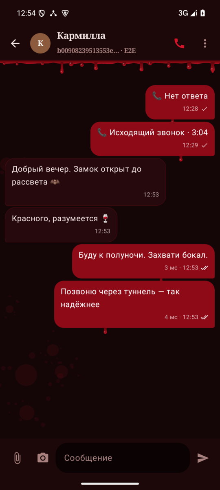
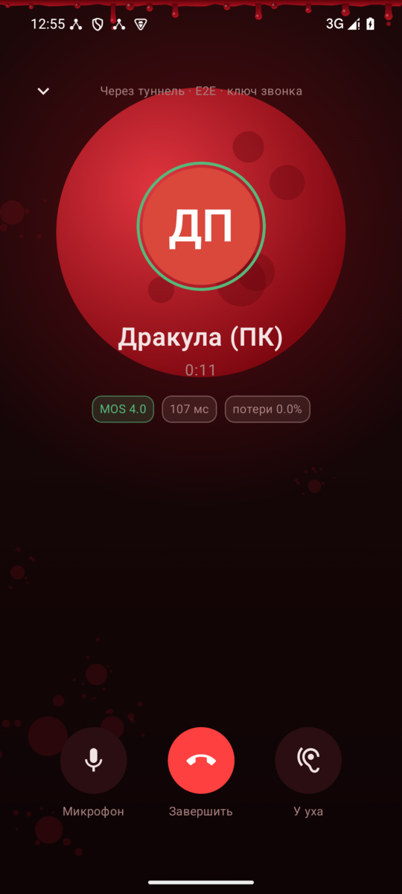
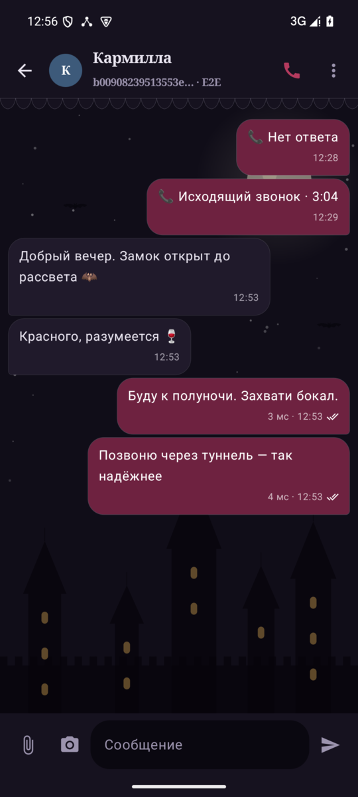
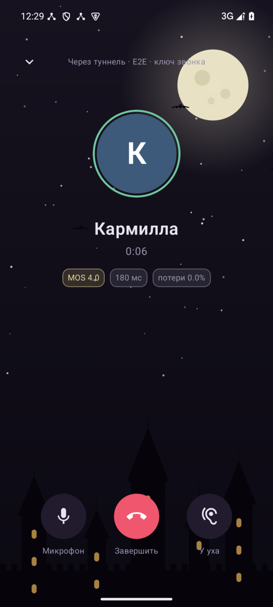

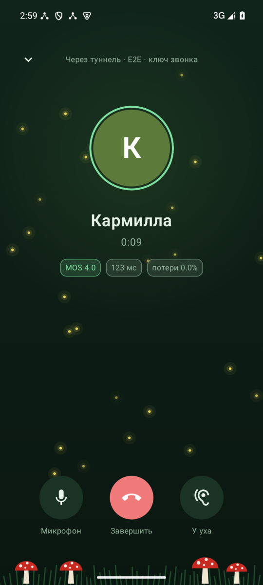

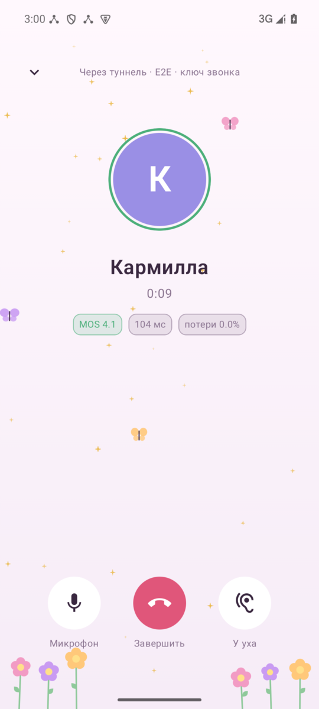

## 4. Темы на компьютере

Выбор — «Контакты и профиль» → «Оформление»: карточки с живыми миниатюрами (капли, луна с летучей мышью, светлячки, бабочка). Рисунок верхней кромки — поверх всего окна, сцена (замок, трава, цветы) — под содержимым каждой панели.

**Светлая**

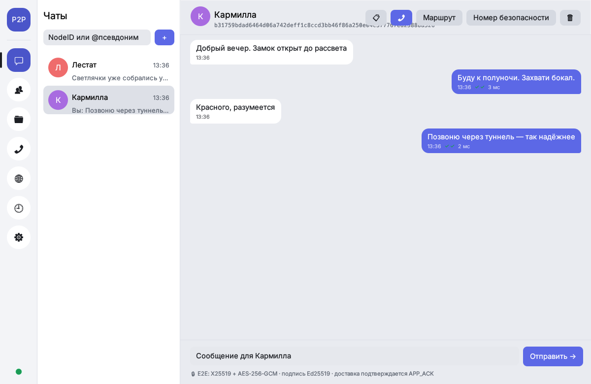

**Кровавая луна**

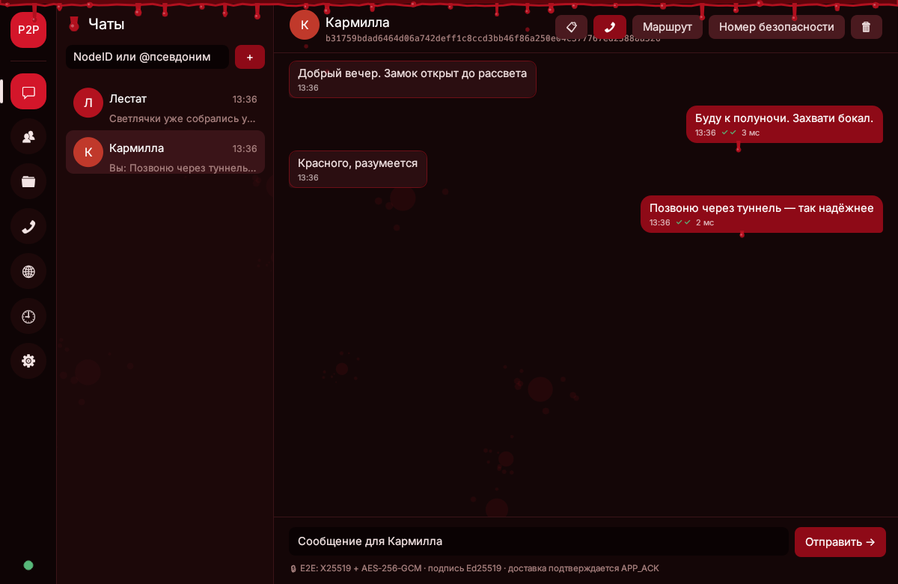

**Ночь в замке**

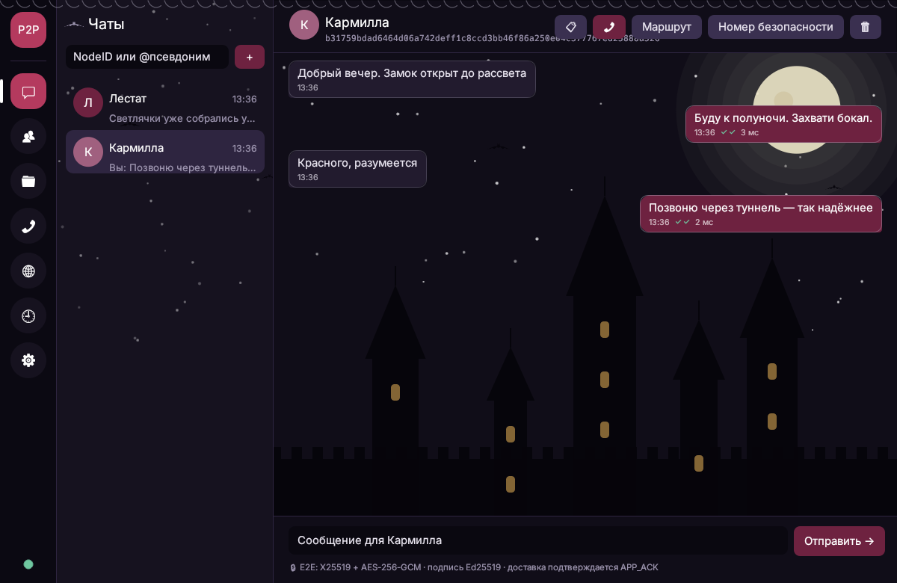

**Лесная фея**

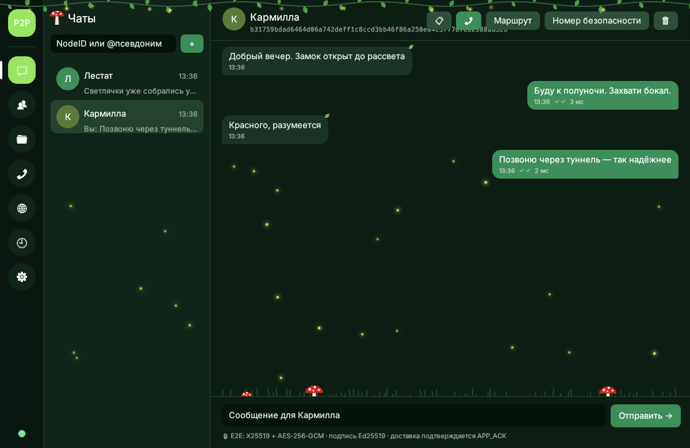

**Цветочная фея**

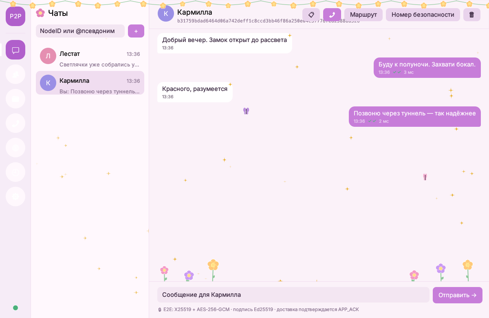

**Выбор темы**

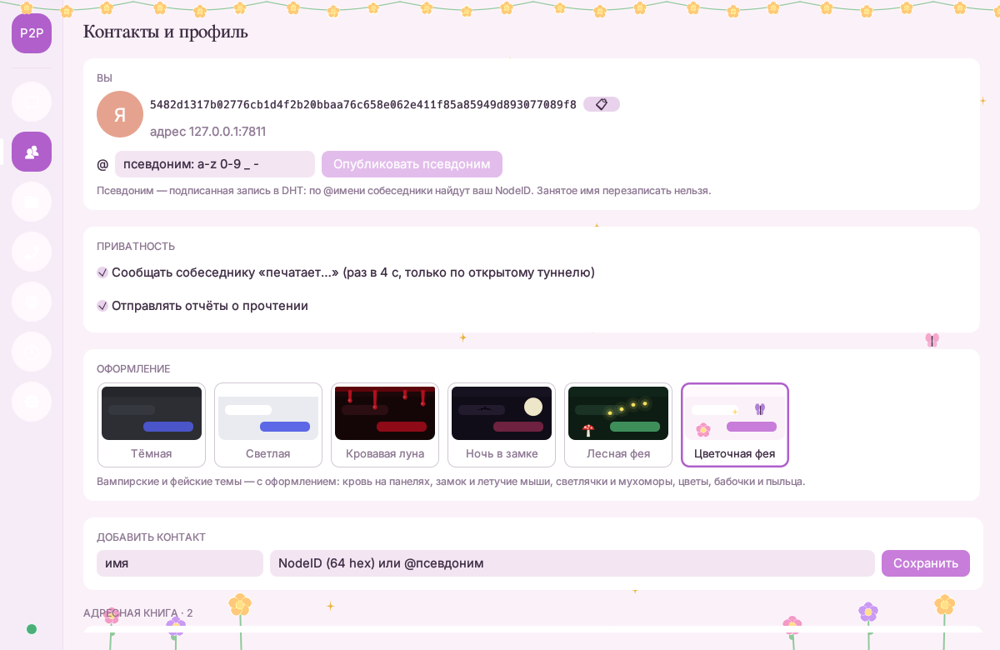

## 5. Экраны

### Звонки

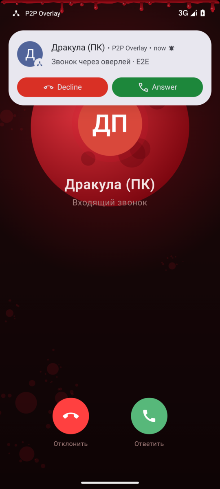
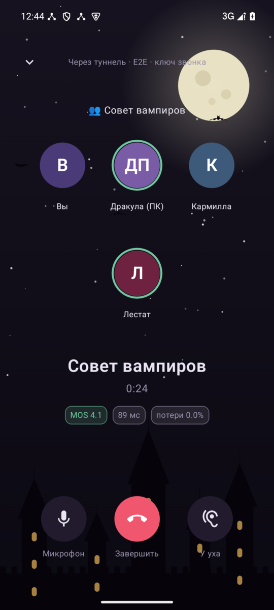

Входящий — уведомление-вызов поверх экрана звонка; групповой — плитки участников, зелёное кольцо у говорящих.

### Предложение файла

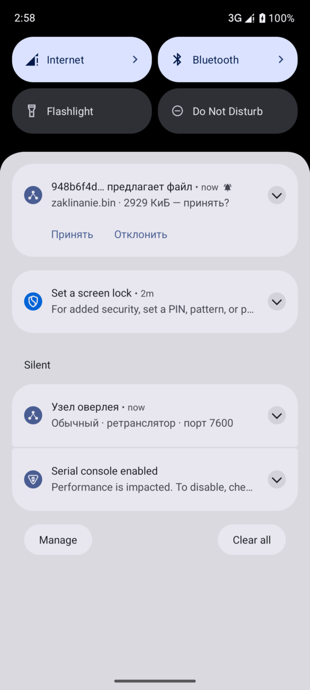

Снимок до того, как появились причина в тексте и предупреждение для файлов больше 2 ГиБ; новая версия — в [версии с нейтральными именами](DESIGN_REPORT_neutral.md#файлы-папки-собеседников-и-согласие-на-приём).

## 6. Анимация

Анимированы только четыре темы с оформлением; тёмная и светлая неподвижны.

| Тема | Анимация |
|---|---|
| Кровавая луна | капли набухают на кончиках подтёков и падают (два независимых цикла 3,6 и 5,3 с на телефоне, на компьютере — у каждого пятого подтёка свой период 3–6 с); луна на звонке пульсирует свечением (2,6 с) |
| Ночь в замке | звёзды мерцают (2,4 с); летучие мыши пересекают экран по синусоиде (17 с) и машут крыльями (0,42 с) |
| Лесная фея | светлячки движутся по замкнутым траекториям и мерцают; листья лианы покачиваются (4 с); ягоды пульсируют; трава колышется |
| Цветочная фея | пыльца-блёстки падают с разной скоростью и мерцают; бабочки летают и машут крыльями; цветы покачиваются |

Цена: на телефоне — бесконечные переходы Compose, перерисовывается только слой рисунка; на компьютере окно перерисовывается ~25 раз в секунду **только** в темах с оформлением (в тёмной и светлой — раз в 0,5 с, как раньше). Кто экономит батарею, выбирает тему без оформления.

## 7. Читаемость (контраст WCAG 2.1)

Отношения яркостей посчитаны по палитрам (норма AA для обычного текста — 4,5, для крупного и значков — 3,0):

| Тема | Текст на фоне | Текст на карточке | Вторичный на фоне | Белый на своём пузыре |
|---|---|---|---|---|
| Тёмная | 10.8 (AAA) | 9.3 (AAA) | 5.2 (AA) | 6.1 (AA) |
| Светлая | 14.0 (AAA) | 16.7 (AAA) | 4.9 (AA) | 4.6 (AA) |
| Кровавая луна | 16.1 (AAA) | 14.5 (AAA) | 5.8 (AA) | 9.5 (AAA) |
| Ночь в замке | 15.5 (AAA) | 13.4 (AAA) | 6.6 (AA) | 10.7 (AAA) |
| Лесная фея | 15.4 (AAA) | 12.0 (AAA) | 7.6 (AAA) | 4.0 (AA (крупный)) |
| Цветочная фея | 12.3 (AAA) | 13.5 (AAA) | 3.8 (AA (крупный)) | 2.9 (ниже AA) |

Основной текст во всех темах — AAA. Слабые места — обе фейские темы, у них заливка своих сообщений светлее, чем у остальных: белый текст на своём пузыре в «Цветочной фее» — **2,9, ниже AA даже для крупного текста**, в «Лесной фее» — 4,0 (годится только для крупного); вторичный текст «Цветочной феи» на светлом фоне — 3,8 (только крупный и подписи). Исправление: затемнить заливку своих сообщений — сиреневую до `#9a4fb6` (5,0, AA), зелёную до `#2f7a49` (5,3, AA), вторичный текст «Цветочной феи» — до `#7a6380` (4,9, AA). Другие темы проверку проходят.

## 8. Ограничения

- В системном шрифте компьютера может не быть эмодзи — значок темы у заголовка «Чаты» поэтому нарисован кистью (капля, летучая мышь, мухомор, цветок), а не взят из шрифта.
- Рисунок под содержимым частично перекрывается карточками (луна на вкладках с карточками) — так задумано: содержимое важнее.
- Тема хранится отдельно на каждом устройстве (настройки клиента), узлу и собеседникам она не передаётся.
- Нет режима «уменьшить движение»: отключить анимацию можно только выбором темы без оформления.

## 9. Как сняты снимки

Телефон — эмулятор Android 15 (x86_64), узел — тот же `p2p-node`, что на компьютере; компьютер — `p2p-desktop` в виртуальном дисплее (Xvfb), подключённый к узлу стенда. Звук собеседников в звонках — тестовый тон узла (`/api/call/tone`), поэтому кольцо «говорит» светится. Снимки телефона уменьшены вдвое.
