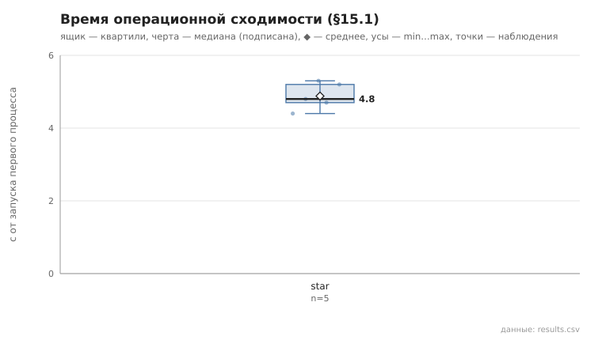
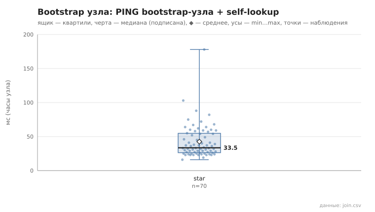

# 01_cold_start

коммит `6726459277fb79ae3b5cfc0491d234fd48ac98a6` + незакоммиченные изменения (diff sha256 `7e04a5b6f82c`), N=15, k=3, α=3, R=3, bootstrap=star, seed=1; драйвер `p2p-orchestrator scenario`

Холодный запуск, 5 независимых запусков. Критерий §15.1: два контрольных раунда подряд (по 15 lookup из заранее сформированного набора) с успехом ≥95% и изменением суммы контактов ≤10% (окно наблюдения — пауза 1 с между раундами); отсчёт — от запуска первого процесса. Процессы запускаются с шагом 0.15 с (launch_span_s), поэтому нижняя граница метода ≈ launch_span_s + 2 раунда + окно.

- **star**: сошлось 5/5; время операционной сходимости, с: n=5, min 4.4, медиана 4.8, среднее 4.9, max 5.3; контактов на узел (min…max по прогонам): 6…11, среднее суммарное 131.6
  - bootstrap узла (часы узла: от старта процесса до конца PING bootstrap-узла + self-lookup), мс: n=70, min 16.0, медиана 33.5, среднее 42.6, max 178.0, p95 82.0

По раундам — rounds.csv, bootstrap каждого узла — join.csv, журналы узлов первого запуска — node_logs/.

## Графики (из results.csv)

