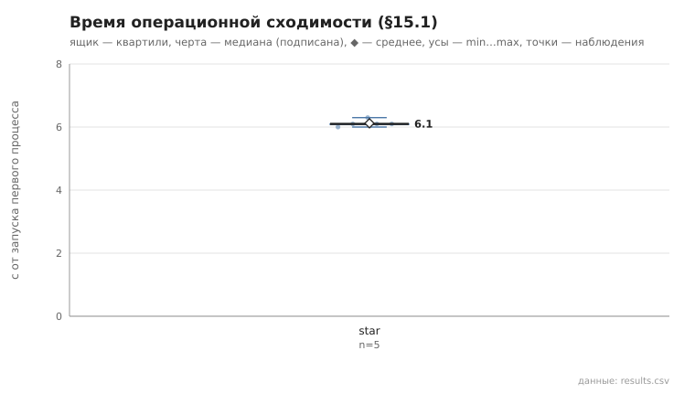
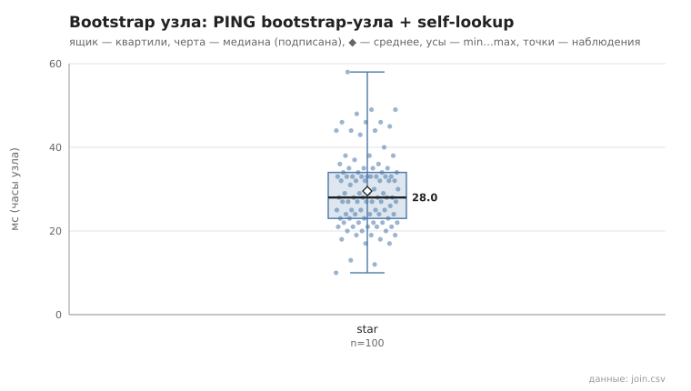

# 01_cold_start

коммит `6726459277fb79ae3b5cfc0491d234fd48ac98a6` + незакоммиченные изменения (diff sha256 `16f203bbc3ef`), N=21, k=4, α=3, R=3, relay=3, канал=tls, bootstrap=star, seed=1, конфиг `config/node_config_advanced.yaml`; драйвер `p2p-orchestrator scenario`

Холодный запуск, 5 независимых запусков. Критерий §15.1: два контрольных раунда подряд (по 21 lookup из заранее сформированного набора) с успехом ≥95% и изменением суммы контактов ≤10% (окно наблюдения — пауза 1 с между раундами); отсчёт — от запуска первого процесса. Процессы запускаются с шагом 0.15 с (launch_span_s), поэтому нижняя граница метода ≈ launch_span_s + 2 раунда + окно.

- **star**: сошлось 5/5; время операционной сходимости, с: n=5, min 6.0, медиана 6.1, среднее 6.1, max 6.3; контактов на узел (min…max по прогонам): 9…15, среднее суммарное 254.8
  - bootstrap узла (часы узла: от старта процесса до конца PING bootstrap-узла + self-lookup), мс: n=100, min 10.0, медиана 28.0, среднее 29.5, max 58.0, p95 46.0

По раундам — rounds.csv, bootstrap каждого узла — join.csv, журналы узлов первого запуска — node_logs/.

## Графики (из results.csv)

