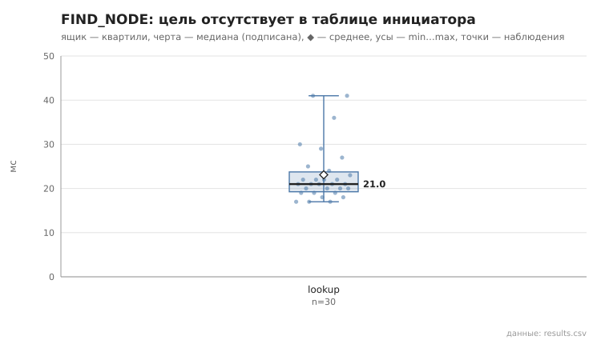
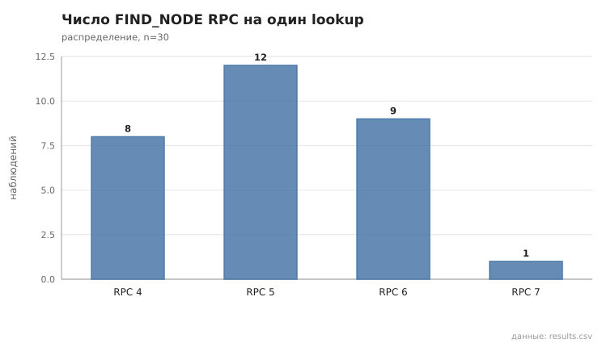
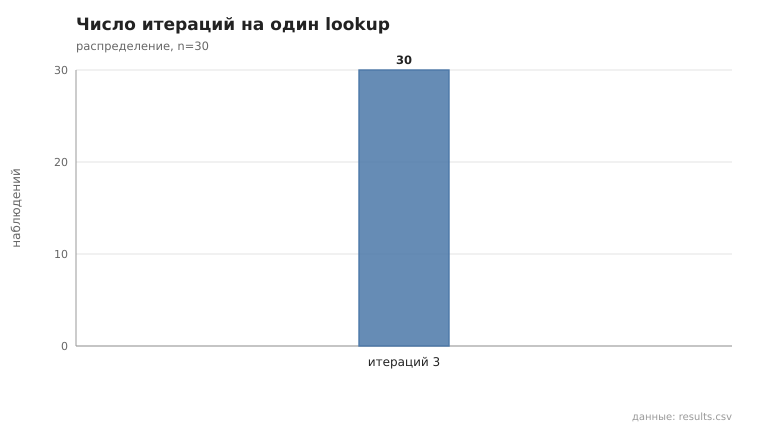

# 02_find_node

коммит `6726459277fb79ae3b5cfc0491d234fd48ac98a6` + незакоммиченные изменения (diff sha256 `6477b6e5e6c2`), N=15, k=3, α=3, R=3, bootstrap=star, seed=1; драйвер `p2p-orchestrator scenario`

Lookup 30; цель отсутствовала в таблице инициатора (по данным узла): 30/30; найдено 30/30 (100%).

- duration_ms: n=30, min 17.0, медиана 21.0, среднее 23.1, max 41.0, p95 41.0
- RPC на lookup: n=30, min 4.0, медиана 5.0, среднее 5.1, max 7.0, p95 6.0
- итераций: n=30, min 3.0, медиана 3.0, среднее 3.0, max 3.0, p95 3.0

## Графики (из results.csv)

