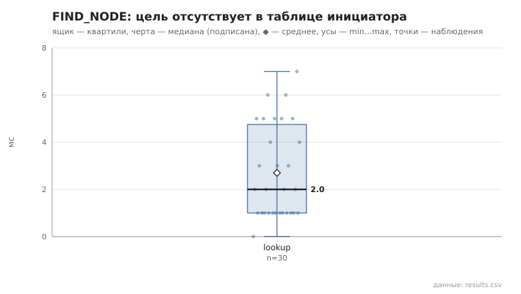
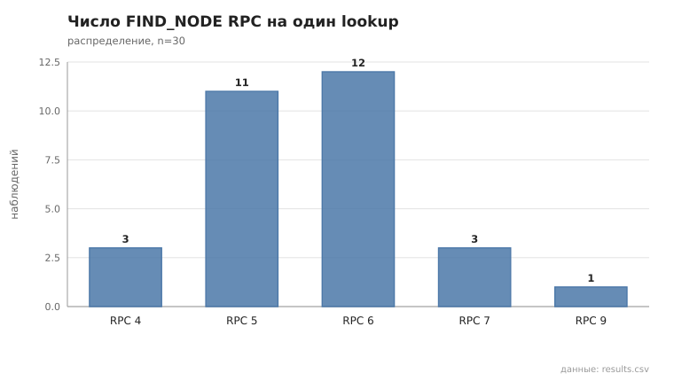
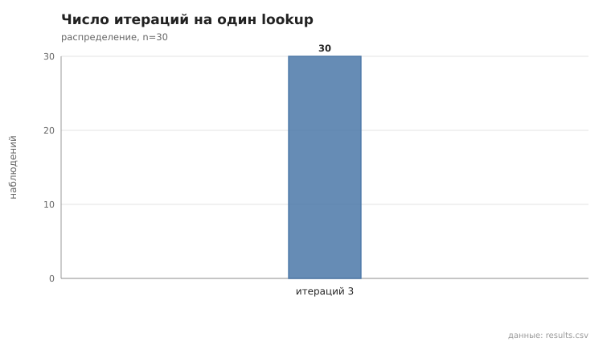

# 02_find_node

коммит `7d2c00f39ac08998e31a122974ed27c84970ef1a` + незакоммиченные изменения (diff sha256 `dd1e5fee38d0`), N=15, k=3, α=3, R=3, relay=2, канал=tls, bootstrap=star, seed=1, конфиг `config/node_config_pool_all.yaml`; драйвер `p2p-orchestrator scenario`

Lookup 30; цель отсутствовала в таблице инициатора (по данным узла): 30/30; найдено 30/30 (100%).

- duration_ms: n=30, min 0.0, медиана 2.0, среднее 2.7, max 7.0, p95 6.0
- RPC на lookup: n=30, min 4.0, медиана 6.0, среднее 5.6, max 9.0, p95 7.0
- итераций: n=30, min 3.0, медиана 3.0, среднее 3.0, max 3.0, p95 3.0

## Графики (из results.csv)

