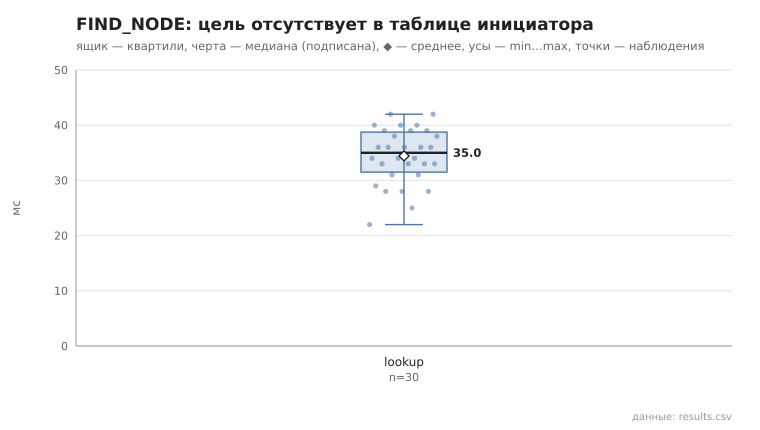
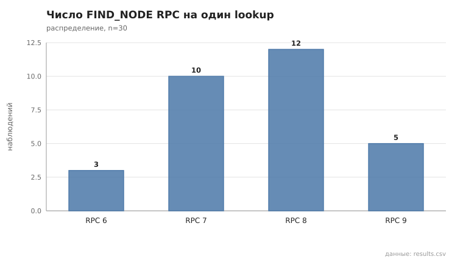
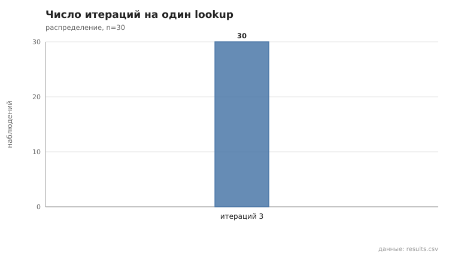

# 02_find_node

коммит `5fee18365b263131d207188d0780b3177dfca4d0` + незакоммиченные изменения (diff sha256 `e3b0c44298fc`), N=21, k=4, α=3, R=3, relay=3, канал=tls, bootstrap=star, seed=1, конфиг `config/node_config_advanced.yaml`; драйвер `p2p-orchestrator scenario`

Lookup 30; цель отсутствовала в таблице инициатора (по данным узла): 30/30; найдено 30/30 (100%).

- duration_ms: n=30, min 22.0, медиана 35.0, среднее 34.4, max 42.0, p95 42.0
- RPC на lookup: n=30, min 6.0, медиана 8.0, среднее 7.6, max 9.0, p95 9.0
- итераций: n=30, min 3.0, медиана 3.0, среднее 3.0, max 3.0, p95 3.0

## Графики (из results.csv)

