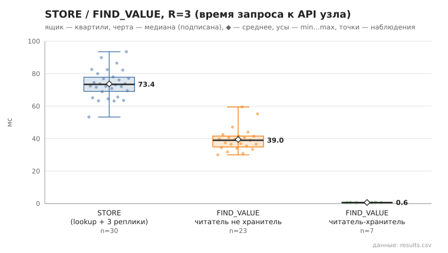

# 03_store_find_value

коммит `6726459277fb79ae3b5cfc0491d234fd48ac98a6` + незакоммиченные изменения (diff sha256 `6477b6e5e6c2`), N=15, k=3, α=3, R=3, bootstrap=star, seed=1; драйвер `p2p-orchestrator scenario`

Операций 30; STORE успешен 30; значение прочитано верно 30/30.
stored_on — число подтвердивших узлов включая автора (R=3 реплики + локальная копия); holders — фактически найдено в хранилищах по /api/status: n=30, min 4.0, медиана 4.0, среднее 4.0, max 4.0, p95 4.0.

- STORE, мс (lookup ключа + 3×STORE): n=30, min 53.3, медиана 73.4, среднее 73.7, max 93.5, p95 89.9
- FIND_VALUE, мс (все): n=30, min 0.6, медиана 36.5, среднее 30.4, max 59.5, p95 55.2
- FIND_VALUE, мс (читатель не хранитель): n=23, min 30.0, медиана 39.0, среднее 39.5, max 59.5, p95 55.2

## Графики (из results.csv)

