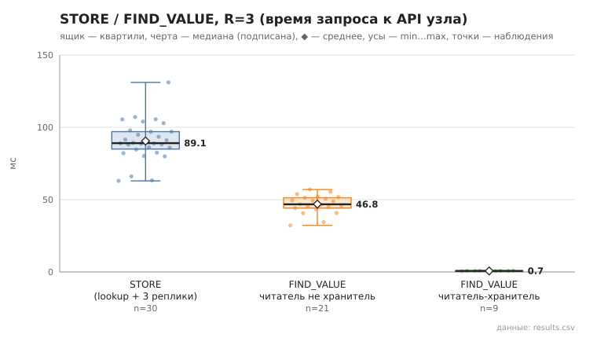

# 03_store_find_value

коммит `6726459277fb79ae3b5cfc0491d234fd48ac98a6` + незакоммиченные изменения (diff sha256 `c6e15b070b44`), N=15, k=3, α=3, R=3, relay=2, канал=tls, bootstrap=star, seed=1, конфиг `config/node_config.yaml`; драйвер `p2p-orchestrator scenario`

Операций 30; STORE успешен 30; значение прочитано верно 30/30.
stored_on — число подтвердивших узлов включая автора (R=3 реплики + локальная копия); holders — фактически найдено в хранилищах по /api/status: n=30, min 4.0, медиана 4.0, среднее 4.0, max 4.0, p95 4.0.

- STORE, мс (lookup ключа + 3×STORE): n=30, min 63.0, медиана 89.1, среднее 90.5, max 131.1, p95 107.1
- FIND_VALUE, мс (все): n=30, min 0.6, медиана 44.6, среднее 33.0, max 57.0, p95 55.4
- FIND_VALUE, мс (читатель не хранитель): n=21, min 32.2, медиана 46.8, среднее 46.9, max 57.0, p95 55.4

## Графики (из results.csv)

