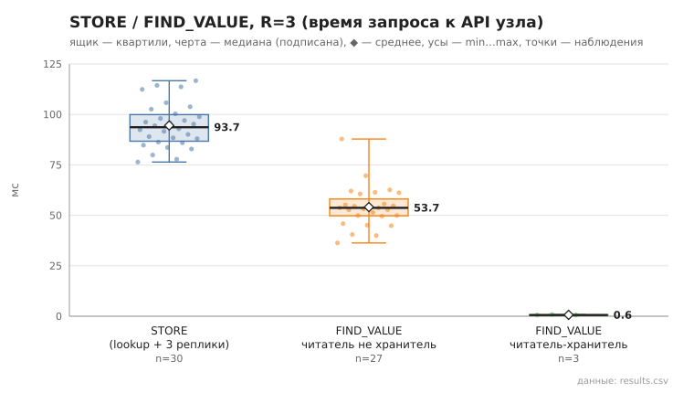

# 03_store_find_value

коммит `6726459277fb79ae3b5cfc0491d234fd48ac98a6` + незакоммиченные изменения (diff sha256 `4408451537ac`), N=21, k=4, α=3, R=3, relay=3, канал=tls, bootstrap=star, seed=1, конфиг `config/node_config_advanced.yaml`; драйвер `p2p-orchestrator scenario`

Операций 30; STORE успешен 30; значение прочитано верно 30/30.
stored_on — число подтвердивших узлов включая автора (R=3 реплики + локальная копия); holders — фактически найдено в хранилищах по /api/status: n=30, min 4.0, медиана 4.0, среднее 4.0, max 4.0, p95 4.0.

- STORE, мс (lookup ключа + 3×STORE): n=30, min 76.4, медиана 93.7, среднее 94.5, max 116.7, p95 114.4
- FIND_VALUE, мс (все): n=30, min 0.6, медиана 53.0, среднее 48.7, max 87.8, p95 69.6
- FIND_VALUE, мс (читатель не хранитель): n=27, min 36.3, медиана 53.7, среднее 54.0, max 87.8, p95 69.6

## Графики (из results.csv)

