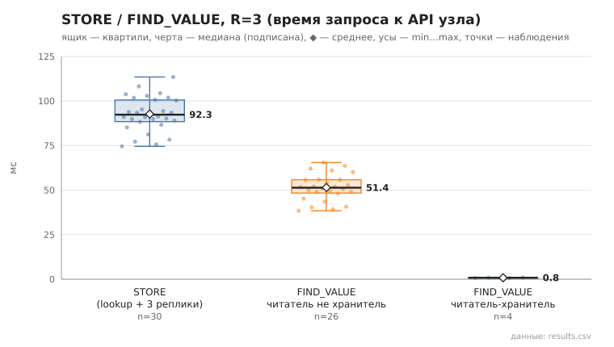

# 03_store_find_value

коммит `5fee18365b263131d207188d0780b3177dfca4d0` + незакоммиченные изменения (diff sha256 `e3b0c44298fc`), N=21, k=4, α=3, R=3, relay=3, канал=tls, bootstrap=star, seed=1, конфиг `config/node_config_advanced.yaml`; драйвер `p2p-orchestrator scenario`

Операций 30; STORE успешен 30; значение прочитано верно 30/30.
stored_on — число подтвердивших узлов включая автора (R=3 реплики + локальная копия); holders — фактически найдено в хранилищах по /api/status: n=30, min 4.0, медиана 4.0, среднее 4.0, max 4.0, p95 4.0.

- STORE, мс (lookup ключа + 3×STORE): n=30, min 74.6, медиана 92.4, среднее 92.7, max 113.5, p95 108.2
- FIND_VALUE, мс (все): n=30, min 0.7, медиана 50.3, среднее 44.7, max 65.5, p95 63.7
- FIND_VALUE, мс (читатель не хранитель): n=26, min 38.4, медиана 51.4, среднее 51.4, max 65.5, p95 63.7

## Графики (из results.csv)

