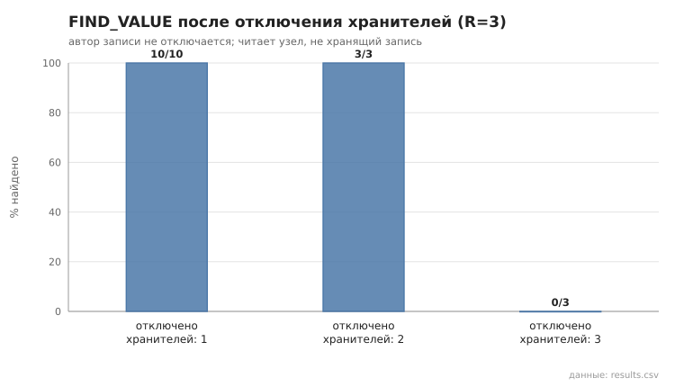
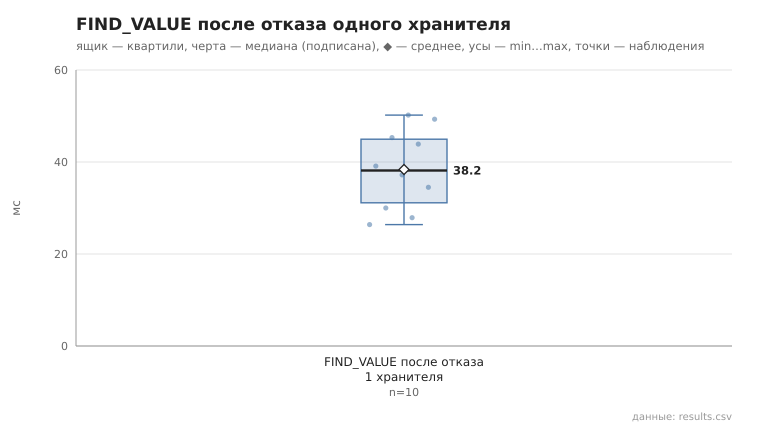

# 04_keeper_failure

коммит `6726459277fb79ae3b5cfc0491d234fd48ac98a6` + незакоммиченные изменения (diff sha256 `6477b6e5e6c2`), N=15, k=3, α=3, R=3, bootstrap=star, seed=1; драйвер `p2p-orchestrator scenario`

Запись публикует узел 0; отключаются (SIGKILL) хранители-реплики (автор не трогается), читает живой узел, не хранящий запись. После каждой инъекции отключённые узлы перезапускаются (та же identity) — условия следующей инъекции одинаковы. Основной сценарий §15.1 п.4 — отключение одного хранителя; 2 и 3 — граница отказоустойчивости при R=3.

- отключено хранителей 1: найдено 10/10; find_ms: n=10, min 26.4, медиана 38.2, среднее 38.4, max 50.2
- отключено хранителей 2: найдено 3/3; find_ms: n=3, min 31.4, медиана 39.8, среднее 40.1, max 49.1
- отключено хранителей 3: найдено 0/3; find_ms: n=0

## Графики (из results.csv)

