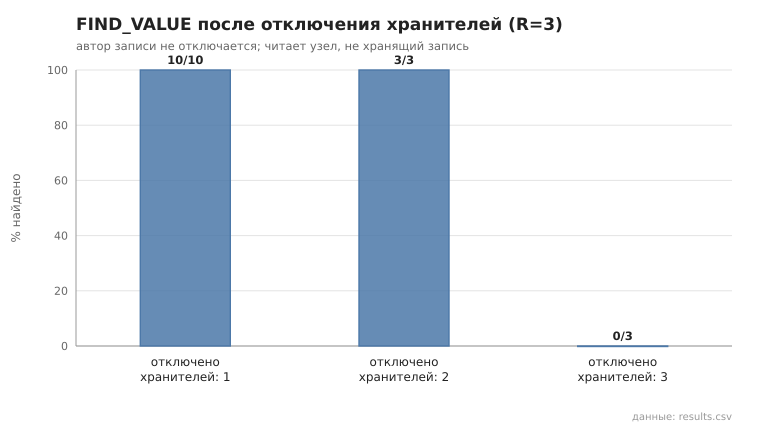
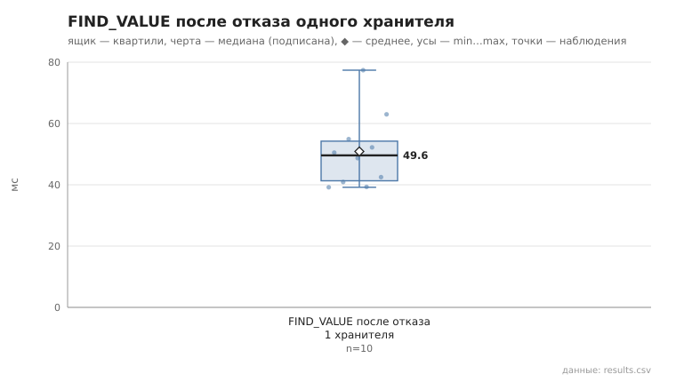

# 04_keeper_failure

коммит `6726459277fb79ae3b5cfc0491d234fd48ac98a6` + незакоммиченные изменения (diff sha256 `4408451537ac`), N=21, k=4, α=3, R=3, relay=3, канал=tls, bootstrap=star, seed=1, конфиг `config/node_config_advanced.yaml`; драйвер `p2p-orchestrator scenario`

Запись публикует узел 0; отключаются (SIGKILL) хранители-реплики (автор не трогается), читает живой узел, не хранящий запись. После каждой инъекции отключённые узлы перезапускаются (та же identity) — условия следующей инъекции одинаковы. Основной сценарий §15.1 п.4 — отключение одного хранителя; 2 и 3 — граница отказоустойчивости при R=3.

- отключено хранителей 1: найдено 10/10; find_ms: n=10, min 39.2, медиана 49.6, среднее 50.9, max 77.4
- отключено хранителей 2: найдено 3/3; find_ms: n=3, min 53.4, медиана 72.1, среднее 72.0, max 90.4
- отключено хранителей 3: найдено 0/3; find_ms: n=0

## Графики (из results.csv)

