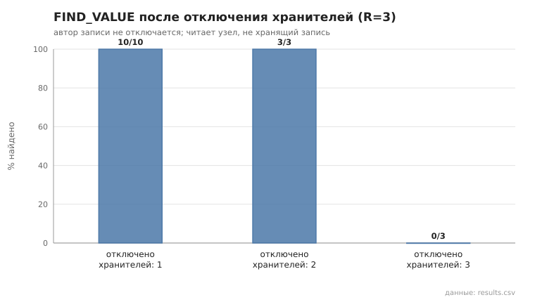
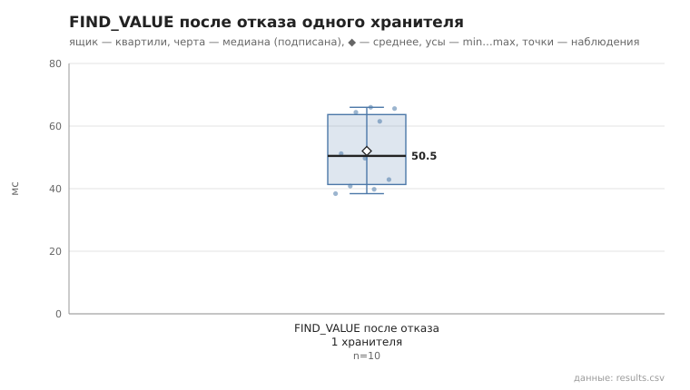

# 04_keeper_failure

коммит `5fee18365b263131d207188d0780b3177dfca4d0` + незакоммиченные изменения (diff sha256 `e3b0c44298fc`), N=21, k=4, α=3, R=3, relay=3, канал=tls, bootstrap=star, seed=1, конфиг `config/node_config_advanced.yaml`; драйвер `p2p-orchestrator scenario`

Запись публикует узел 0; отключаются (SIGKILL) хранители-реплики (автор не трогается), читает живой узел, не хранящий запись. После каждой инъекции отключённые узлы перезапускаются (та же identity) — условия следующей инъекции одинаковы. Основной сценарий §15.1 п.4 — отключение одного хранителя; 2 и 3 — граница отказоустойчивости при R=3.

- отключено хранителей 1: найдено 10/10; find_ms: n=10, min 38.4, медиана 50.5, среднее 52.0, max 66.0
- отключено хранителей 2: найдено 3/3; find_ms: n=3, min 44.9, медиана 51.1, среднее 49.1, max 51.3
- отключено хранителей 3: найдено 0/3; find_ms: n=0

## Графики (из results.csv)

