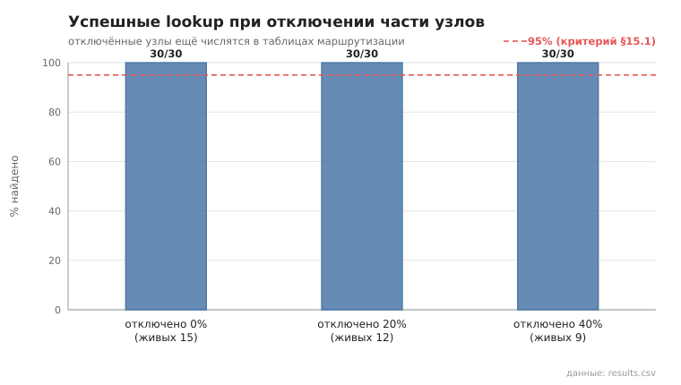
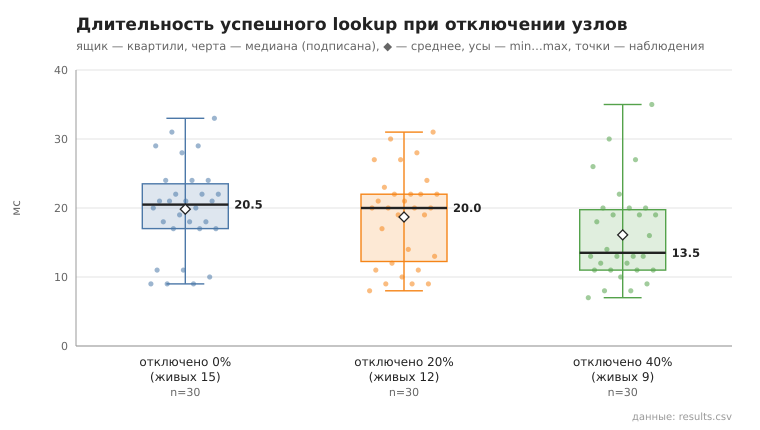

# 05_lookup_failure

коммит `6726459277fb79ae3b5cfc0491d234fd48ac98a6` + незакоммиченные изменения (diff sha256 `6477b6e5e6c2`), N=15, k=3, α=3, R=3, bootstrap=star, seed=1; драйвер `p2p-orchestrator scenario`

Часть узлов останавливается (SIGKILL), через 2 с — пока они ещё числятся в таблицах маршрутизации и попадают в кандидаты lookup — живые узлы ищут друг друга. Отключения накопительные.

- отключено 0 из 15 (0%): успех 30/30; duration_ms n=30, min 9.0, медиана 20.5, среднее 19.8, max 33.0, p95 31.0; RPC n=30, min 3.0, медиана 5.0, среднее 5.2, max 9.0, p95 7.0
- отключено 3 из 15 (20%): успех 30/30; duration_ms n=30, min 8.0, медиана 20.0, среднее 18.7, max 31.0, p95 30.0; RPC n=30, min 3.0, медиана 4.0, среднее 4.1, max 7.0, p95 7.0
- отключено 6 из 15 (40%): успех 30/30; duration_ms n=30, min 7.0, медиана 13.5, среднее 16.1, max 35.0, p95 30.0; RPC n=30, min 1.0, медиана 3.0, среднее 2.8, max 5.0, p95 4.0

## Графики (из results.csv)

