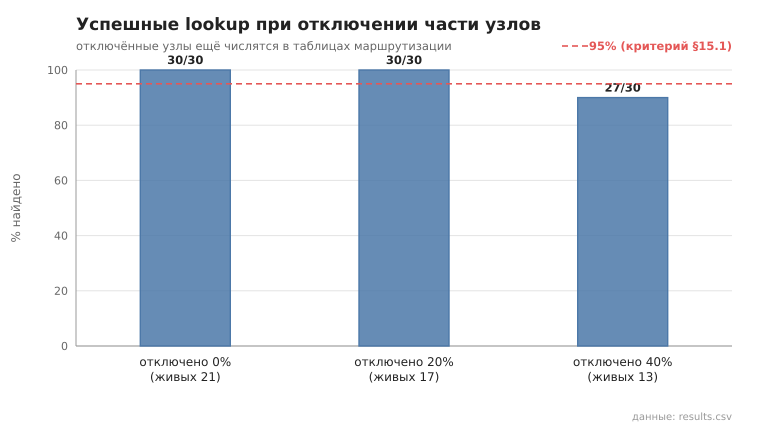
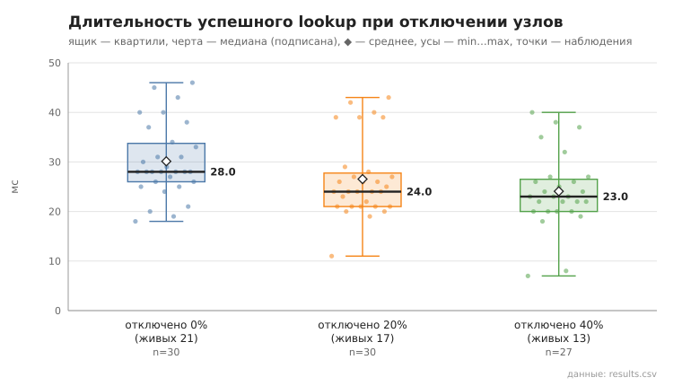

# 05_lookup_failure

коммит `6726459277fb79ae3b5cfc0491d234fd48ac98a6` + незакоммиченные изменения (diff sha256 `8328f84b9ef6`), N=21, k=4, α=3, R=3, relay=3, канал=tls, bootstrap=star, seed=1, конфиг `config/node_config_advanced.yaml`; драйвер `p2p-orchestrator scenario`

Часть узлов останавливается (SIGKILL), через 2 с — пока они ещё числятся в таблицах маршрутизации и попадают в кандидаты lookup — живые узлы ищут друг друга. Отключения накопительные.

- отключено 0 из 21 (0%): успех 30/30; duration_ms n=30, min 18.0, медиана 28.0, среднее 30.1, max 46.0, p95 45.0; RPC n=30, min 4.0, медиана 6.0, среднее 6.2, max 9.0, p95 9.0
- отключено 4 из 21 (20%): успех 30/30; duration_ms n=30, min 11.0, медиана 24.0, среднее 26.5, max 43.0, p95 42.0; RPC n=30, min 2.0, медиана 5.0, среднее 5.2, max 9.0, p95 9.0
- отключено 8 из 21 (40%): успех 27/30; duration_ms n=27, min 7.0, медиана 23.0, среднее 24.1, max 40.0, p95 38.0; RPC n=27, min 1.0, медиана 5.0, среднее 4.7, max 8.0, p95 7.0

## Графики (из results.csv)

