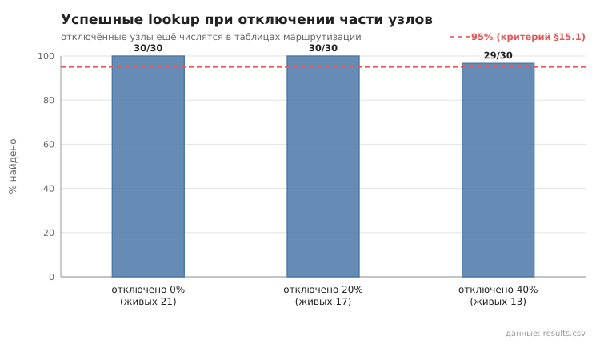
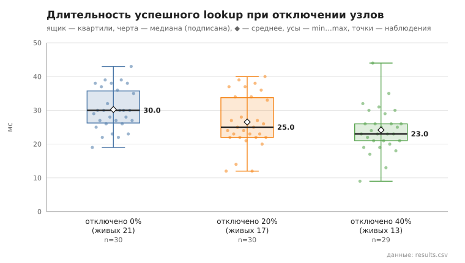

# 05_lookup_failure

коммит `5fee18365b263131d207188d0780b3177dfca4d0` + незакоммиченные изменения (diff sha256 `e3b0c44298fc`), N=21, k=4, α=3, R=3, relay=3, канал=tls, bootstrap=star, seed=1, конфиг `config/node_config_advanced.yaml`; драйвер `p2p-orchestrator scenario`

Часть узлов останавливается (SIGKILL), через 2 с — пока они ещё числятся в таблицах маршрутизации и попадают в кандидаты lookup — живые узлы ищут друг друга. Отключения накопительные.

- отключено 0 из 21 (0%): успех 30/30; duration_ms n=30, min 19.0, медиана 30.0, среднее 30.2, max 43.0, p95 39.0; RPC n=30, min 4.0, медиана 6.0, среднее 6.2, max 9.0, p95 9.0
- отключено 4 из 21 (20%): успех 30/30; duration_ms n=30, min 12.0, медиана 25.0, среднее 26.5, max 40.0, p95 39.0; RPC n=30, min 3.0, медиана 5.0, среднее 4.9, max 8.0, p95 8.0
- отключено 8 из 21 (40%): успех 29/30; duration_ms n=29, min 9.0, медиана 23.0, среднее 24.2, max 44.0, p95 35.0; RPC n=29, min 1.0, медиана 4.0, среднее 3.8, max 7.0, p95 6.0

## Графики (из results.csv)

