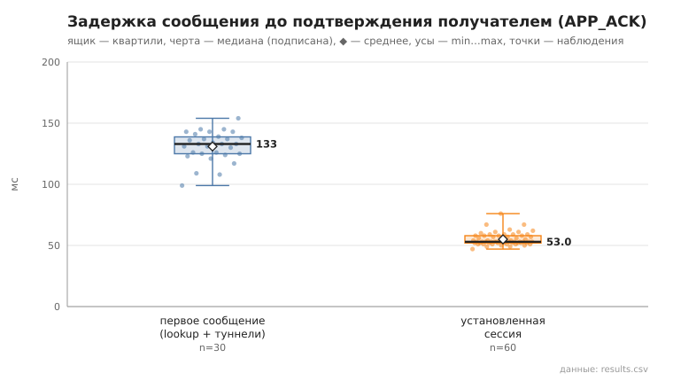
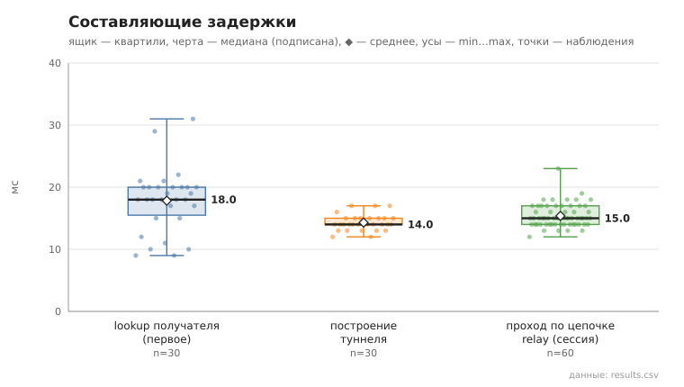

# 06_tunnel_message

коммит `6726459277fb79ae3b5cfc0491d234fd48ac98a6` + незакоммиченные изменения (diff sha256 `6477b6e5e6c2`), N=15, k=3, α=3, R=3, bootstrap=star, seed=1; драйвер `p2p-orchestrator scenario`

30 пар (неупорядоченные пары не повторяются, туннелей между ними до первого сообщения нет), по 3 сообщения на пару. Доставлено с APP_ACK 90/90.
first — туннель строился в этой отправке (lookup + TUNNEL_BUILD; у получателя — свой обратный туннель для APP_ACK); session — туннель уже установлен, lookup не выполняется.

- время построения туннеля, мс: n=30, min 12.0, медиана 14.0, среднее 14.3, max 17.0, p95 17.0
- lookup получателя (first), мс: n=30, min 9.0, медиана 18.0, среднее 17.8, max 31.0, p95 29.0
- первое сообщение, RTT до APP_ACK, мс: n=30, min 99.0, медиана 133.0, среднее 131.0, max 154.0, p95 145.0
- установленная сессия, RTT до APP_ACK, мс: n=60, min 47.0, медиана 53.0, среднее 55.0, max 76.0, p95 63.0
- установленная сессия, проход по цепочке до получателя (TUNNEL_ACK), мс: n=60, min 12.0, медиана 15.0, среднее 15.4, max 23.0, p95 18.0

## Графики (из results.csv)

