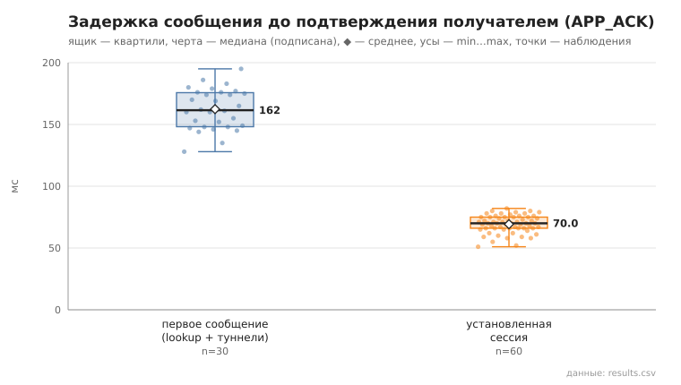
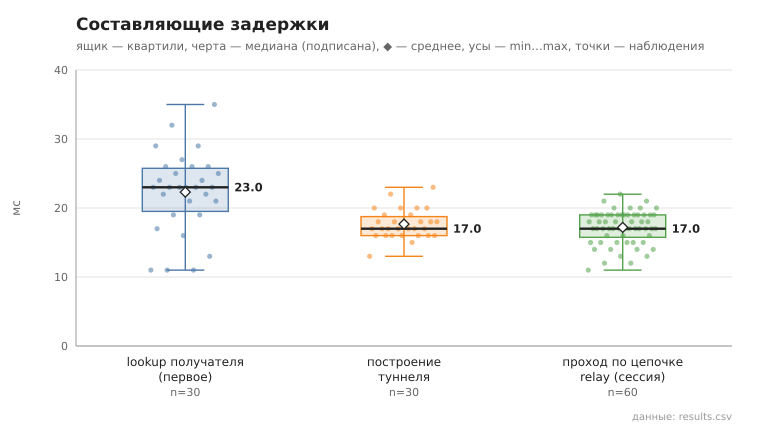

# 06_tunnel_message

коммит `6726459277fb79ae3b5cfc0491d234fd48ac98a6` + незакоммиченные изменения (diff sha256 `c6e15b070b44`), N=15, k=3, α=3, R=3, relay=2, канал=tls, bootstrap=star, seed=1, конфиг `config/node_config.yaml`; драйвер `p2p-orchestrator scenario`

30 пар (неупорядоченные пары не повторяются, туннелей между ними до первого сообщения нет), по 3 сообщения на пару. Доставлено с APP_ACK 90/90.
first — туннель строился в этой отправке (lookup + TUNNEL_BUILD; у получателя — свой обратный туннель для APP_ACK); session — туннель уже установлен, lookup не выполняется.

- время построения туннеля, мс: n=30, min 13.0, медиана 17.0, среднее 17.7, max 23.0, p95 22.0
- lookup получателя (first), мс: n=30, min 11.0, медиана 23.0, среднее 22.3, max 35.0, p95 32.0
- первое сообщение, RTT до APP_ACK, мс: n=30, min 128.0, медиана 161.5, среднее 162.4, max 195.0, p95 186.0
- установленная сессия, RTT до APP_ACK, мс: n=60, min 51.0, медиана 70.0, среднее 69.3, max 82.0, p95 79.0
- установленная сессия, проход по цепочке до получателя (TUNNEL_ACK), мс: n=60, min 11.0, медиана 17.0, среднее 17.2, max 22.0, p95 20.0

## Графики (из results.csv)

