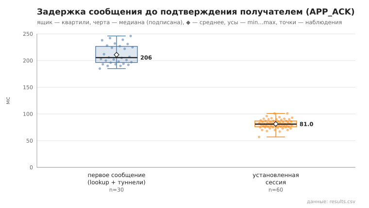
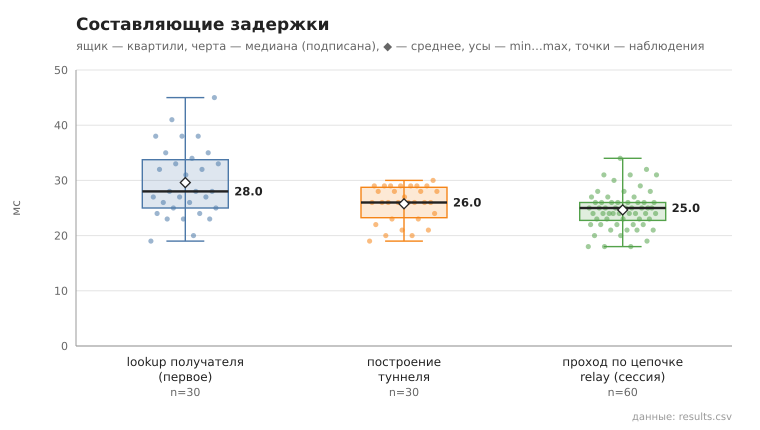

# 06_tunnel_message

коммит `6726459277fb79ae3b5cfc0491d234fd48ac98a6` + незакоммиченные изменения (diff sha256 `8328f84b9ef6`), N=21, k=4, α=3, R=3, relay=3, канал=tls, bootstrap=star, seed=1, конфиг `config/node_config_advanced.yaml`; драйвер `p2p-orchestrator scenario`

30 пар (неупорядоченные пары не повторяются, туннелей между ними до первого сообщения нет), по 3 сообщения на пару. Доставлено с APP_ACK 90/90.
first — туннель строился в этой отправке (lookup + TUNNEL_BUILD; у получателя — свой обратный туннель для APP_ACK); session — туннель уже установлен, lookup не выполняется.

- время построения туннеля, мс: n=30, min 19.0, медиана 26.0, среднее 25.8, max 30.0, p95 29.0
- lookup получателя (first), мс: n=30, min 19.0, медиана 28.0, среднее 29.6, max 45.0, p95 41.0
- первое сообщение, RTT до APP_ACK, мс: n=30, min 185.0, медиана 205.5, среднее 210.8, max 246.0, p95 242.0
- установленная сессия, RTT до APP_ACK, мс: n=60, min 57.0, медиана 81.0, среднее 81.5, max 101.0, p95 94.0
- установленная сессия, проход по цепочке до получателя (TUNNEL_ACK), мс: n=60, min 18.0, медиана 25.0, среднее 24.6, max 34.0, p95 31.0

## Графики (из results.csv)

