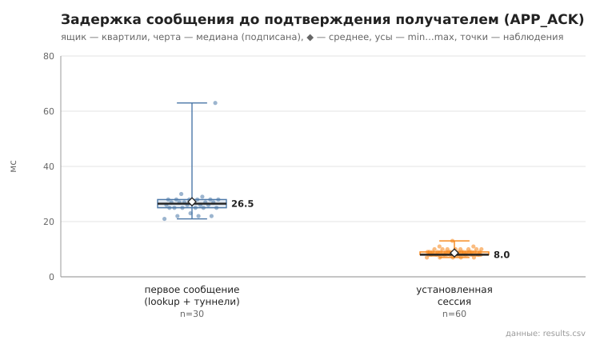
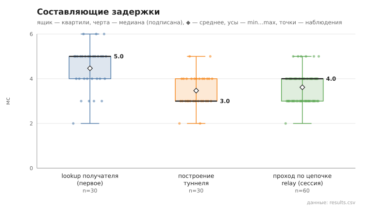

# 06_tunnel_message

коммит `7d2c00f39ac08998e31a122974ed27c84970ef1a` + незакоммиченные изменения (diff sha256 `dd1e5fee38d0`), N=15, k=3, α=3, R=3, relay=2, канал=tls, bootstrap=star, seed=1, конфиг `config/node_config.yaml`; драйвер `p2p-orchestrator scenario`

30 пар (неупорядоченные пары не повторяются, туннелей между ними до первого сообщения нет), по 3 сообщения на пару. Доставлено с APP_ACK 90/90.
first — туннель строился в этой отправке (lookup + TUNNEL_BUILD; у получателя — свой обратный туннель для APP_ACK); session — туннель уже установлен, lookup не выполняется.

- время построения туннеля, мс: n=30, min 2.0, медиана 3.0, среднее 3.5, max 5.0, p95 5.0
- lookup получателя (first), мс: n=30, min 2.0, медиана 5.0, среднее 4.5, max 6.0, p95 6.0
- первое сообщение, RTT до APP_ACK, мс: n=30, min 21.0, медиана 26.5, среднее 27.2, max 63.0, p95 30.0
- установленная сессия, RTT до APP_ACK, мс: n=60, min 7.0, медиана 8.0, среднее 8.7, max 13.0, p95 10.0
- установленная сессия, проход по цепочке до получателя (TUNNEL_ACK), мс: n=60, min 2.0, медиана 4.0, среднее 3.6, max 5.0, p95 5.0

## Графики (из results.csv)

