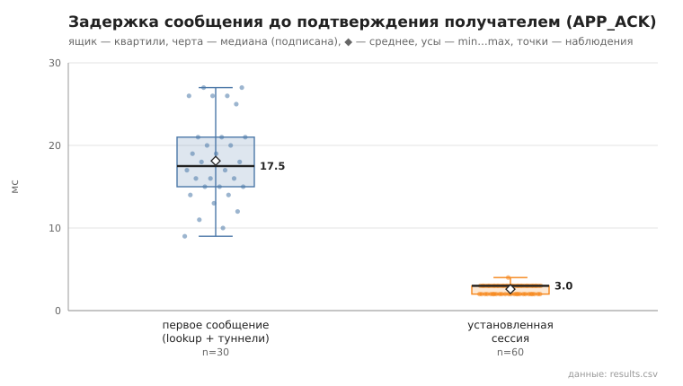
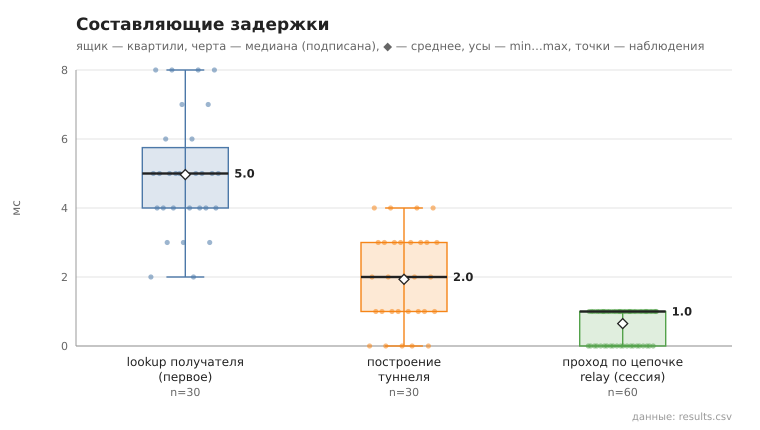

# 06_tunnel_message

коммит `c732b144cdc0c8f545762b12837a8e36d499a21d` + незакоммиченные изменения (diff sha256 `cb3e3addf6d4`), N=15, k=3, α=3, R=3, relay=2, канал=tls, bootstrap=star, seed=1, конфиг `config/node_config.yaml`; драйвер `p2p-orchestrator scenario`

30 пар (неупорядоченные пары не повторяются, туннелей между ними до первого сообщения нет), по 3 сообщения на пару. Доставлено с APP_ACK 90/90.
first — туннель строился в этой отправке (lookup + TUNNEL_BUILD; у получателя — свой обратный туннель для APP_ACK); session — туннель уже установлен, lookup не выполняется.

- время построения туннеля, мс: n=30, min 0.0, медиана 2.0, среднее 1.9, max 4.0, p95 4.0
- lookup получателя (first), мс: n=30, min 2.0, медиана 5.0, среднее 5.0, max 8.0, p95 8.0
- первое сообщение, RTT до APP_ACK, мс: n=30, min 9.0, медиана 17.5, среднее 18.1, max 27.0, p95 27.0
- установленная сессия, RTT до APP_ACK, мс: n=60, min 2.0, медиана 3.0, среднее 2.6, max 4.0, p95 3.0
- установленная сессия, проход по цепочке до получателя (TUNNEL_ACK), мс: n=60, min 0.0, медиана 1.0, среднее 0.7, max 1.0, p95 1.0

## Графики (из results.csv)

