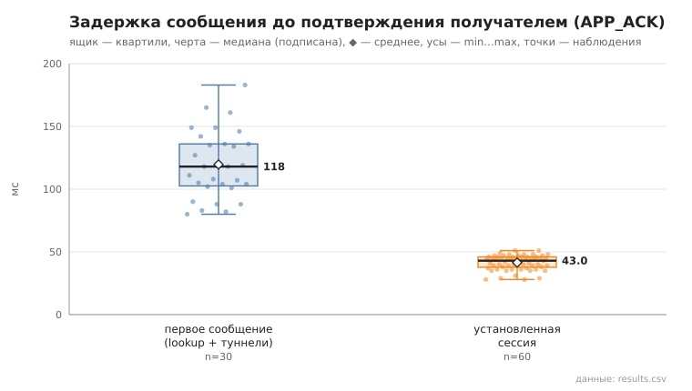
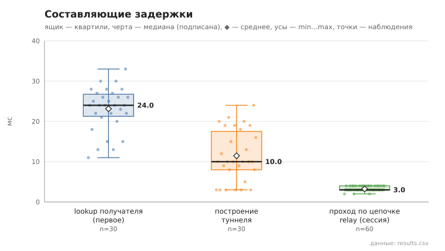

# 06_tunnel_message

коммит `c732b144cdc0c8f545762b12837a8e36d499a21d` + незакоммиченные изменения (diff sha256 `cb3e3addf6d4`), N=15, k=3, α=3, R=3, relay=2, канал=tls, bootstrap=star, seed=1, конфиг `config/node_config.yaml`; драйвер `p2p-orchestrator scenario`

30 пар (неупорядоченные пары не повторяются, туннелей между ними до первого сообщения нет), по 3 сообщения на пару. Доставлено с APP_ACK 90/90.
first — туннель строился в этой отправке (lookup + TUNNEL_BUILD; у получателя — свой обратный туннель для APP_ACK); session — туннель уже установлен, lookup не выполняется.

- время построения туннеля, мс: n=30, min 3.0, медиана 10.0, среднее 11.5, max 24.0, p95 21.0
- lookup получателя (first), мс: n=30, min 11.0, медиана 24.0, среднее 23.1, max 33.0, p95 30.0
- первое сообщение, RTT до APP_ACK, мс: n=30, min 80.0, медиана 118.0, среднее 119.7, max 183.0, p95 165.0
- установленная сессия, RTT до APP_ACK, мс: n=60, min 28.0, медиана 43.0, среднее 41.4, max 51.0, p95 48.0
- установленная сессия, проход по цепочке до получателя (TUNNEL_ACK), мс: n=60, min 2.0, медиана 3.0, среднее 3.2, max 4.0, p95 4.0

## Графики (из results.csv)

