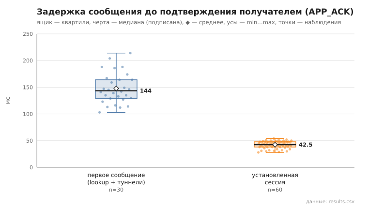
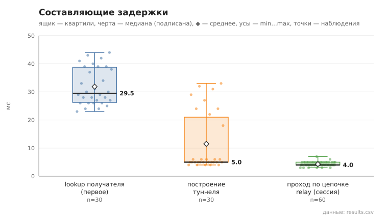

# 06_tunnel_message

коммит `c732b144cdc0c8f545762b12837a8e36d499a21d` + незакоммиченные изменения (diff sha256 `cb3e3addf6d4`), N=21, k=4, α=3, R=3, relay=3, канал=tls, bootstrap=star, seed=1, конфиг `config/node_config_advanced.yaml`; драйвер `p2p-orchestrator scenario`

30 пар (неупорядоченные пары не повторяются, туннелей между ними до первого сообщения нет), по 3 сообщения на пару. Доставлено с APP_ACK 90/90.
first — туннель строился в этой отправке (lookup + TUNNEL_BUILD; у получателя — свой обратный туннель для APP_ACK); session — туннель уже установлен, lookup не выполняется.

- время построения туннеля, мс: n=30, min 4.0, медиана 5.0, среднее 11.5, max 33.0, p95 32.0
- lookup получателя (first), мс: n=30, min 23.0, медиана 29.5, среднее 31.9, max 44.0, p95 43.0
- первое сообщение, RTT до APP_ACK, мс: n=30, min 103.0, медиана 143.5, среднее 147.8, max 214.0, p95 204.0
- установленная сессия, RTT до APP_ACK, мс: n=60, min 28.0, медиана 42.5, среднее 42.4, max 54.0, p95 51.0
- установленная сессия, проход по цепочке до получателя (TUNNEL_ACK), мс: n=60, min 3.0, медиана 4.0, среднее 4.3, max 7.0, p95 5.0

## Графики (из results.csv)

