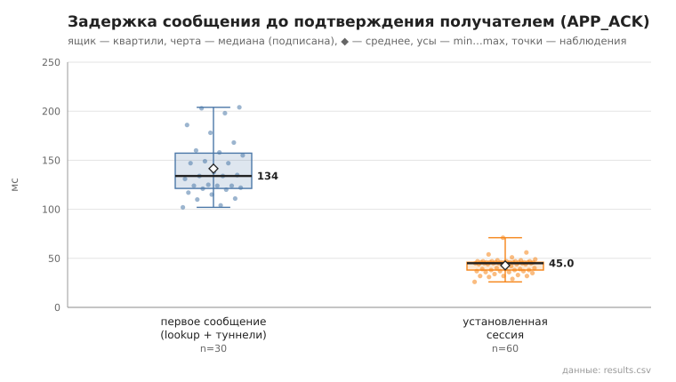
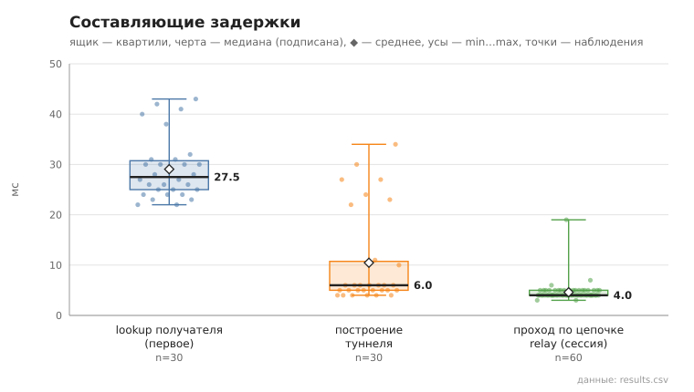

# 06_tunnel_message

коммит `5fee18365b263131d207188d0780b3177dfca4d0` + незакоммиченные изменения (diff sha256 `e3b0c44298fc`), N=21, k=4, α=3, R=3, relay=3, канал=tls, bootstrap=star, seed=1, конфиг `config/node_config_advanced.yaml`; драйвер `p2p-orchestrator scenario`

30 пар (неупорядоченные пары не повторяются, туннелей между ними до первого сообщения нет), по 3 сообщения на пару. Доставлено с APP_ACK 90/90.
first — туннель строился в этой отправке (lookup + TUNNEL_BUILD; у получателя — свой обратный туннель для APP_ACK); session — туннель уже установлен, lookup не выполняется.

- время построения туннеля, мс: n=30, min 4.0, медиана 6.0, среднее 10.5, max 34.0, p95 30.0
- lookup получателя (first), мс: n=30, min 22.0, медиана 27.5, среднее 29.1, max 43.0, p95 42.0
- первое сообщение, RTT до APP_ACK, мс: n=30, min 102.0, медиана 134.0, среднее 141.5, max 204.0, p95 203.0
- установленная сессия, RTT до APP_ACK, мс: n=60, min 26.0, медиана 45.0, среднее 42.8, max 71.0, p95 51.0
- установленная сессия, проход по цепочке до получателя (TUNNEL_ACK), мс: n=60, min 3.0, медиана 4.0, среднее 4.6, max 19.0, p95 5.0

## Графики (из results.csv)

