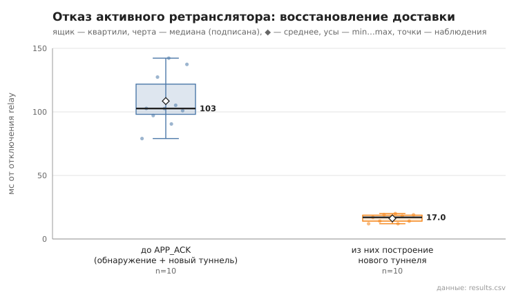

# 07_relay_failure

коммит `6726459277fb79ae3b5cfc0491d234fd48ac98a6` + незакоммиченные изменения (diff sha256 `6477b6e5e6c2`), N=15, k=3, α=3, R=3, bootstrap=star, seed=1; драйвер `p2p-orchestrator scenario`

Отправитель строит туннель (сообщение доставлено), затем relay этого туннеля отключается (SIGKILL; hop_index чередуется), и сообщение отправляется повторно до доставки (лимит 60 с). recovery_ms — от отключения до APP_ACK; включает обнаружение отказа (нет TUNNEL_ACK), lookup, построение нового туннеля без отказавшего relay и повтор. После инъекции relay перезапускается.

- инъекций 10, доставка восстановлена 10/10; без единой неудачной попытки (перестроение внутри той же отправки): 10
- новый маршрут не содержит отключённый relay: 10/10
- время восстановления доставки, мс: n=10, min 79.0, медиана 102.7, среднее 108.5, max 142.3
- из них построение нового туннеля, мс: n=10, min 12.0, медиана 17.0, среднее 16.2, max 20.0

## Графики (из results.csv)

