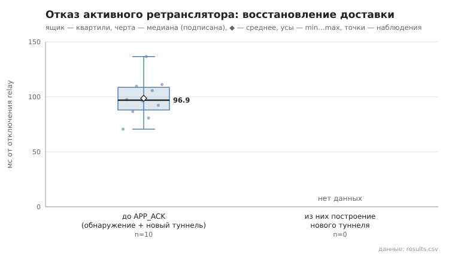

# 07_relay_failure

коммит `6726459277fb79ae3b5cfc0491d234fd48ac98a6` + незакоммиченные изменения (diff sha256 `8328f84b9ef6`), N=21, k=4, α=3, R=3, relay=3, канал=tls, bootstrap=star, seed=1, конфиг `config/node_config_advanced.yaml`; драйвер `p2p-orchestrator scenario`

Отправитель строит туннель (сообщение доставлено), затем relay этого туннеля отключается (SIGKILL; hop_index чередуется), и сообщение отправляется повторно до доставки (лимит 60 с). recovery_ms — от отключения до APP_ACK; включает обнаружение отказа (нет TUNNEL_ACK), lookup, построение нового туннеля без отказавшего relay и повтор. После инъекции relay перезапускается.

- инъекций 10, доставка восстановлена 10/10; без единой неудачной попытки (перестроение внутри той же отправки): 10
- новый маршрут не содержит отключённый relay: 10/10
- время восстановления доставки, мс: n=10, min 70.6, медиана 96.9, среднее 98.7, max 136.6
- из них построение нового туннеля, мс: n=0

## Графики (из results.csv)

