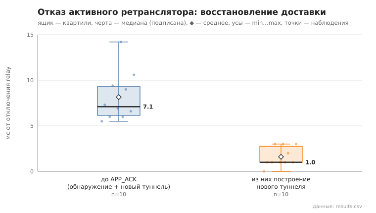

# 07_relay_failure

коммит `c732b144cdc0c8f545762b12837a8e36d499a21d` + незакоммиченные изменения (diff sha256 `cb3e3addf6d4`), N=15, k=3, α=3, R=3, relay=2, канал=tls, bootstrap=star, seed=1, конфиг `config/node_config_pool_all.yaml`; драйвер `p2p-orchestrator scenario`

Отправитель строит туннель (сообщение доставлено), затем relay этого туннеля отключается (SIGKILL; hop_index чередуется), и сообщение отправляется повторно до доставки (лимит 60 с). recovery_ms — от отключения до APP_ACK; включает обнаружение отказа (нет TUNNEL_ACK), lookup, построение нового туннеля без отказавшего relay и повтор. После инъекции relay перезапускается.

- инъекций 10, доставка восстановлена 10/10; без единой неудачной попытки (перестроение внутри той же отправки): 10
- новый маршрут не содержит отключённый relay: 10/10
- время восстановления доставки, мс: n=10, min 5.5, медиана 7.1, среднее 8.2, max 14.2
- из них построение нового туннеля, мс: n=10, min 0.0, медиана 1.0, среднее 1.6, max 3.0

## Графики (из results.csv)

