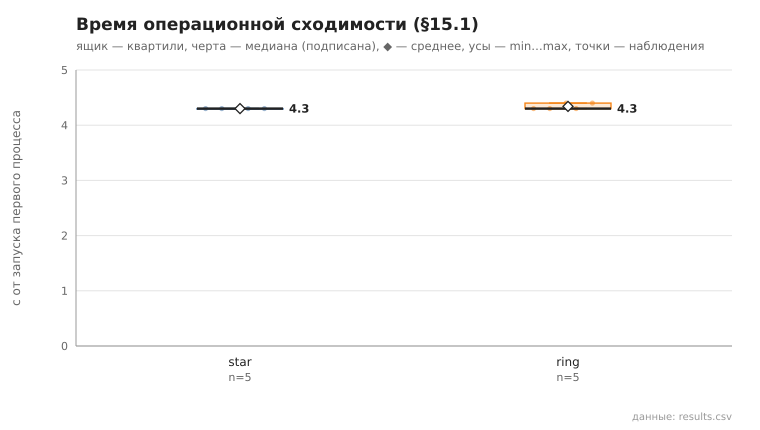
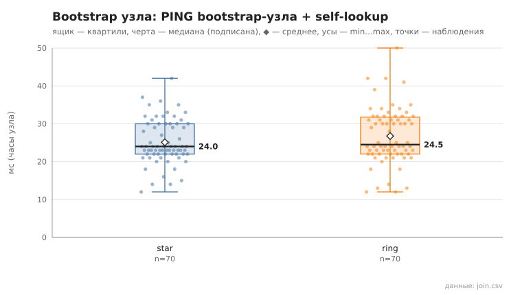

# 09_bootstrap_compare

коммит `6726459277fb79ae3b5cfc0491d234fd48ac98a6` + незакоммиченные изменения (diff sha256 `fe4ceb1647cd`), N=15, k=3, α=3, R=3, bootstrap=star+ring, seed=1; драйвер `p2p-orchestrator scenario`

Сравнение bootstrap-схем при прочих равных (N, k, α, R, тайм-ауты, seed): star — все узлы к узлу 0, ring — узел i к узлу i−1. 5 запусков на схему. Критерий §15.1: два контрольных раунда подряд (по 15 lookup из заранее сформированного набора) с успехом ≥95% и изменением суммы контактов ≤10% (окно наблюдения — пауза 1 с между раундами); отсчёт — от запуска первого процесса. Процессы запускаются с шагом 0.15 с (launch_span_s), поэтому нижняя граница метода ≈ launch_span_s + 2 раунда + окно.

- **star**: сошлось 5/5; время операционной сходимости, с: n=5, min 4.3, медиана 4.3, среднее 4.3, max 4.3; контактов на узел (min…max по прогонам): 5…11, среднее суммарное 132.2
  - bootstrap узла (часы узла: от старта процесса до конца PING bootstrap-узла + self-lookup), мс: n=70, min 12.0, медиана 24.0, среднее 25.1, max 42.0, p95 35.0
- **ring**: сошлось 5/5; время операционной сходимости, с: n=5, min 4.3, медиана 4.3, среднее 4.3, max 4.4; контактов на узел (min…max по прогонам): 6…11, среднее суммарное 130.6
  - bootstrap узла (часы узла: от старта процесса до конца PING bootstrap-узла + self-lookup), мс: n=70, min 12.0, медиана 24.5, среднее 26.8, max 50.0, p95 41.0

## Графики (из results.csv)

