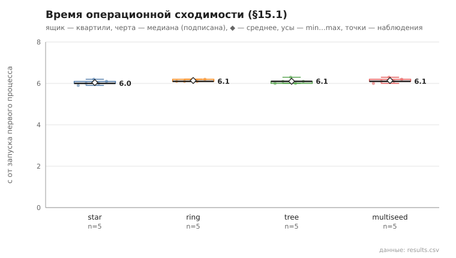
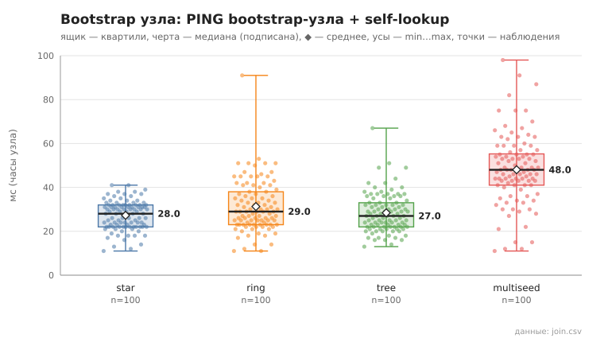

# 09_bootstrap_compare

коммит `6726459277fb79ae3b5cfc0491d234fd48ac98a6` + незакоммиченные изменения (diff sha256 `aa7d63258d82`), N=21, k=4, α=3, R=3, relay=3, канал=tls, bootstrap=star+ring+tree+multiseed, seed=1, конфиг `config/node_config_advanced.yaml`; драйвер `p2p-orchestrator scenario`

Сравнение bootstrap-схем при прочих равных (N, k, α, R, тайм-ауты, seed): star — все узлы к узлу 0, ring — узел i к узлу i−1, tree — двоичное дерево (к родителю (i−1)/2), multiseed — три seed, остальные знают все три. 5 запусков на схему. Критерий §15.1: два контрольных раунда подряд (по 21 lookup из заранее сформированного набора) с успехом ≥95% и изменением суммы контактов ≤10% (окно наблюдения — пауза 1 с между раундами); отсчёт — от запуска первого процесса. Процессы запускаются с шагом 0.15 с (launch_span_s), поэтому нижняя граница метода ≈ launch_span_s + 2 раунда + окно.

- **star**: сошлось 5/5; время операционной сходимости, с: n=5, min 5.9, медиана 6.0, среднее 6.0, max 6.2; контактов на узел (min…max по прогонам): 8…16, среднее суммарное 259.6
  - bootstrap узла (часы узла: от старта процесса до конца PING bootstrap-узла + self-lookup), мс: n=100, min 11.0, медиана 28.0, среднее 27.2, max 41.0, p95 37.0
- **ring**: сошлось 5/5; время операционной сходимости, с: n=5, min 6.1, медиана 6.1, среднее 6.1, max 6.2; контактов на узел (min…max по прогонам): 8…17, среднее суммарное 260.2
  - bootstrap узла (часы узла: от старта процесса до конца PING bootstrap-узла + self-lookup), мс: n=100, min 11.0, медиана 29.0, среднее 31.3, max 91.0, p95 51.0
- **tree**: сошлось 5/5; время операционной сходимости, с: n=5, min 6.0, медиана 6.1, среднее 6.1, max 6.3; контактов на узел (min…max по прогонам): 9…16, среднее суммарное 256.2
  - bootstrap узла (часы узла: от старта процесса до конца PING bootstrap-узла + self-lookup), мс: n=100, min 13.0, медиана 27.0, среднее 28.4, max 67.0, p95 42.0
- **multiseed**: сошлось 5/5; время операционной сходимости, с: n=5, min 6.0, медиана 6.1, среднее 6.1, max 6.3; контактов на узел (min…max по прогонам): 8…17, среднее суммарное 259.4
  - bootstrap узла (часы узла: от старта процесса до конца PING bootstrap-узла + self-lookup), мс: n=100, min 11.0, медиана 48.0, среднее 48.0, max 98.0, p95 75.0

## Графики (из results.csv)

