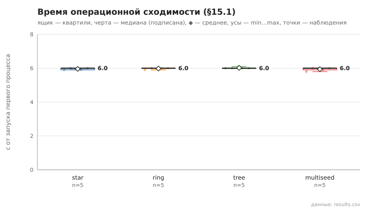
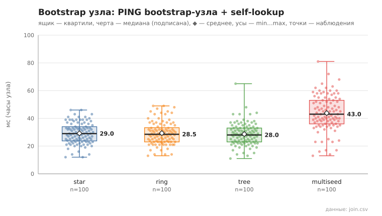

# 09_bootstrap_compare

коммит `5fee18365b263131d207188d0780b3177dfca4d0` + незакоммиченные изменения (diff sha256 `0c321869d961`), N=21, k=4, α=3, R=3, relay=3, канал=tls, bootstrap=star+ring+tree+multiseed, seed=1, конфиг `config/node_config_advanced.yaml`; драйвер `p2p-orchestrator scenario`

Сравнение bootstrap-схем при прочих равных (N, k, α, R, тайм-ауты, seed): star — все узлы к узлу 0, ring — узел i к узлу i−1, tree — двоичное дерево (к родителю (i−1)/2), multiseed — три seed, остальные знают все три. 5 запусков на схему. Критерий §15.1: два контрольных раунда подряд (по 21 lookup из заранее сформированного набора) с успехом ≥95% и изменением суммы контактов ≤10% (окно наблюдения — пауза 1 с между раундами); отсчёт — от запуска первого процесса. Процессы запускаются с шагом 0.15 с (launch_span_s), поэтому нижняя граница метода ≈ launch_span_s + 2 раунда + окно.

- **star**: сошлось 5/5; время операционной сходимости, с: n=5, min 5.9, медиана 6.0, среднее 6.0, max 6.0; контактов на узел (min…max по прогонам): 9…17, среднее суммарное 260.2
  - bootstrap узла (часы узла: от старта процесса до конца PING bootstrap-узла + self-lookup), мс: n=100, min 12.0, медиана 29.0, среднее 29.2, max 46.0, p95 41.0
- **ring**: сошлось 5/5; время операционной сходимости, с: n=5, min 5.9, медиана 6.0, среднее 6.0, max 6.0; контактов на узел (min…max по прогонам): 9…15, среднее суммарное 255.2
  - bootstrap узла (часы узла: от старта процесса до конца PING bootstrap-узла + self-lookup), мс: n=100, min 13.0, медиана 28.5, среднее 29.3, max 49.0, p95 45.0
- **tree**: сошлось 5/5; время операционной сходимости, с: n=5, min 6.0, медиана 6.0, среднее 6.0, max 6.1; контактов на узел (min…max по прогонам): 8…17, среднее суммарное 257.2
  - bootstrap узла (часы узла: от старта процесса до конца PING bootstrap-узла + self-lookup), мс: n=100, min 11.0, медиана 28.0, среднее 28.7, max 65.0, p95 43.0
- **multiseed**: сошлось 5/5; время операционной сходимости, с: n=5, min 5.8, медиана 6.0, среднее 5.9, max 6.0; контактов на узел (min…max по прогонам): 8…16, среднее суммарное 261.8
  - bootstrap узла (часы узла: от старта процесса до конца PING bootstrap-узла + self-lookup), мс: n=100, min 13.0, медиана 43.0, среднее 43.8, max 81.0, p95 62.0

## Графики (из results.csv)

