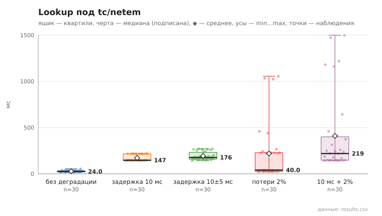
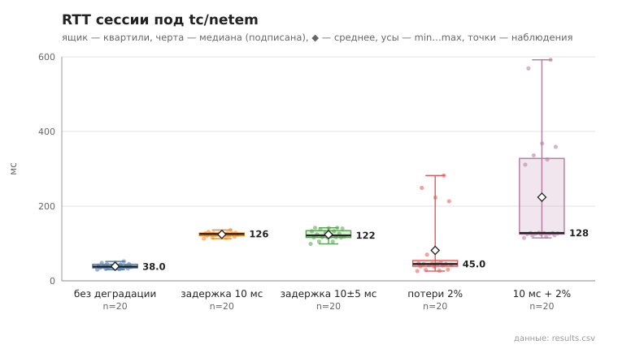

# 10_netem

коммит `5fee18365b263131d207188d0780b3177dfca4d0` + незакоммиченные изменения (diff sha256 `41661ee1da76`), N=21, k=4, α=3, R=3, relay=3, канал=tls, bootstrap=star, seed=1, конфиг `config/node_config_advanced.yaml`; драйвер `p2p-orchestrator scenario`

На интерфейс loopback по очереди накладываются профили `tc qdisc … netem` (все узлы на одной машине — деградация действует на каждое соединение между ними). Сеть одна; на каждом профиле — 30 lookup и сообщения. Учтите: на каждый hop туннеля и каждое рукопожатие задержка приходится отдельно.

- **без деградации** (`—`): lookup 30/30, мс n=30, min 18.0, медиана 24.0, среднее 27.8, max 53.0, p95 44.0; первое сообщение доставлено 10/10; сессия 20/20, RTT мс n=20, min 30.0, медиана 38.0, среднее 38.9, max 52.0, p95 48.0
- **задержка 10 мс** (`delay 10ms`): lookup 30/30, мс n=30, min 140.0, медиана 147.0, среднее 171.6, max 222.0, p95 221.0; первое сообщение доставлено 10/10; сессия 20/20, RTT мс n=20, min 113.0, медиана 125.5, среднее 124.2, max 136.0, p95 131.0
- **задержка 10±5 мс** (`delay 10ms 5ms distribution normal`): lookup 30/30, мс n=30, min 143.0, медиана 176.5, среднее 192.9, max 270.0, p95 270.0; первое сообщение доставлено 10/10; сессия 20/20, RTT мс n=20, min 99.0, медиана 121.5, среднее 123.8, max 142.0, p95 142.0
- **потери 2%** (`loss 2%`): lookup 30/30, мс n=30, min 22.0, медиана 40.0, среднее 218.8, max 1056.0, p95 1033.0; первое сообщение доставлено 10/10; сессия 20/20, RTT мс n=20, min 26.0, медиана 45.0, среднее 81.5, max 282.0, p95 249.0
- **10 мс + 2%** (`delay 10ms loss 2%`): lookup 30/30, мс n=30, min 142.0, медиана 219.0, среднее 409.8, max 1499.0, p95 1473.0; первое сообщение доставлено 10/10; сессия 20/20, RTT мс n=20, min 115.0, медиана 128.0, среднее 223.9, max 592.0, p95 569.0

## Графики (из results.csv)

