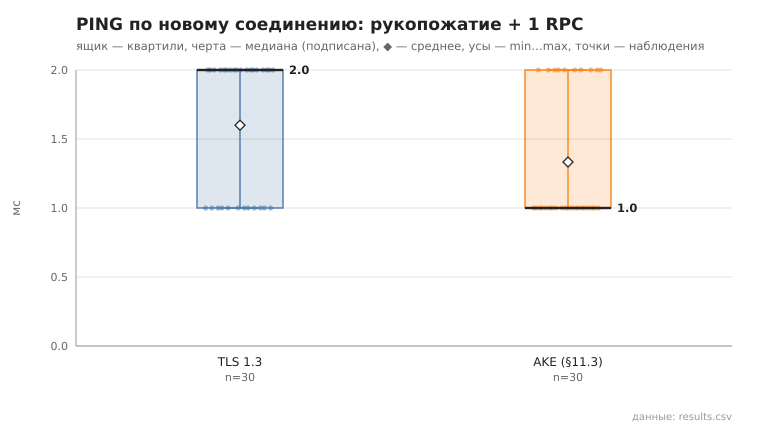
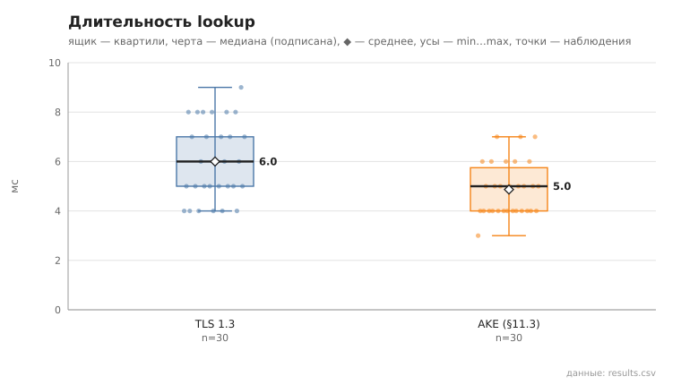
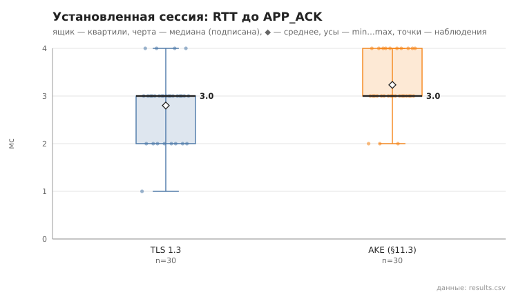
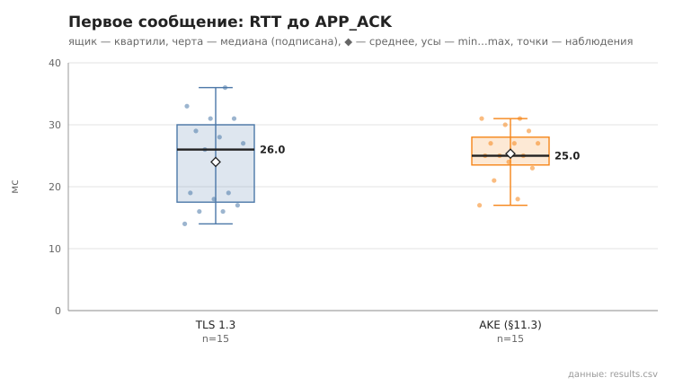

# channel_compare

коммит `c732b144cdc0c8f545762b12837a8e36d499a21d` + незакоммиченные изменения (diff sha256 `f23ec84a1d45`), N=21, k=4, α=3, R=3, relay=3, канал=tls, bootstrap=star, seed=1, конфиг `config/node_config_advanced.yaml`; драйвер `p2p-orchestrator scenario`

Одна и та же сеть из 21 узлов поднимается дважды: с каналом TLS 1.3 и с собственным рукопожатием (AKE, §11.3). Остальное одинаково (seed, пары, сборка `release`).

- PING по новому соединению (рукопожатие + 1 RPC), мс
  - TLS 1.3: n=30, min 1.0, медиана 2.0, среднее 1.6, max 2.0, p95 2.0
  - AKE: n=30, min 1.0, медиана 1.0, среднее 1.3, max 2.0, p95 2.0
- lookup, мс
  - TLS 1.3: n=30, min 4.0, медиана 6.0, среднее 6.0, max 9.0, p95 8.0
  - AKE: n=30, min 3.0, медиана 5.0, среднее 4.9, max 7.0, p95 7.0
- построение туннеля, мс
  - TLS 1.3: n=15, min 0.0, медиана 4.0, среднее 3.5, max 7.0
  - AKE: n=15, min 1.0, медиана 2.0, среднее 2.9, max 6.0
- первое сообщение, RTT до APP_ACK, мс
  - TLS 1.3: n=15, min 14.0, медиана 26.0, среднее 24.0, max 36.0
  - AKE: n=15, min 17.0, медиана 25.0, среднее 25.3, max 31.0
- установленная сессия, RTT до APP_ACK, мс
  - TLS 1.3: n=30, min 1.0, медиана 3.0, среднее 2.8, max 4.0, p95 4.0
  - AKE: n=30, min 2.0, медиана 3.0, среднее 3.2, max 4.0, p95 4.0

## Графики (из results.csv)

