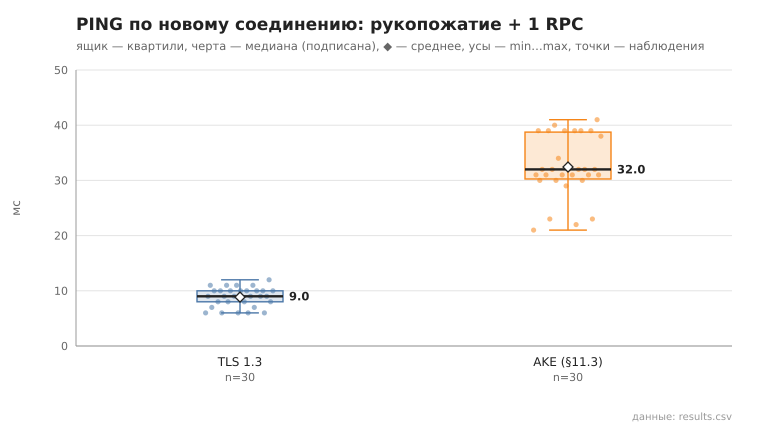
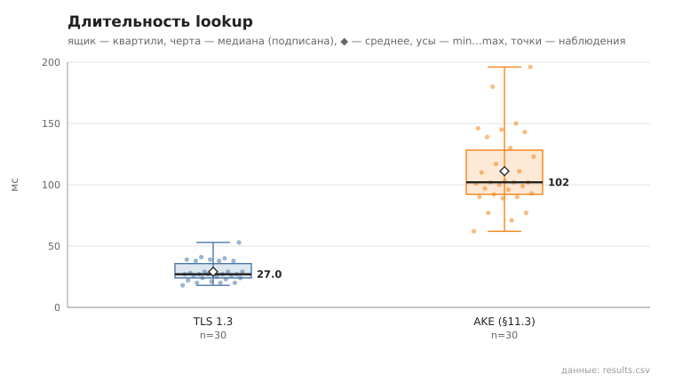
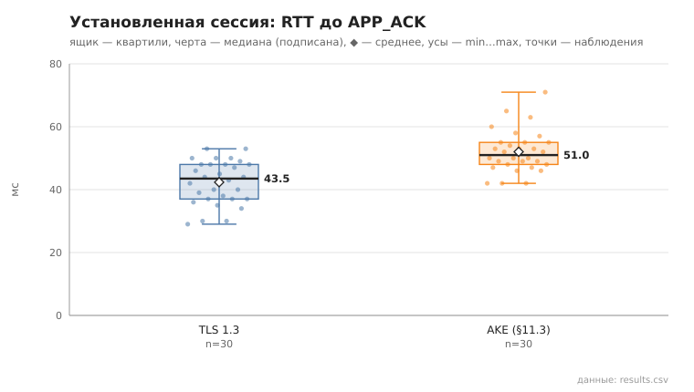
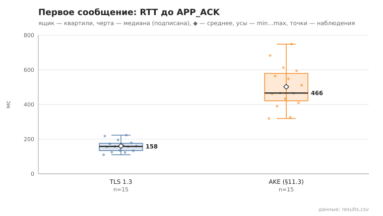

# channel_compare

коммит `c732b144cdc0c8f545762b12837a8e36d499a21d` + незакоммиченные изменения (diff sha256 `cb3e3addf6d4`), N=21, k=4, α=3, R=3, relay=3, канал=tls, bootstrap=star, seed=1, конфиг `config/node_config_advanced.yaml`; драйвер `p2p-orchestrator scenario`

Одна и та же сеть из 21 узлов поднимается дважды: с каналом TLS 1.3 и с собственным рукопожатием (AKE, §11.3). Остальное одинаково (seed, пары, сборка `debug`).

- PING по новому соединению (рукопожатие + 1 RPC), мс
  - TLS 1.3: n=30, min 6.0, медиана 9.0, среднее 8.9, max 12.0, p95 11.0
  - AKE: n=30, min 21.0, медиана 32.0, среднее 32.4, max 41.0, p95 40.0
- lookup, мс
  - TLS 1.3: n=30, min 18.0, медиана 27.0, среднее 29.1, max 53.0, p95 41.0
  - AKE: n=30, min 62.0, медиана 102.0, среднее 111.1, max 196.0, p95 180.0
- построение туннеля, мс
  - TLS 1.3: n=15, min 4.0, медиана 22.0, среднее 19.7, max 35.0
  - AKE: n=15, min 7.0, медиана 11.0, среднее 48.9, max 115.0
- первое сообщение, RTT до APP_ACK, мс
  - TLS 1.3: n=15, min 110.0, медиана 158.0, среднее 160.7, max 223.0
  - AKE: n=15, min 319.0, медиана 466.0, среднее 502.0, max 748.0
- установленная сессия, RTT до APP_ACK, мс
  - TLS 1.3: n=30, min 29.0, медиана 43.5, среднее 42.3, max 53.0, p95 53.0
  - AKE: n=30, min 42.0, медиана 51.0, среднее 52.0, max 71.0, p95 65.0

## Графики (из results.csv)

