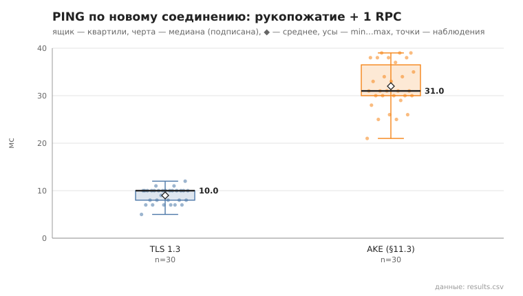
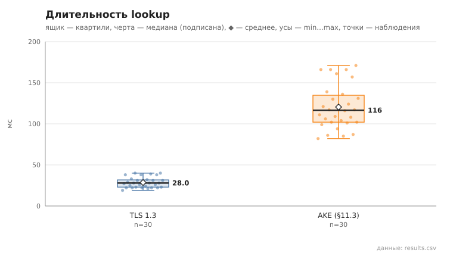
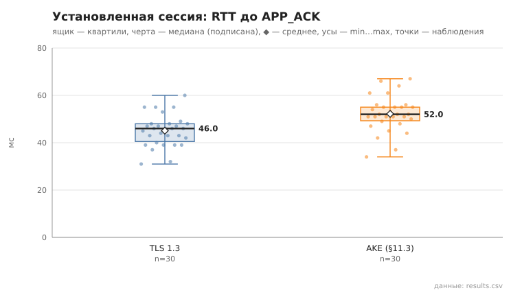
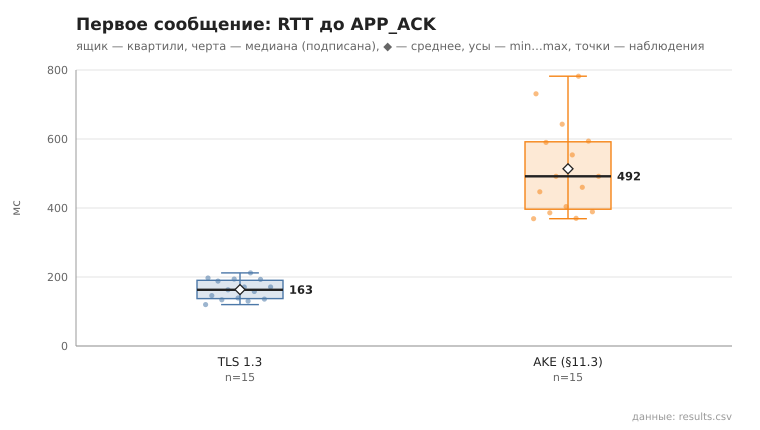

# channel_compare

коммит `5fee18365b263131d207188d0780b3177dfca4d0` + незакоммиченные изменения (diff sha256 `b84b157ea175`), N=21, k=4, α=3, R=3, relay=3, канал=tls, bootstrap=star, seed=1, конфиг `config/node_config_advanced.yaml`; драйвер `p2p-orchestrator scenario`

Одна и та же сеть из 21 узлов поднимается дважды: с каналом TLS 1.3 и с собственным рукопожатием (AKE, §11.3). Остальное одинаково (seed, пары, сборка `debug`).

- PING по новому соединению (рукопожатие + 1 RPC), мс
  - TLS 1.3: n=30, min 5.0, медиана 10.0, среднее 9.0, max 12.0, p95 11.0
  - AKE: n=30, min 21.0, медиана 31.0, среднее 32.0, max 39.0, p95 39.0
- lookup, мс
  - TLS 1.3: n=30, min 19.0, медиана 28.0, среднее 28.6, max 40.0, p95 40.0
  - AKE: n=30, min 82.0, медиана 116.5, среднее 120.4, max 171.0, p95 166.0
- построение туннеля, мс
  - TLS 1.3: n=15, min 4.0, медиана 24.0, среднее 18.9, max 31.0
  - AKE: n=15, min 8.0, медиана 11.0, среднее 50.2, max 108.0
- первое сообщение, RTT до APP_ACK, мс
  - TLS 1.3: n=15, min 120.0, медиана 163.0, среднее 163.5, max 212.0
  - AKE: n=15, min 369.0, медиана 492.0, среднее 513.5, max 782.0
- установленная сессия, RTT до APP_ACK, мс
  - TLS 1.3: n=30, min 31.0, медиана 46.0, среднее 45.1, max 60.0, p95 55.0
  - AKE: n=30, min 34.0, медиана 52.0, среднее 52.2, max 67.0, p95 66.0

## Графики (из results.csv)

