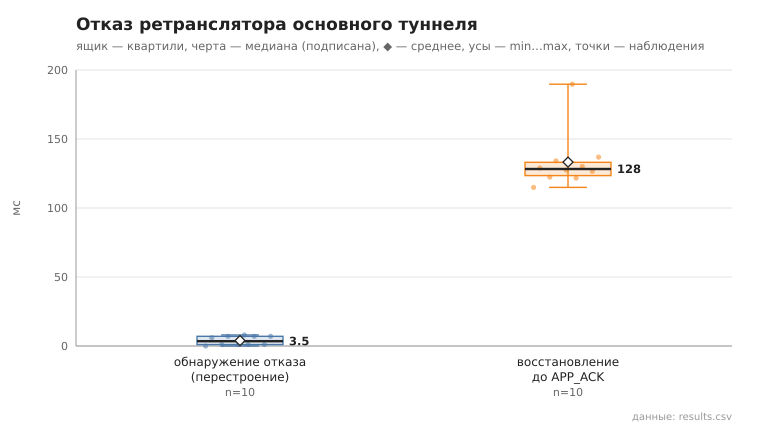

# failover

коммит `6726459277fb79ae3b5cfc0491d234fd48ac98a6` + незакоммиченные изменения (diff sha256 `485232e3e14d`), N=15, k=3, α=3, R=3, relay=2, канал=tls, bootstrap=star, seed=1, конфиг `config/node_config.yaml`; драйвер `p2p-orchestrator scenario`

Как в 07, но с пулом туннелей: после первой отправки пул достраивается в фоне (1,5 с), затем отключается relay **основного** туннеля, и сообщение отправляется снова. pool_size = 1. detect_ms — от начала отправки до обнаружения отказа (нет TUNNEL_ACK / ERROR), switch_ms — от обнаружения до TUNNEL_ACK по резервному туннелю.

- инъекций 10: переключение на резервный 0, перестроение маршрута 10, отказ не затронул отправку 0, не восстановлено 0
- время восстановления (от отключения до APP_ACK), мс: n=10, min 114.9, медиана 128.2, среднее 133.3, max 189.7
- время обнаружения отказа, мс: переключение — n=0; перестроение — n=10, min 0.0, медиана 3.5, среднее 3.9, max 8.0
- время переключения на резервный туннель, мс: n=0
- построение нового туннеля при перестроении, мс: n=10, min 17.0, медиана 20.5, среднее 21.8, max 29.0

## Графики (из results.csv)

