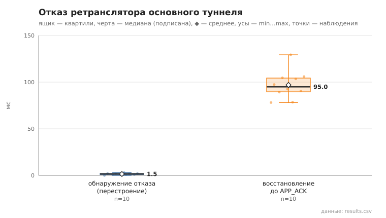

# failover

коммит `c732b144cdc0c8f545762b12837a8e36d499a21d` + незакоммиченные изменения (diff sha256 `1bdbe5abb0d7`), N=15, k=3, α=3, R=3, relay=2, канал=tls, bootstrap=star, seed=1, конфиг `config/node_config.yaml`; драйвер `p2p-orchestrator scenario`

Как в 07, но с пулом туннелей: после первой отправки пул достраивается в фоне (1,5 с), затем отключается relay **основного** туннеля, и сообщение отправляется снова. pool_size = 1. detect_ms — от начала отправки до обнаружения отказа (нет TUNNEL_ACK / ERROR), switch_ms — от обнаружения до TUNNEL_ACK по резервному туннелю.

- инъекций 10: переключение на резервный 0, перестроение маршрута 10, отказ не затронул отправку 0, не восстановлено 0
- время восстановления (от отключения до APP_ACK), мс: n=10, min 78.1, медиана 95.0, среднее 97.0, max 129.3
- время обнаружения отказа, мс: переключение — n=0; перестроение — n=10, min 0.0, медиана 1.5, среднее 1.5, max 3.0
- время переключения на резервный туннель, мс: n=0
- построение нового туннеля при перестроении, мс: n=10, min 12.0, медиана 13.0, среднее 13.3, max 15.0

## Графики (из results.csv)

