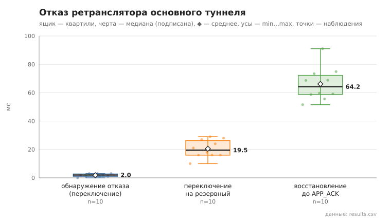

# failover

коммит `5fee18365b263131d207188d0780b3177dfca4d0` + незакоммиченные изменения (diff sha256 `0c321869d961`), N=21, k=4, α=3, R=3, relay=3, канал=tls, bootstrap=star, seed=1, конфиг `config/node_config_advanced.yaml`; драйвер `p2p-orchestrator scenario`

Как в 07, но с пулом туннелей: после первой отправки пул достраивается в фоне (1,5 с), затем отключается relay **основного** туннеля, и сообщение отправляется снова. pool_size = 3. detect_ms — от начала отправки до обнаружения отказа (нет TUNNEL_ACK / ERROR), switch_ms — от обнаружения до TUNNEL_ACK по резервному туннелю.

- инъекций 10: переключение на резервный 10, перестроение маршрута 0, отказ не затронул отправку 0, не восстановлено 0
- время восстановления (от отключения до APP_ACK), мс: n=10, min 51.6, медиана 64.2, среднее 66.2, max 91.0
- время обнаружения отказа, мс: переключение — n=10, min 0.0, медиана 2.0, среднее 1.8, max 3.0; перестроение — n=0
- время переключения на резервный туннель, мс: n=10, min 10.0, медиана 19.5, среднее 20.5, max 29.0
- построение нового туннеля при перестроении, мс: n=0

## Графики (из results.csv)

