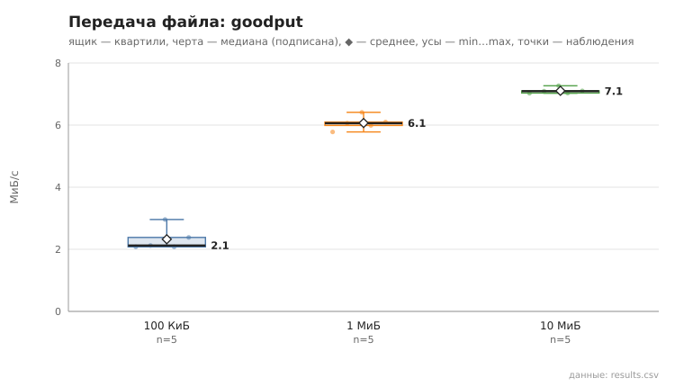
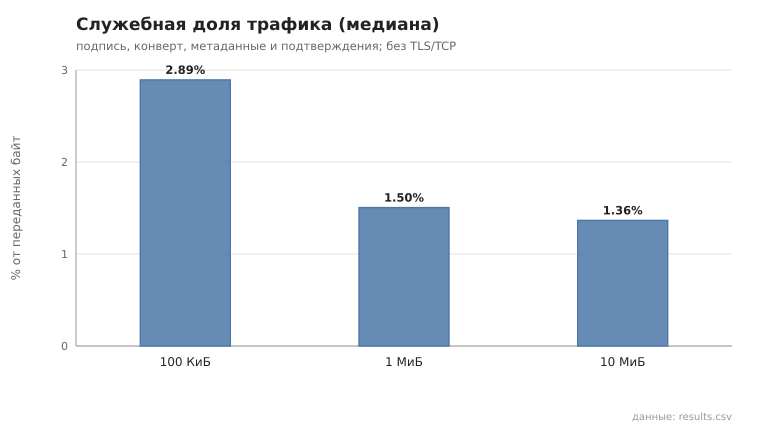

# files_transfer

коммит `c732b144cdc0c8f545762b12837a8e36d499a21d` + незакоммиченные изменения (diff sha256 `1bdbe5abb0d7`), N=21, k=4, α=3, R=3, relay=3, канал=tls, bootstrap=star, seed=1, конфиг `config/node_config_advanced.yaml`; драйвер `p2p-orchestrator scenario`

Файлы со случайным содержимым передаются между случайными парами узлов через туннель (2 relay) по протоколу §13.2: предложение → блоки по 40 КиБ окнами по 8 → подтверждения → итоговая проверка SHA-256 получателем. goodput = размер / время от предложения до итогового подтверждения; служебная доля = (байты конвертов в обе стороны − размер) / байты конвертов — накладные расходы прикладного протокола (подпись, конверт, метаданные, подтверждения), без TLS/TCP и без умножения на число hop. Целостность проверена по SHA-256 файла в `downloads/` получателя.

- 100 КиБ: доставлено и SHA-256 совпал 5/5; goodput, МиБ/с: n=5, min 2.1, медиана 2.1, среднее 2.3, max 3.0; служебная доля, %: n=5, min 2.8, медиана 2.9, среднее 2.9, max 2.9; повторов блоков: 0
- 1 МиБ: доставлено и SHA-256 совпал 5/5; goodput, МиБ/с: n=5, min 5.8, медиана 6.1, среднее 6.1, max 6.4; служебная доля, %: n=5, min 1.5, медиана 1.5, среднее 1.5, max 1.5; повторов блоков: 0
- 10 МиБ: доставлено и SHA-256 совпал 5/5; goodput, МиБ/с: n=5, min 7.0, медиана 7.1, среднее 7.1, max 7.3; служебная доля, %: n=5, min 1.4, медиана 1.4, среднее 1.4, max 1.4; повторов блоков: 0

## Графики (из results.csv)

