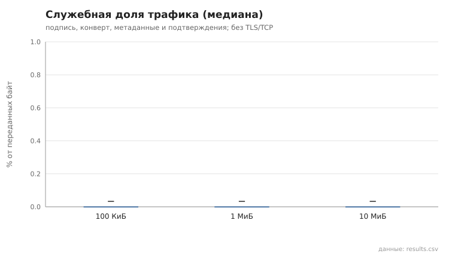

> ⚠️ **ПРОГОН НЕДЕЙСТВИТЕЛЕН — ошибка сценария, а не передачи.** Все 15 передач завершились успешно (`ok=true` в
> `results.csv`), но проверка целостности искала файл в `downloads/<имя>`, а с ADR-46 принятые файлы лежат в папке
> отправителя `downloads/<16 hex NodeID>/<имя>`. Файл не находился → `sha256_verified=false` → «0/5». Сценарий исправлен
> (`src/experiment/scenarios.rs`, проверка в папке отправителя); действительный перепрогон —
> [`../20261112_221251_advanced`](../20261112_221251_advanced/summary.md): 5/5 каждого размера. Оставлен как пример того,
> как эксперимент поймал рассинхрон сценария и кода.

# files_transfer

коммит `5fee18365b263131d207188d0780b3177dfca4d0` + незакоммиченные изменения (diff sha256 `0c321869d961`), N=21, k=4, α=3, R=3, relay=3, канал=tls, bootstrap=star, seed=1, конфиг `config/node_config_advanced.yaml`; драйвер `p2p-orchestrator scenario`

Файлы со случайным содержимым передаются между случайными парами узлов через туннель (2 relay) по протоколу §13.2: предложение → блоки по 40 КиБ окнами по 8 → подтверждения → итоговая проверка SHA-256 получателем. goodput = размер / время от предложения до итогового подтверждения; служебная доля = (байты конвертов в обе стороны − размер) / байты конвертов — накладные расходы прикладного протокола (подпись, конверт, метаданные, подтверждения), без TLS/TCP и без умножения на число hop. Целостность проверена по SHA-256 файла в `downloads/` получателя.

- 100 КиБ: доставлено и SHA-256 совпал 0/5; goodput, МиБ/с: n=0; служебная доля, %: n=0; повторов блоков: 0
- 1 МиБ: доставлено и SHA-256 совпал 0/5; goodput, МиБ/с: n=0; служебная доля, %: n=0; повторов блоков: 0
- 10 МиБ: доставлено и SHA-256 совпал 0/5; goodput, МиБ/с: n=0; служебная доля, %: n=0; повторов блоков: 0

## Графики (из results.csv)

