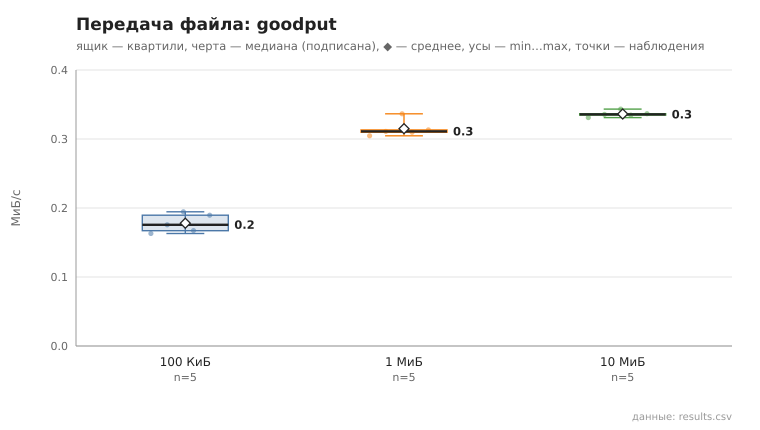
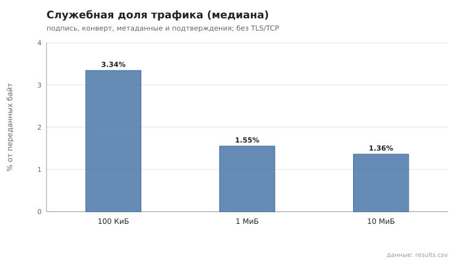

# files_transfer

коммит `5fee18365b263131d207188d0780b3177dfca4d0` + незакоммиченные изменения (diff sha256 `b84b157ea175`), N=21, k=4, α=3, R=3, relay=3, канал=tls, bootstrap=star, seed=1, конфиг `config/node_config_advanced.yaml`; драйвер `p2p-orchestrator scenario`

Файлы со случайным содержимым передаются между случайными парами узлов через туннель (2 relay) по протоколу §13.2: предложение → блоки по 40 КиБ окнами по 8 → подтверждения → итоговая проверка SHA-256 получателем. goodput = размер / время от предложения до итогового подтверждения; служебная доля = (байты конвертов в обе стороны − размер) / байты конвертов — накладные расходы прикладного протокола (подпись, конверт, метаданные, подтверждения), без TLS/TCP и без умножения на число hop. Целостность проверена по SHA-256 файла в `downloads/<папка отправителя>/` получателя.

- 100 КиБ: доставлено и SHA-256 совпал 5/5; goodput, МиБ/с: n=5, min 0.2, медиана 0.2, среднее 0.2, max 0.2; служебная доля, %: n=5, min 3.3, медиана 3.3, среднее 3.3, max 3.4; повторов блоков: 0
- 1 МиБ: доставлено и SHA-256 совпал 5/5; goodput, МиБ/с: n=5, min 0.3, медиана 0.3, среднее 0.3, max 0.3; служебная доля, %: n=5, min 1.5, медиана 1.6, среднее 1.5, max 1.6; повторов блоков: 0
- 10 МиБ: доставлено и SHA-256 совпал 5/5; goodput, МиБ/с: n=5, min 0.3, медиана 0.3, среднее 0.3, max 0.3; служебная доля, %: n=5, min 1.3, медиана 1.4, среднее 1.4, max 1.4; повторов блоков: 0

## Графики (из results.csv)

