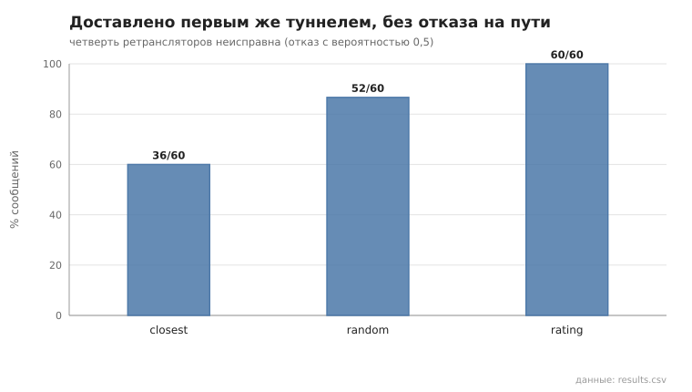
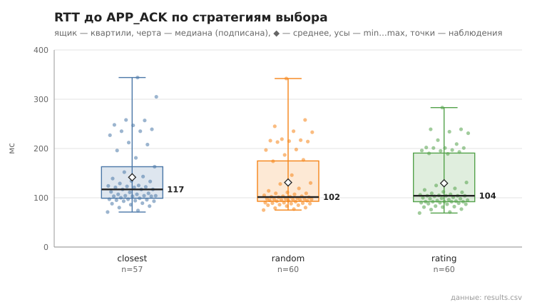

# relay_strategy

коммит `6726459277fb79ae3b5cfc0491d234fd48ac98a6` + незакоммиченные изменения (diff sha256 `7924fe308c7e`), N=21, k=4, α=3, R=3, relay=3, канал=tls, bootstrap=star, seed=1, конфиг `config/node_config_advanced.yaml`; драйвер `p2p-orchestrator scenario`

Одна и та же сеть (21 узлов, пул туннелей, конфиг продвинутого уровня) с 5 неисправными ретрансляторами: каждый с вероятностью 0.5 отвечает ошибкой вместо пересылки (`--fault-drop`). Неисправные узлы, 3 отправителя и получатели одинаковы для всех стратегий (seed). Разогрев — 10 сообщений на отправителя (профили накапливаются), измерение — 20 на отправителя. «Без отказа на пути» — доставлено первым же туннелем, без переключения и перестроения. Профили, которые отправители построили, — profiles_*.json.

- **closest**: доставлено 57/60; без отказа на пути 36/60 (60%); переключений на резервный 14, перестроений 7; RTT до APP_ACK, мс: n=57, min 71.0, медиана 117.0, среднее 141.6, max 344.0, p95 258.0
- **random**: доставлено 60/60; без отказа на пути 52/60 (87%); переключений на резервный 5, перестроений 3; RTT до APP_ACK, мс: n=60, min 75.0, медиана 101.5, среднее 131.0, max 342.0, p95 235.0
- **rating**: доставлено 60/60; без отказа на пути 60/60 (100%); переключений на резервный 0, перестроений 0; RTT до APP_ACK, мс: n=60, min 69.0, медиана 104.0, среднее 129.4, max 283.0, p95 234.0

## Графики (из results.csv)

