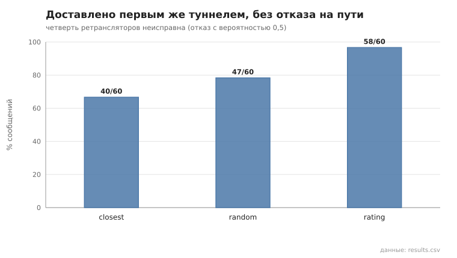
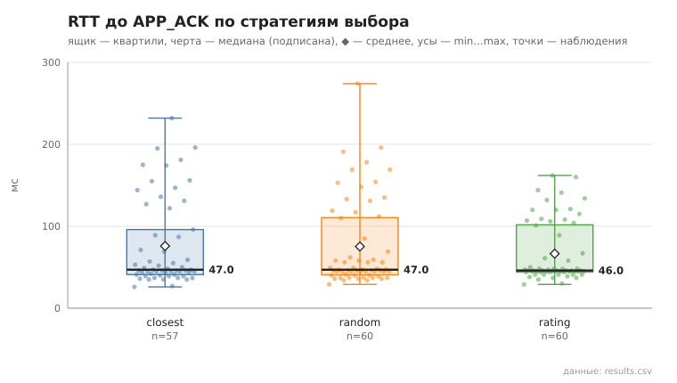

# relay_strategy

коммит `c732b144cdc0c8f545762b12837a8e36d499a21d` + незакоммиченные изменения (diff sha256 `cb3e3addf6d4`), N=21, k=4, α=3, R=3, relay=3, канал=tls, bootstrap=star, seed=1, конфиг `config/node_config_advanced.yaml`; драйвер `p2p-orchestrator scenario`

Одна и та же сеть (21 узлов, пул туннелей, конфиг продвинутого уровня) с 5 неисправными ретрансляторами: каждый с вероятностью 0.5 отвечает ошибкой вместо пересылки (`--fault-drop`). Неисправные узлы, 3 отправителя и получатели одинаковы для всех стратегий (seed). Разогрев — 10 сообщений на отправителя (профили накапливаются), измерение — 20 на отправителя. «Без отказа на пути» — доставлено первым же туннелем, без переключения и перестроения. Профили, которые отправители построили, — profiles_*.json.

- **closest**: доставлено 57/60; без отказа на пути 40/60 (67%); переключений на резервный 5, перестроений 12; RTT до APP_ACK, мс: n=57, min 26.0, медиана 47.0, среднее 75.9, max 232.0, p95 195.0
- **random**: доставлено 60/60; без отказа на пути 47/60 (78%); переключений на резервный 7, перестроений 6; RTT до APP_ACK, мс: n=60, min 29.0, медиана 47.0, среднее 75.2, max 274.0, p95 178.0
- **rating**: доставлено 60/60; без отказа на пути 58/60 (97%); переключений на резервный 1, перестроений 1; RTT до APP_ACK, мс: n=60, min 29.0, медиана 46.0, среднее 66.5, max 162.0, p95 141.0

## Графики (из results.csv)

