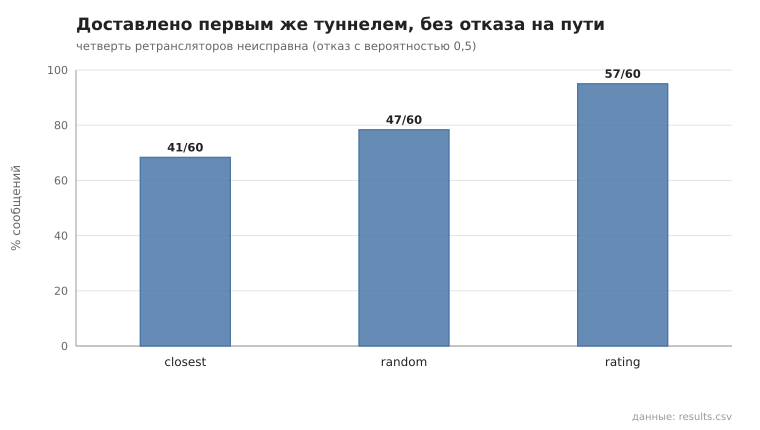
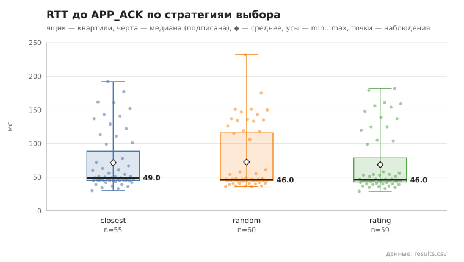

# relay_strategy

коммит `5fee18365b263131d207188d0780b3177dfca4d0` + незакоммиченные изменения (diff sha256 `0c321869d961`), N=21, k=4, α=3, R=3, relay=3, канал=tls, bootstrap=star, seed=1, конфиг `config/node_config_advanced.yaml`; драйвер `p2p-orchestrator scenario`

Одна и та же сеть (21 узлов, пул туннелей, конфиг продвинутого уровня) с 5 неисправными ретрансляторами: каждый с вероятностью 0.5 отвечает ошибкой вместо пересылки (`--fault-drop`). Неисправные узлы, 3 отправителя и получатели одинаковы для всех стратегий (seed). Разогрев — 10 сообщений на отправителя (профили накапливаются), измерение — 20 на отправителя. «Без отказа на пути» — доставлено первым же туннелем, без переключения и перестроения. Профили, которые отправители построили, — profiles_*.json.

- **closest**: доставлено 55/60; без отказа на пути 41/60 (68%); переключений на резервный 10, перестроений 4; RTT до APP_ACK, мс: n=55, min 30.0, медиана 49.0, среднее 71.5, max 192.0, p95 162.0
- **random**: доставлено 60/60; без отказа на пути 47/60 (78%); переключений на резервный 8, перестроений 5; RTT до APP_ACK, мс: n=60, min 36.0, медиана 46.0, среднее 72.5, max 232.0, p95 151.0
- **rating**: доставлено 59/60; без отказа на пути 57/60 (95%); переключений на резервный 2, перестроений 0; RTT до APP_ACK, мс: n=59, min 29.0, медиана 46.0, среднее 68.5, max 182.0, p95 161.0

## Графики (из results.csv)

